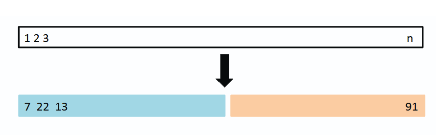
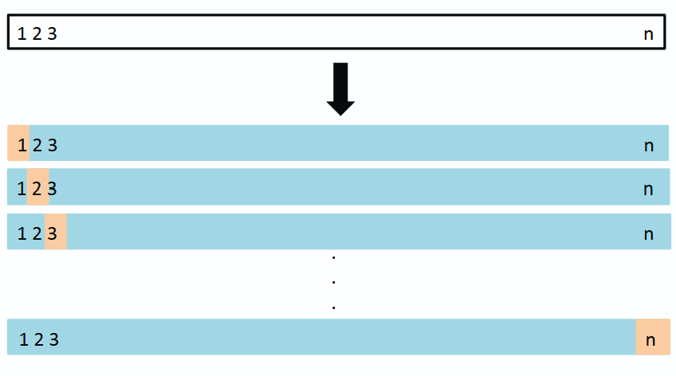
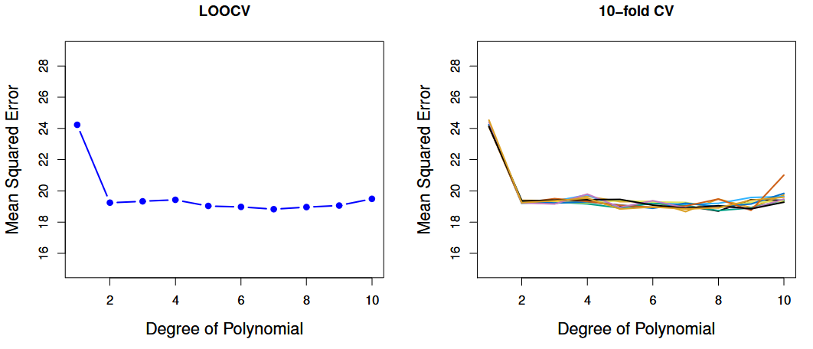
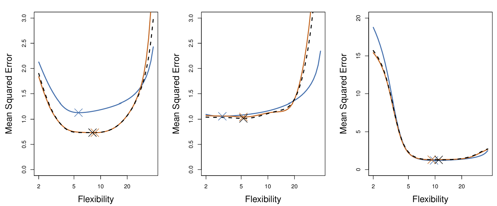
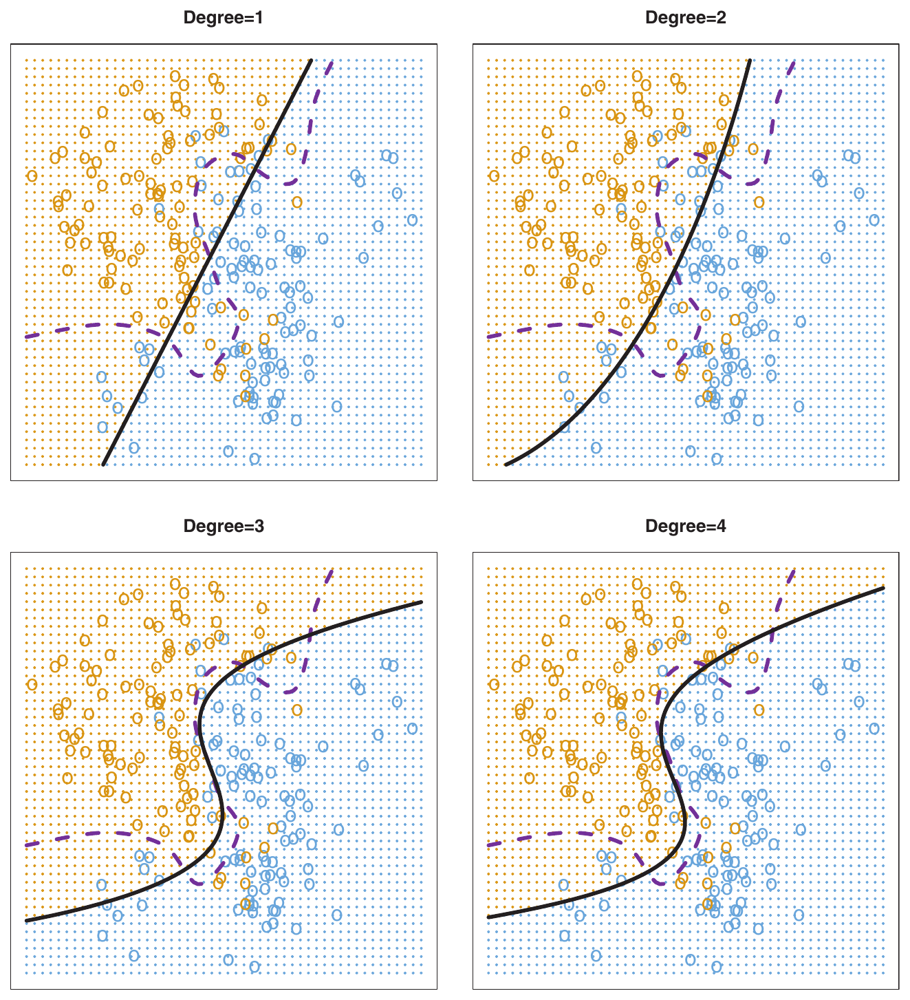
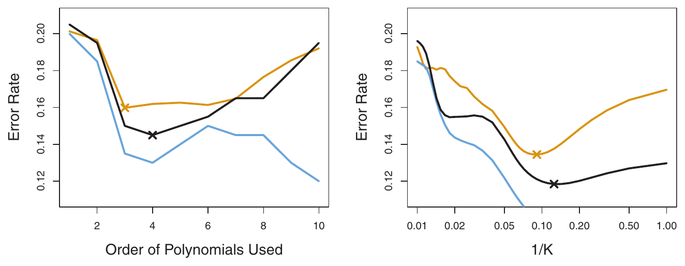

## Section 5.1

1. The Validation Set Approach
2. Leave-One-Out Cross-Validation (LOOCV)
3. k-Fold Cross-Validation (k-fold CV)
4. Bias-Variance Trade-Off for k-fold Cross-Validation
5. Cross-Validation on Classification Problems

:::{.notes}
- Today: chapter 5.1, cross-validation methods
- Maggie: validation set, LOOCV, k-fold CV
- Shrey: bias-variance trade-off for k-fold CV, and CV on classification problems + worksheet
:::

## The Problem

- From previous chapters, we learned how to fit linear and logistic regression models
- We want to know how well each candidate model will generalize to new data
- For regression, training MSE, $MSE_{Training} = \frac{1}{n} \sum_{i=1}^{n} (y_i-\hat{y}_i)^2$, is an overly optimistic estimate of test MSE
- If no test set is available, we can hold out part of our observations as a validation set to estimate test MSE

:::{.notes}
- Recap: we can fit linear and logistic regression, so we often end up with several candidate models
- Question: how well will each one predict *new* data? That is the test error (test MSE for regression)
- Ideal: a designated test set. Usually we don't have one
- Why not just use training MSE? The model was fit to those exact observations, so the coefficients were chosen to make training MSE small. It is overly optimistic, and it keeps falling as models get more flexible
- Fix: hold out part of our observations from the fitting process (validation / hold-out set), fit on the rest, and compute MSE on the held-out part as an *estimate* of test MSE
- That is the idea behind all the methods today
:::

## Example Set-Up {style="font-size: 0.8em;"}

- `Auto` dataset in `ISLR2` library: gas mileage, horsepower, and 7 other variables for 392 vehicles
- **Response variable**: miles per gallon (mpg)
- **Predictor**: engine horsepower

```{r}
#| echo: FALSE

library(ISLR2)
library(ggplot2)

mpg <- ISLR2::Auto$mpg
horsepower <- ISLR2::Auto$horsepower

data <- data.frame(horsepower, mpg)

ggplot(data, aes(x = horsepower, y = mpg)) +
  geom_point() +
  labs(
    title = "Horsepower vs. MPG in the Auto Dataset",
    x = "Horsepower",
    y = "Miles per Gallon (MPG)"
  ) +
  theme_minimal(base_size = 16)
```

:::{.notes}
- Running example from the textbook: `Auto` dataset, 392 vehicles
- For simplicity: mpg is the response, horsepower is the predictor
- Point out the curve in the scatterplot: the relationship is not a straight line
:::

## Candidate Models

- The textbook considers polynomial terms of horsepower up to and including degree 10
- Flexibility here = polynomial degree

1. $y = \beta_0 + \beta_1 x + \epsilon$ 
2. $y = \beta_0 + \beta_1 x+ \beta_2 x^2 + \epsilon$ 

$\vdots$

10. $y = \beta_0 + \beta_1 x + \beta_2 x^2 + ... + \beta_{10} x^{10} + \epsilon$

:::{.notes}
- Candidates: linear (degree 1), quadratic (degree 2), and so on up to degree 10
- Higher degree = more flexible, wigglier curve
- Goal: use held-out data to decide which degree predicts best
:::


## Validation Set Approach {style="font-size: 0.8em;"}

- Randomly divide the available data once into two parts:
  - Training set
  - Validation set (or hold-out set)
- Fit the model on the training set, predict the validation set, and compute the validation set MSE
- Textbook example: 392 observations split 196 / 196
- The split proportion is a choice (e.g. 70/30 or 80/20 are common)

{fig-alt="Validation Set Schematic" width="80%"}

:::{.notes}
- Randomly split the data once: training set (fit the model) and validation set (evaluate it)
- Textbook example: 50/50 split, 196 and 196
- Proportion can vary. 70/30 or 80/20 are common in practice (the book does not discuss this)
- Schematic: blue = training, orange = validation. Observations 7, 22, 13 are in training; 91 is in validation
- Validation set MSE is our estimate of test MSE
- Two major drawbacks, next slide
:::


## Disadvantages of the Validation Set Approach {style="font-size: 0.7em;"}

- **High variability**: the estimate depends on which observations land in the training vs. validation set
- **Overestimates test MSE**: only part of the data (half) is used to fit the model, and models tend to do worse with fewer observations

{fig-alt="MSE of model over different runs" width="80%"}

:::{.notes}
- Left plot: one random split. One validation MSE per candidate model (degree 1 to 10) forms one curve
- Right plot: the same method repeated ten times, each with a different random split. The curves differ noticeably, and they don't agree on which degree is best
- Drawback 1: variability. The estimate depends on which observations ended up where
- Drawback 2: we fit on only about half the data, so the validation MSE tends to *overestimate* test MSE
- Takeaway the book draws: all ten curves agree the linear fit is not adequate. That is about all we can say with confidence
- Cross-validation addresses both issues
:::

## Leave-One-Out Cross-Validation {style="font-size: 0.7em;"}

- Divide the dataset into 2 parts:
  - Validation set has 1 observation: $(x_1, y_1)$
  - Training set has $n-1$ observations: $\{(x_2, y_2), (x_3, y_3), \dots, (x_n, y_n)\}$
- Compute $\hat{MSE}_{Test}^{(1)} = (y_1 - \hat{y}_1)^2$
- Repeat $n$ times so every observation takes a turn in the validation set, giving $n$ MSEs
- **CV Estimate**: $CV_{(n)} = \frac{1}{n} \sum_{i=1}^{n} \hat{MSE}_{Test}^{(i)}$

{fig-alt="Schematic of LOOCV" width="70%"}

:::{.notes}
- Validation set = a single observation; train on the other n-1
- Compute the squared error on the held-out point
- Repeat so *every* observation gets one turn as the validation set
- Average the n squared errors: this is the LOOCV (CV) estimate of test MSE, equation 5.1
- One squared error alone is a poor estimate (based on one point), so averaging all n matters
- Compare CV estimates across candidate models
:::


## Advantages of LOOCV Over the Validation Set Approach {style="font-size: 0.8em;"}

- **Much less bias**: each fit uses $n-1$ observations, almost the whole dataset
- **No randomness in the splits**: running LOOCV again on the same data gives the identical result

:::{.notes}
- Advantage 1: far less bias. Training sets have n-1 observations vs. about half for the validation set approach, so we don't overestimate test MSE as much
- Advantage 2: no random splitting. Same data, same result every run
- We will see the LOOCV curve a few slides from now (figure 5.4)
- Careful wording: "same result every run" is not the same as "low variance." Shrey will cover how LOOCV's estimate behaves across datasets in 5.1.4
:::

## Disadvantages of LOOCV {style="font-size: 0.8em;"}

- Model must be fit $n$ times
  - Can be very time consuming if $n$ is large or each fit is slow

:::{.notes}
- Downside: n model fits
- Costly if n is large or the model is slow to fit
- Good news for one important case: next slide
:::

## A Shortcut for Least Squares {style="font-size: 0.75em;"}

- For **least squares linear or polynomial regression only**, LOOCV costs the same as one model fit:

$$CV_{(n)} = \frac{1}{n} \sum_{i=1}^{n} \left( \frac{y_i - \hat{y}_i}{1-h_i} \right)^2$$

  - $\hat{y}_i$: $i$th fitted value from the *original* least squares fit on all $n$ observations
  - $h_i$: leverage of observation $i$, between $\frac{1}{n}$ and 1. It reflects how much an observation influences its own fit
  - Simple linear regression: $h_i = \frac{1}{n} + \frac{(x_i - \bar{x})^2}{\sum_{i'=1}^{n} (x_{i'} - \bar{x})^2}$
- Gives exactly the same estimate as $CV_{(n)} = \frac{1}{n} \sum_{i=1}^{n} \hat{MSE}_{Test}^{(i)}$

:::{.notes}
- Only for least squares linear or polynomial regression
- Fit the model once on all n observations. Take each ordinary residual, divide by (1 - h_i), square, average. We fit the model once on all the data, take each residual, divide it by 1 minus its leverage, square, and average. That matches the LOOCV estimate exactly, at the cost of one fit.
- Same result as n separate refits
- Note: y-hat means something different here. In equation 5.1 it is the prediction from a model fit *without* observation i. Here it is the fitted value from the one full fit, which did include observation i
- Why divide by 1 - h_i? Ordinary residual is too small because the point helped determine its own fit. High-leverage points get inflated the most
- Leverage: Chapter 3, equation 3.37, page 99. The formula on the slide is the simple linear regression version; it is more complicated for multiple regression
- Does not work for logistic regression or LDA: those need n refits
:::

## K-fold Cross-Validation {style="font-size: 0.7em;"}
- Randomly divide the observations into $k$ "folds" of approximately equal size
  - Each fold takes a turn as the validation set
  - The other $k-1$ folds are the training set
- Gives $k$ MSEs, one per fold
- **K-fold CV Estimate**: $CV_{(k)} = \frac{1}{k} \sum_{i=1}^{k} \hat{MSE}_{Test}^{(i)}$
- LOOCV is the special case $k = n$

{fig-alt="K-fold cross-validation schematic" width="55%"}

:::{.notes}
- Alternative to LOOCV: randomly split the data into k folds of about equal size
- Fold 1 is the validation set, fit on the other k-1 folds, compute MSE on fold 1
- Repeat k times so each fold is the validation set once
- Average the k MSEs: k-fold CV estimate, equation 5.3
- LOOCV is k-fold with k = n
- Typical choice: k = 5 or 10. Reason 1 is computational (k fits instead of n). Reason 2 is the bias-variance trade-off, which Shrey covers next
- Each fit uses (k-1)n/k observations: 80% for k = 5, 90% for k = 10, vs. about 50% for the validation set approach
- Randomness: the assignment of observations to folds is random, so results vary slightly between runs
:::

## LOOCV and K-Fold CV Estimates on `Auto`

{fig-alt="Cross-Validation on Auto dataset" width="100%"}

:::{.notes}
- Left: LOOCV curve. Run it again and you get exactly the same curve
- Right: 10-fold CV, run nine times with different random fold assignments. The curves differ slightly
- That variability is much lower than for the validation set approach (compare the right plot of figure 5.2)
:::

## Using CV Estimates to Choose a Candidate Model {style="font-size: 0.8em;"}
- On real data we never know the true test MSE
- With **simulated** data we do, so we can check how well CV works
- Can we trust CV to point us to a good level of flexibility?

{fig-alt="Simulated vs. real MSE and CV Estimate curves"}

:::{.notes}
- Setup: these are the same three simulated data sets from Chapter 2, generated from three different true functions (moderately nonlinear, close to linear, far from linear). Not shown here
- Because the data is simulated, we can generate fresh data and measure the true test MSE (blue). On real data we can't
- For each data set, smoothing splines of varying flexibility were fit; x-axis = flexibility (higher = wigglier)
- Left: CV underestimates the true test MSE
- Center: CV is close at low flexibility, overestimates at high flexibility
- Right: CV is nearly identical to the true curve
- LOOCV and 10-fold look very similar in all three
- Key point: when choosing among models we mostly care where the minimum is. Point at the crosses: they land close together in every panel
- So: values can be off, but CV is reliable for picking about the right flexibility. "Close to," not exact
- Each panel is one simulated data set, so this is three examples, not a systematic study
- If asked why CV is off in some panels: the book doesn't say
- If asked what flexibility means: how wiggly the fitted curve is; details in Chapter 2
:::

## Bias-Variance Trade-Off for k-Fold CV {style="font-size: 0.7em;"}

- Besides being cheaper, k-fold CV is often **more accurate** than LOOCV
- **Question:** LOOCV gives the same estimate every run on the same data. Can it still have high variance?

::: {.fragment}
- Yes. Variance is about a **new dataset**. LOOCV's $n$ models train on almost the same data, so their errors are highly correlated and don't cancel out

| `Auto` ($n = 392$) | Validation set | k-fold $(k = 5, 10)$ | LOOCV |
|:---|:---:|:---:|:---:|
| Obs. per fit | 196 | 314 / 353 | 391 |
| Bias | High | Intermediate | Lowest |
| Variance | High | Lower | Tends to be higher |

: {tbl-colwidths="[22,22,26,30]"}

- $k = 5$ or $10$ balances the two (shown **empirically**). **Next (6.2):** ridge regression makes the same trade-off
:::

:::{.notes}
- Maggie showed k-fold is cheaper. The book's second reason is it's often more accurate
- Bias: fewer observations per fit = worse fits = overestimates test error. LOOCV has the least bias
- ASK QUESTION
- Variance = new dataset, not rerunning. LOOCV's models are near-copies, like asking the same person the same question 392 times
- k = 5 or 10: a bit more bias, less variance. Shown empirically to have the best balance between bias and variance
- Ridge: bigger λ = less flexible = lower variance, higher bias
- If asked if LOOCV always has a higher variance, the book says it tends to.
:::

## Cross-Validation for Classification {style="font-size: 0.75em;"}

- Same procedure, but count **mistakes** instead of squared error. LOOCV error rate:

$$CV_{(n)} = \frac{1}{n} \sum_{i=1}^{n} Err_i, \qquad Err_i = I(y_i \neq \hat{y}_i)$$

- **Example:** logistic regression with polynomial terms of the predictors, e.g. degree 2:

$$\log\left(\frac{p}{1-p}\right) = \beta_0 + \beta_1 X_1 + \beta_2 X_1^2 + \beta_3 X_2 + \beta_4 X_2^2$$

:::{.notes}
- So far everything was MSE. For a category, count mistakes: I() is 1 if we get observation i wrong, 0 if right
- Link to 4.3 logistic regression. Squared terms bend the boundary, like adding horsepower squared
:::

## Logistic Regression: Degrees 1 to 4 {style="font-size: 0.7em;"}

:::: {.columns}

::: {.column width="55%"}
{fig-alt="Logistic regression decision boundaries for polynomial degrees 1 to 4"}
:::

::: {.column width="45%"}
| Model | Test error rate |
|:---|:---:|
| Degree 1 | 0.201 |
| Degree 2 | 0.197 |
| Degree 3 | 0.160 |
| Degree 4 | 0.162 |
| Bayes (best possible) | 0.133 |

- Simulated data, so we know the true test error
- On real data we don't, so we use CV (next slide)
:::

::::

:::{.notes}
- Degree 1 misses the curve. Degree 3 is best. Degree 4 is slightly worse
- Simulated, so we know these test errors. On real data we don't, so we use CV
:::

## Using 10-Fold CV to Choose Flexibility {style="font-size: 0.75em;"}

{fig-alt="Training, test, and 10-fold CV error rates for logistic regression and KNN"}

- Training error keeps falling, so it always picks the most flexible model. CV tracks the U-shaped test error and lands close to the best flexibility

:::{.notes}
- Blue keeps falling, so it can't choose. Orange (test) is U-shaped
- Left: CV picks degree 4, true best is 3. Degrees 3 to 6 are nearly tied, so 4 is fine
- Right: KNN, same story. K = **NUMBER OF NEIGHBOURS**, not folds. More flexible to the right
- CLOSING: the next presentation will use CV the same way to choose λ
:::

## References

- James, G., Witten, D., Hastie, T., and Tibshirani, R. *An Introduction to Statistical Learning with Applications in R* (ISLR2), 2nd ed. Springer, 2021. Section 5.1.
