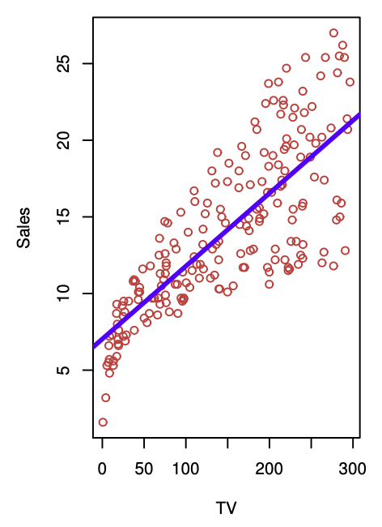
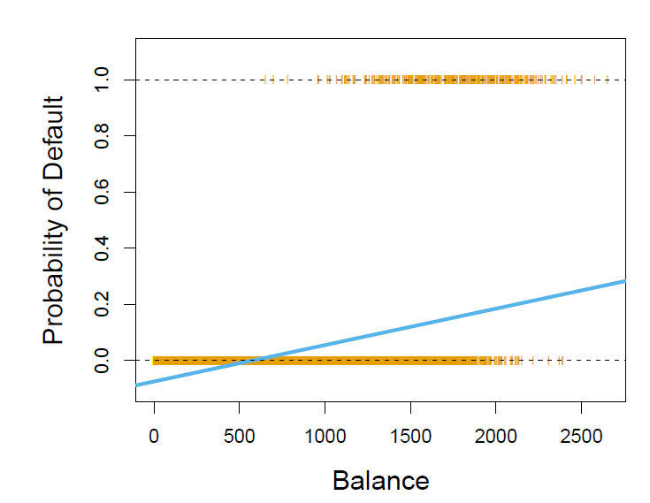
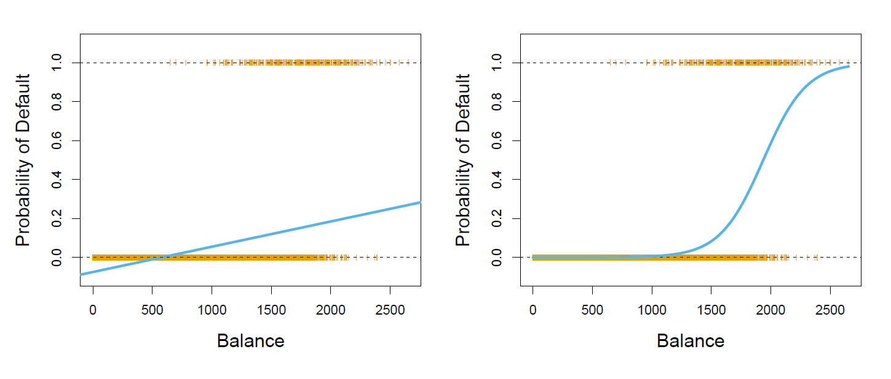
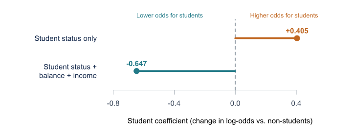

```{r}
#| include: false
# Use data/Default.csv if it's there; otherwise fall back to the ISLR2 package
if (file.exists("data/Default.csv")) {
  Default <- read.csv("data/Default.csv", stringsAsFactors = TRUE)
} else if (requireNamespace("ISLR2", quietly = TRUE)) {
  Default <- ISLR2::Default
} else {
  stop("Put Default.csv in a data/ folder next to presentation.qmd, or run install.packages('ISLR2')")
}

fit_bal <- glm(default ~ balance, data = Default, family = binomial)
fit_stu <- glm(default ~ student, data = Default, family = binomial)
p_bal <- function(x) predict(fit_bal, data.frame(balance = x), type = "response")

# Print a glm coefficient table as a markdown table
coef_table <- function(fit, short = FALSE) {
  t <- summary(fit)$coefficients
  hdr <- if (short) c("Coefficient", "SE", "$z$", "$p$") else
    c("Coefficient", "Std. error", "$z$-statistic", "$p$-value")
  rn <- sub("studentYes", "student[Yes]", sub("(Intercept)", "Intercept", rownames(t), fixed = TRUE))
  pv <- ifelse(t[, 4] < 1e-4, "< 0.0001", sprintf("%.4f", t[, 4]))
  cat("| |", paste(hdr, collapse = " | "), "|\n|:---|---:|---:|---:|---:|\n")
  for (i in seq_len(nrow(t))) {
    cat(sprintf("| `%s` | %.4f | %.4f | %.2f | %s |\n",
                rn[i], t[i, 1], t[i, 2], t[i, 3], pv[i]))
  }
}

# Toy example: six customers and three candidate curves
xt <- c(500, 1000, 1400, 1700, 2000, 2400)
yt <- c(0, 0, 0, 1, 0, 1)
cands <- list("Curve A" = c(3, -0.002), "Curve B" = c(-1, 0), "Curve C" = c(-6, 0.003))
lik <- function(b) { p <- plogis(b[1] + b[2] * xt); prod(ifelse(yt == 1, p, 1 - p)) }
fit_toy <- glm(yt ~ xt, family = binomial)
L <- c(sapply(cands, lik), MLE = lik(coef(fit_toy)))
```

## Linear Regression

- Useful for making predictions on numerical data.
- For example, the TV model:

{fig-alt="Fitted line with TV budget as predictor and sales unit as response." style="max-height: 400px; max-width: 90%; width: auto; height: auto; object-fit: contain; display: block; margin: 20px auto;"}

::: {.notes}
Previously we looked at linear regression, We saw that it is very useful when we want to make predictions on numerical data. Revisiting the TV model from last week we can directly make predictions on the tv sales number by the spending. however there are limitations that come from this approach
:::

## Linear Regression

- Useful for making continuous predictions on numerical data.
- What about for classification tasks? or estimating probabilities?

::: {.notes}
the main question for linear regression that we focus on is how would this work for classification, or in specific to estimate probabilities. As discussed in the first week, we can have either qualitative or quantitative problems. clearly linear regression is good for quantitative, but what about qualitative. Let us look at an example
:::

## The Default Dataset

Here we observe

$$
\Pr(\text{default} = \text{Yes} \mid \text{balance})
$$

{fig-alt="Fitted line with account balance as predictor and probability of default as response." style="max-height: 400px; max-width: 90%; width: auto; height: auto; object-fit: contain; display: block; margin: 20px auto;"}

::: {.notes}
let us take a look at the credit card default dataset. here we care about the probability that the customer will default given their average balance. orange ticks are the true values

you can see that with linear regression it is possible to make these predictions however there are many things that make us choose a different model. One most important being that we can get negative probabilities and probabilities greater than 1, which are not valid, making this not a correct way of choosing.
:::

## Logistic Regression

Let $p(X) = \Pr(Y = 1 \mid X)$

Then consider a linear regression model

$$
p(X) = \beta_0 + \beta_1 X
$$

We use the *logistic function*

$$
p(X) = \frac{e^{\beta_0 + \beta_1 X}}{1 + e^{\beta_0 + \beta_1 X}}
$$

Fit using the "maximum likelihood" method

::: {.notes}
just go through the points

Maximum likelihood method talked about later
:::

## Linear vs Logistic Regression

{fig-alt="Comparison of classification of the default dataset where left side is linear and right is logistic regression" style="max-height: 400px; max-width: 90%; width: auto; height: auto; object-fit: contain; display: block; margin: 20px auto;"}

::: {.notes}
Notice how preds are bound by 0 and 1 resulting in proper probabilities
:::

## Odds

By manipulating the logistic function we have:

$$
\frac{p(X)}{1-p(X)} = e^{\beta_0+\beta_1 X}
$$

which we call the odds

## Log Odds (Logits)

By taking the logarithm of both sides we get:

$$
\log\left(\frac{p(X)}{1-p(X)}\right) = \beta_0 + \beta_1 X
$$

Which we call the log odds or logits

::: {.notes}
odds are popularly used for horse racing as they relate more to the natural strategy people take

log odds gives us back the linear regressor in this case
:::

## Estimating the coefficients {.smaller}

$\;p(X) = \dfrac{e^{\beta_0 + \beta_1 X}}{1 + e^{\beta_0 + \beta_1 X}}$. Last week we used least squares; here we use **maximum likelihood**: make $\hat p(x_i)$ close to **1 for defaulters** and **0 for non-defaulters**.

$$
\ell(\beta_0, \beta_1) = \prod_{i:\, y_i = 1} p(x_i) \;\prod_{i':\, y_{i'} = 0} \big(1 - p(x_{i'})\big)
$$

Taking logs gives the function we maximize over $(\beta_0, \beta_1)$:

$$
\begin{aligned}
\log \ell(\beta_0, \beta_1) &= \displaystyle\sum_{i=1}^{n} \Big[\, y_i \log p(x_i) + (1 - y_i) \log\big(1 - p(x_i)\big) \Big] \\
&= \displaystyle\sum_{i=1}^{n} \Big[\, y_i(\beta_0 + \beta_1 x_i) - \log\big(1 + e^{\beta_0 + \beta_1 x_i}\big) \Big]
\end{aligned}
$$

::: {.takeaway}
No closed form, so software maximizes $\log \ell$ numerically. **Least squares is maximum likelihood** when errors are Gaussian.
:::

::: {.notes}
Likelihood = probability of the data we saw, as a function of the betas. Each defaulter contributes p, each non-defaulter 1 - p.
:::

## Which curve makes the data most likely? {.smaller}

```{r}
#| fig-width: 12
#| fig-height: 2.7
#| fig-align: center
par(mfrow = c(1, 3), mar = c(4, 4.5, 2, 1), cex = 1.1, las = 1, bty = "l")
for (nm in names(cands)) {
  b <- cands[[nm]]
  curve(plogis(b[1] + b[2] * x), from = 0, to = 2900, lwd = 3, col = "steelblue",
        ylim = c(0, 1), xlab = "Balance ($)", ylab = "Pr(default)", main = nm)
  points(xt, yt, pch = 21, cex = 2, bg = ifelse(yt == 1, "firebrick", "forestgreen"))
}
```

Six customers: **red** = defaulted, **green** = didn't. **Rank the curves.**

. . .

| | Curve A | Curve B | Curve C | **MLE** |
|:---|---:|---:|---:|---:|
| Likelihood $\ell$ | `r sprintf("%.4f", L[1])` | `r sprintf("%.4f", L[2])` | `r sprintf("%.4f", L[3])` | **`r sprintf("%.4f", L[4])`** |

::: {.takeaway}
The MLE beats every other curve **by construction**.
:::

::: {.notes}
A is backwards, B is flat (balance doesn't matter = the beta_1 = 0 null), C is sensible. MLE beats all of them by construction. Max is only ~0.09: the $1700 defaulter and $2000 non-defaulter can't both be fit.
:::

## Reading the output {.smaller}

```{r}
#| output: asis
coef_table(fit_bal)
```

- Same table as last week, with a **$z$-statistic** $= \hat\beta_1 / \text{SE}(\hat\beta_1)$ in place of $t$ (TV had $t = 17.67$; balance has $z \approx 25$)
- $H_0: \beta_1 = 0$ means balance doesn't matter — that's **Curve B**. Rejected.
- Each extra **\$100** of balance multiplies the **odds** of default by $e^{100 \times 0.0055} \approx 1.73$

::: {.takeaway}
Interpret $\hat\beta_1$ on the **odds** scale, in units that mean something (\$100, not \$1).
:::

## Making predictions {.smaller}

Plug in: $\;\hat p(X) = \dfrac{e^{-10.6513 + 0.0055 X}}{1 + e^{-10.6513 + 0.0055 X}}$

```{r}
#| fig-width: 11
#| fig-height: 2.4
#| fig-align: center
par(mar = c(4, 4.5, 1, 1), cex = 1.1, las = 1, bty = "l")
curve(p_bal(x), from = 0, to = 2700, lwd = 3, col = "steelblue",
      xlab = "Balance ($)", ylab = "Pr(default)", ylim = c(0, 1.05))
pts <- c(1000, 1500, 2000)
points(pts, p_bal(pts), pch = 21, cex = 2, bg = "orange")
text(pts, p_bal(pts), sprintf("$%s: %.3f", format(pts, big.mark = ","), p_bal(pts)),
     pos = c(3, 3, 2), offset = 1)
```

\$1000 → \$1500 adds **`r sprintf("%.2f", p_bal(1500) - p_bal(1000))`**, while \$1500 → \$2000 adds **`r sprintf("%.2f", p_bal(2000) - p_bal(1500))`**.

::: {.takeaway}
Same odds ratio, very different change in probability. Unlike linear regression, the effect of $X$ **depends on where you start**.
:::

## Qualitative predictors {.smaller}

Code `student` as a **dummy variable**. It enters the linear sum like any other predictor and is fit by maximum likelihood:

$$
x = \begin{cases} 1 & \text{student} \\ 0 & \text{non-student} \end{cases}
\qquad\qquad
\log\frac{p(X)}{1-p(X)} = \beta_0 + \beta_1 x
$$

:::: {.columns}
::: {.column width="56%"}
**Table 4.2**

```{r}
#| output: asis
coef_table(fit_stu, short = TRUE)
```
:::

::: {.column width="42%"}
**Predictions:** plug in $x = 1$ or $x = 0$

::: {style="font-size: 0.8em;"}
$$
\hat p(\text{student}) = \frac{e^{-3.5041 + 0.4049}}{1 + e^{-3.5041 + 0.4049}} = 0.0431
$$

$$
\hat p(\text{non-student}) = \frac{e^{-3.5041}}{1 + e^{-3.5041}} = 0.0292
$$
:::
:::
::::

::: {.takeaway}
$\hat\beta_1 = 0.4049$ is the **difference in log-odds** between students and non-students. Positive and significant: students have a higher probability of default.
:::

::: {.notes}
With K > 2 levels: K - 1 dummies, each compared to a baseline level, same as chapter 3. If asked: these predictions equal the raw group default rates (127/2944, 206/7056), because two parameters can fit two groups exactly.
:::

## More than one predictor? - No worries!

::: {style="font-size: 0.7em;"}
For a binary prediction, the formula can be generalized to $p$ predictors by:

$$
\log\left(\frac{p(X)}{1 - p(X)}\right) = \beta_0 + \beta_1 X_1 + \cdots + \beta_p X_p
$$

which can be rearranged to:

$$
p(X) = \frac{e^{\beta_0 + \beta_1 X_1 + \cdots + \beta_p X_p}}{1 + e^{\beta_0 + \beta_1 X_1 + \cdots + \beta_p X_p}}
$$
:::

::: {.notes}
For a binary prediction with multiple predictors, the formula can be generalized to the form shown on the screen

Now this might seem quite daunting, but we can actually use the exact same maximum likelihood estimation to determine the values for the beta coefficients as we previously talked about.
:::

## Example: Predicting Credit-Card Default

```{=html}
<style>
#example-predicting-credit-card-default {
    height: 700px;
    top: 0 !important;
    box-sizing: border-box;
    padding-bottom: 45px;
}
#example-predicting-credit-card-default .default-graph {
    margin-bottom: 36px;
}
#example-predicting-credit-card-default .default-graph p {
    margin: 0;
}
#example-predicting-credit-card-default .default-graph img {
    display: block;
    width: 90%;
    max-height: 340px;
    object-fit: contain;
    margin: 0 auto;
}
#example-predicting-credit-card-default .slide-source {
    position: absolute;
    bottom: 12px;
    left: 0;
    width: 100%;
    font-size: 12px;
    line-height: 1.3;
    color: #666;
}
#example-predicting-credit-card-default .slide-source p {
    margin: 0;
}
</style>
```

::: {style="font-size: 0.7em;"}
**Outcome:** Default? (Yes/No)

::: {.default-graph}
{.nostretch fig-alt="The student coefficient is positive, 0.405, with student status alone, but negative, -0.647, after adjusting for balance and income. Values are changes in log-odds relative to non-students."}
:::

**Why use multiple predictors?** Account for balance and income instead of attributing their associations to student status alone.
:::

::: {.slide-source}
*Source: ISLP, Chapter 4, Tables 4.2 and 4.3 ([textbook](https://hastie.su.domains/ISLP/ISLP_website.pdf)).*
:::

::: {.notes}
Now what if we have a binary classification problem and multiple predictors?

An example of when this might be useful could be if we are trying to estimate whether someone will default on their credit-card debt. A logistic regression using only student status assigns one probability to students and another to non-students and in this case maybe we find that students have higher default rates.

But students also tend to carry higher credit-card balances, and balance is strongly associated with default. So instead we might fit a multiple logistic regression using student status, balance, and income together. Now the student coefficient is negative

What can we interpret this as?

Among people with the same balance and income, students have a lower estimated probability of default.

Multiple predictors can tease out some more speccific relationships between predictors and response that might be masked when considering a single predictor.

Multiple predictors may also improve predictions when they contribute useful information, but, as discussed last week adding predictors does not guarantee better performance.

And, as we will talk about next week, we can compare the performance of models with different numbers of predictors using cross-validation methods.

This example actually demonstrates something interesting: why did the coefficent for the student flip?
:::

## Multiple Predictors: Confounding

::: {style="font-size: 0.7em;"}
::: {style="margin-bottom: 2em;"}
*Hypothetical model predicting a Stanley Cup win*
:::

| Predictor | Goals only | Goals + wins |
|:----------|:----------:|:------------:|
| Goals scored | Positive | Negative |
| Regular-season wins | — | Positive |

::: {style="margin-top: 2em;"}
*Entries show coefficient signs.*
:::

::: {style="margin-top: 2em;"}
**Hint:** Holding wins fixed changes what the goals coefficient means.
:::
:::

::: {.notes}
To look at this a little closer I want to propose another hypothetical example.

Suppose we want to comapre two models that predict if a hockey team will win the stanley cup. One model only uses the number of goals scored and the other looks considers both the number of goals and the number of wins.

We might observe that in the single predictor case that a greater number of goals corresponds to a greater probability of winning the stanley cup leading to a positive coefficient.

But if we look in the two predictor model the number of wins has a positive association with winning the stanley cup but the coefficient for number of goals flips and becomes negative.

WHY MIGHT THIS BE? -> CLASS TO ANSWER

If we do some eda we may find that teams goals and wins are correlated and teams who score more tend to win more. When we are just looking at the goals their coefficient captures information about winning more games because of this correlation. But when we add wins to the model the interpretation chnages, we now compare teams with the same number of wins.

This example illustrates how results obtained with one predictor can change quite significantly compared to those with multiple predictors especially when there is correlation. In general, we refer to this as confounding and it is an important phenomenon to keep in mind when performing these types of analyses.
:::

## Multinomial Logistic Regression

- Extension of logistic regression to more than two classes ($K > 2$)
- Predicts the probability of each possible class
- All class probabilities add up to 1

**Example: Emergency room diagnosis**

- Stroke
- Drug overdose
- Epileptic seizure

::: {.notes}
So far, we have looked at logistic regression for binary classification.

Multinomial logistic regression extends this to more than two possible outcomes.

For example, the textbook considers predicting whether a patient has a stroke, drug overdose, or epileptic seizure.

Instead of predicting between two classes, we estimate the probability of each diagnosis.
:::

## Baseline-Class Approach

- Choose one class as the baseline
- Model the log-odds of other classes relative to it
- The baseline has a score of 0, so $e^0 = 1$
- Changing the baseline does not change the predicted probabilities

**Example:**

- Stroke: score = 2
- Drug overdose: score = 1
- Epileptic seizure (baseline): score = 0

::: {.notes}
One way to represent multinomial logistic regression is by choosing a baseline class.

We choose one class as a reference and model the other classes relative to it.

For example, we can choose epileptic seizure as our baseline.

Its score is set to zero, so its exponentiated score is one.

This does not mean that its probability is one.

The baseline can be any class, and changing it does not change the predicted probabilities.
:::

## Softmax Coding {.smaller}

- Alternative representation of multinomial logistic regression
- Assigns a linear score to each class
- Converts scores into probabilities using softmax

$$
P(Y=k\mid X) = \frac{e^{z_k}}{\sum_{j=1}^{K} e^{z_j}}
$$

**Example:**

| Class | Score | Probability |
|---|---:|---:|
| Stroke | 2 | 66.5% |
| Drug overdose | 1 | 24.5% |
| Epileptic seizure | 0 | 9.0% |

::: {.takeaway}
Baseline-class coding and softmax coding are equivalent ways to represent multinomial logistic regression.
:::

::: {.notes}
The second approach is called softmax coding.

Instead of choosing a baseline class, we assign a linear score to every class.

The softmax function converts those scores into probabilities that sum to one.

For example, scores of two, one, and zero produce probabilities of approximately 66.5%, 24.5%, and 9%.

The important takeaway is that both approaches are mathematically equivalent and produce the same probabilities.

The log-odds between any two classes can still be modeled as a linear function of the predictors.
:::

## Conclusion {.smaller}

- *Logistic Regression* is used to predict probabilities for binary classification
- *Odds* are the ratio of success to failure
- *Log odds/logits* are how we relate the underlying linear model to logistic regression
- *Maximum likelihood* estimates the coefficients; predictions plug them into the logistic function
- *Multiple Logistic Regression* is used when we have multiple predictors and a binary outcome
- *Multinomial Logistic Regression* extends this to more than two classes
