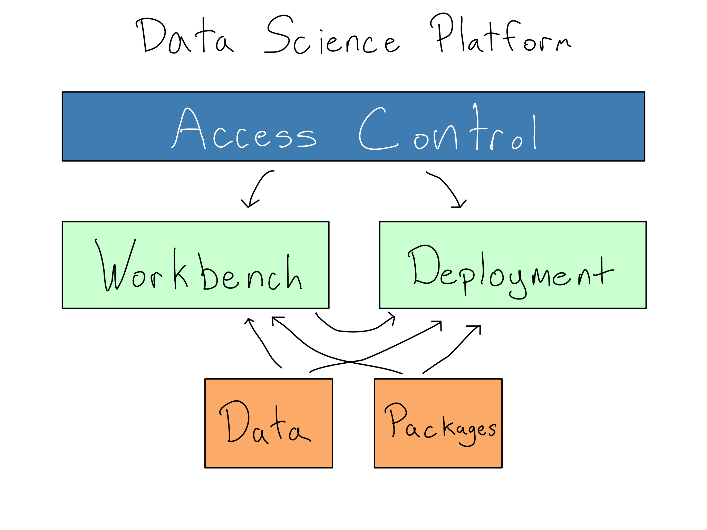
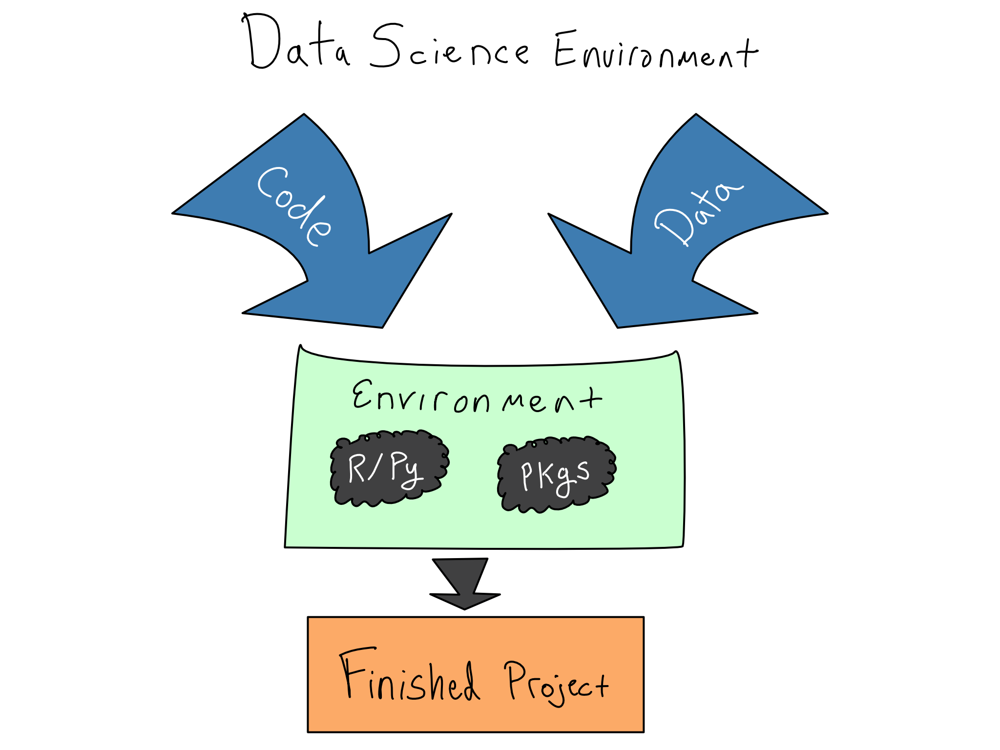
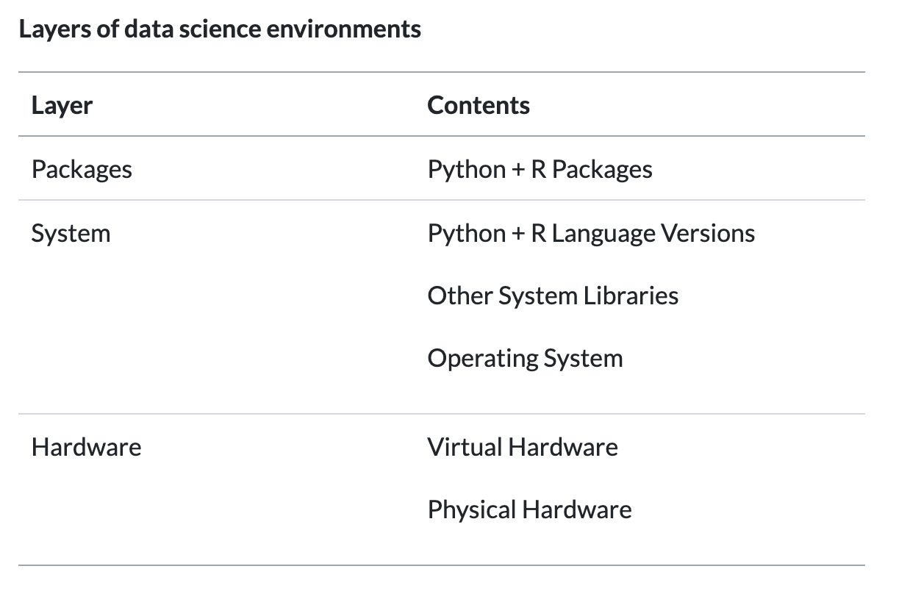
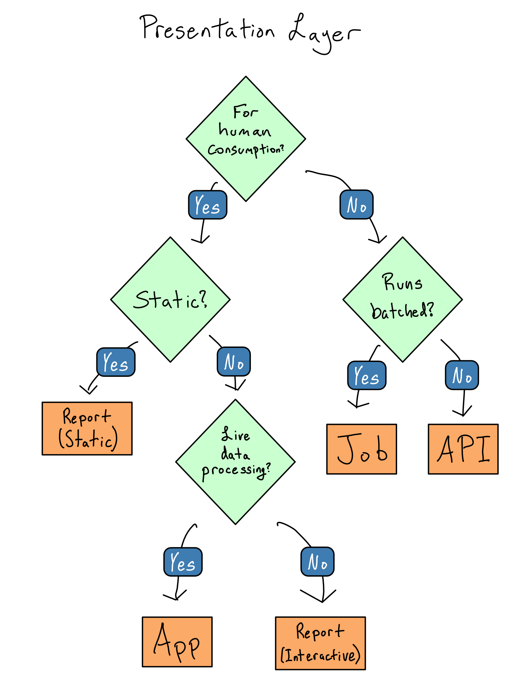
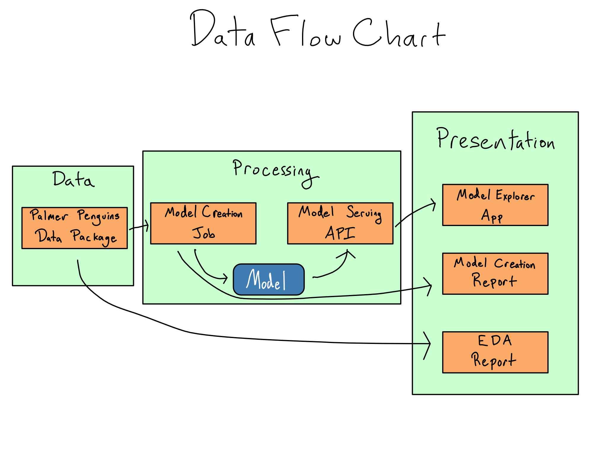
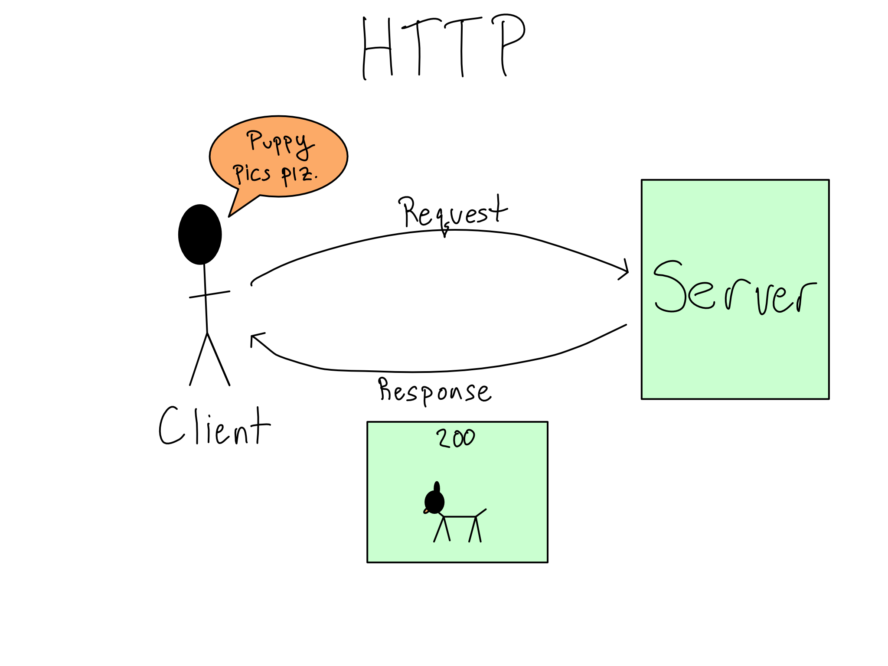
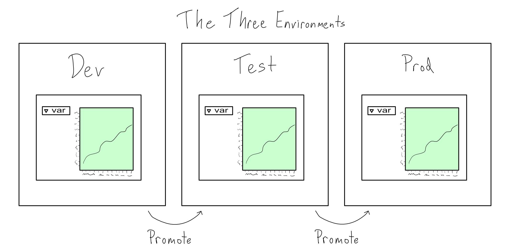
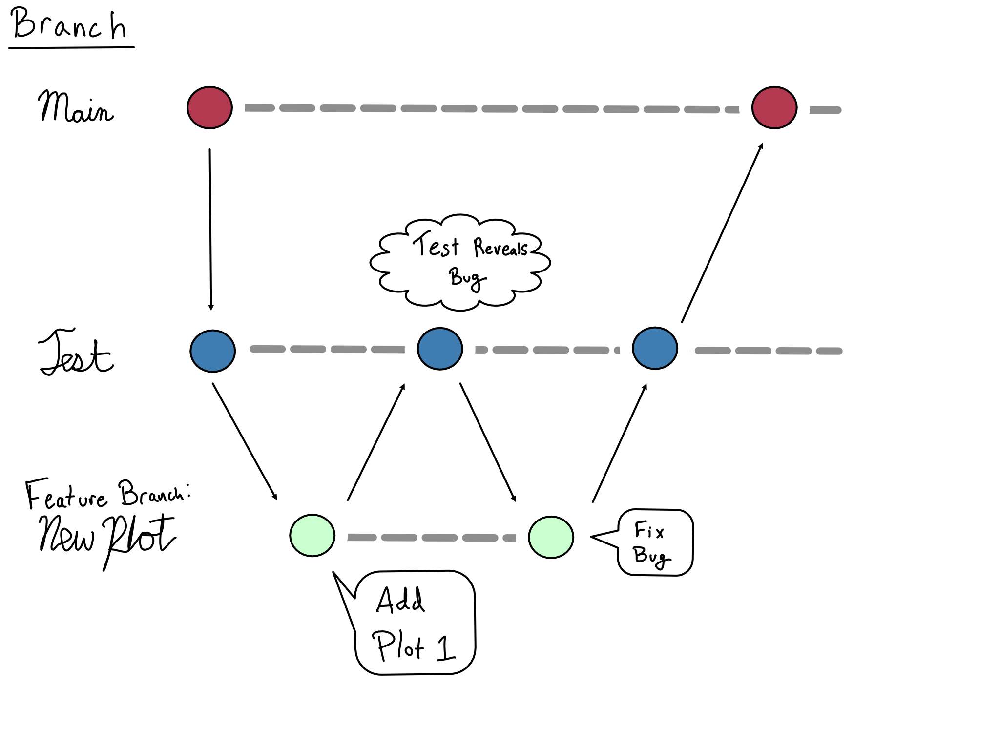
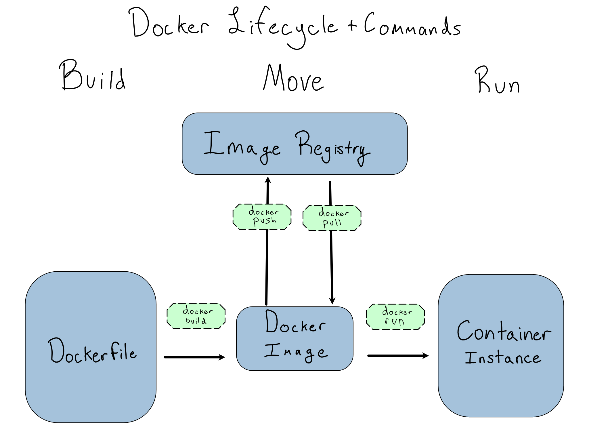

# Why reproducible, portable environments matter

## DevOps

- DevOps is a set of cultural norms, practices, and tooling to help make developing and deploying software smoother and lower risk.

::: {.notes}
- Data science alone is pretty useless. Graphs, models, papers.
- Ultimately, these things don't matter.
- What does matter is whether your work is useful. That is, whether it affects decisions at your organization, or in the broader world.
- That means you must share your work by putting it in production.
- DevOps is a set of cultural norms, practices, and tooling to help make developing and deploying software smoother and lower risk.
- Many data scientists think of in production as an exotic state where supercomputers run state-of-the-art machine learning models run over dozens of shards of data, terabytes each. There's a misty mountaintop in the background, and there's no Google Sheet, CSV file, or half-baked database query in sight.
- But that's a myth. If you're a data scientist putting your work in front of someone else's eyes, you are in production. 
- Regardless of the maturity or the form, every organization wants to know that the work is reliable, the environment is safe, and that the product will be available when people need it.
- And that's what DevOps is about.
:::

## Two components

::: {.notes}
- A lot of data science is done on personal computers. Data scientists download Jupyter Notebook or RStudio, install Python and R, and get to work. However, organizations are increasingly consolidating data science operations onto a centralized data science platform or data science environment.
1. The workbench. This is where data scientists go to get work done. It has Python, R, data access, sufficient computational resources, and the open-source Python and R packages you need to do work.
- A good workbench drastically speeds onboarding for the data science team. Compared to the days, weeks, or months to provide each laptop access to each data source, adding a new person to the platform takes minutes, and they arrive with all of their tools pre-provisioned.
- Once data science projects are complete, they need to go somewhere to be shared. That means the data science environment needs to include a deployment platform where data science projects can be hosted and shared with other people and systems.
:::

## Managing environments

*Discussion: Have you tried to share your work before and not had it run on someone else's computer?*

::: {.notes}
- One of the core issues DevOps addresses is the "works on my machine" problem. If you've ever collaborated on a data science project, you've almost certainly reached a point where something worked on your laptop but not for your colleague, and you don't know why.
- The code you're writing relies on the environment in which it runs. While most data scientists have ways to share code, sharing environments isn't always standard practice, but it should be. We can take lessons from DevOps, where the solution is to create explicit linkages between the code and the environment so you can share both.
- In data science, that means actively managing your data science environments using code. Your data science environment is the stack of software and hardware below your code, from the R and Python packages you're using right down to the physical hardware your code runs on.
- Ignoring the readiness of the data science environment results in the "it works on my machine" phenomenon with a failed attempt to share code with a colleague or deploy an app to production.
- But, the first steps toward a more reproducible environment are: to create and use environments as code.
- The DevOps term for this is that environments are stateless, that is environments should be "cattle, not pets". That means that you can use standardized tooling to create and destroy functionally identical copies of the environment without secret state being left behind.
:::

## Environments have layers

::: {.notes}
- Data science environments have three distinct layers. Being clear about each of these layers reveals your actual reproducibility needs and which environmental layers you need to target putting into code.
1. At the bottom of the environment is the hardware layer. This is the physical and virtual hardware where the code runs. For example, this might be your laptop or a virtual server from a cloud provider. 
2. Above that is the system layer, which includes the operating system, essential system libraries, and Python and/or R. 
3. Above that is the package layer, where your Python and R packages live.
- As a data scientist, you can and should be responsible for the package layer, and getting this layer right is where the biggest reproducibility bang for your buck lies. 
:::

## The package layer

There are three different places packages can live:

1. In a repository.
2. In a library.
3. Loaded.

Success means:

1. Isolation.
2. Transportability.

::: {.notes}
- There are three different places packages can live.
1. In a repository. You're used to installing packages from repositories like PyPI, Conda, CRAN, BioConductor, or uv. These repositories are like the grocery store. The food is packaged up and ready to go, but it is inert. There are also many varieties there. Repositories can hold both current and archival versions of each package.
2. In a library. Once you install the packages you need with install.packages() or pip install or conda install or uv add, they're in your library, the data science equivalent of a pantry. Libraries can hold – at most – one version of any given package. Libraries can be specific to the project, user, or shared across the system.
3. Loaded. Loading a package with a library or import command is like taking the food out of the pantry and putting it on the counter so you can cook with it.
- As a data scientist, the atomic unit of package reproducibility is in the middle – the library.
- Let's say you work on one project for a while, installing packages from the repository into your library. You go away for a year to work on other projects or try to share your project with someone else. When you come back, it's likely that future you or your colleague won't have the correct versions and your code will break.
- What would've been better is if you'd had an environment as code strategy that created a portable environment for each project on your system.
- A successful package environment as code setup has two key attributes:
1. Your package environment is isolated and cannot be disrupted by other activities on the same machine.
2. Your package environment can easily be captured and transported elsewhere.
:::

## Using virtual environments

1. Create standalone package libraries
2. Document environment state
3. Collaborate or deploy
4. Use a virtual environment

(We use `uv` for this, cf @gold2024 who uses `venv`.)

::: {.notes}
1. Step 1: Create standalone package libraries
    - Each project should have its own library. When you start your project, it should be in a standalone directory that includes everything the project needs – including a virtual environment.
    - This is called a project-oriented workflow.
    - Gold recommends that if a project includes multiple content items (say an app, API, and ETL script), then there should be one Git repo for the whole project with each content item in its own directory with its own virtual environment. When you work on the project, you activate the virtual environment and install and use packages in there.
2. Step 2: Document environment state.
    - The way to make the environment portable is to document what's in the package library. In uv this is the `pyproject.toml` and `uv.lock`. 
    - Since all this work occurs in a standalone package environment, you don't have to worry about what will happen if you return after a break. You'll still have those same packages to use.
3. Step 3: Collaborate or deploy
    - When you share your project, you want to share only the lockfile, not the actual package libraries. Package installs are specific to the operating system and the language version you're using, so you want your target system to install the package specifically for that system.
    - For example, if you're working on a Mac and you collaborate or deploy to a Windows or Linux machine, you can't share the actual package files. Those machines will need to install the required set of packages for themselves.
    - Additionally, package files can be large. Sharing a requirements file makes downloads and uploads much more manageable, especially if you're using Git. So, check `uv.lock` into Git with your project.
4. Step 4: Use a virtual environment
    - Then, when your deployment target, collaborator, or future you downloads your project, it will restore the documented environment, again using tools from `uv`.
:::

## What's happening under the hood

::: {.notes}
- Installed packages are stored in libraries, which are just directories on your system. Your Python session keeps track of the set of libraries it should use with `sys.path` in Python.
- When you install a package, it installs into the first library allowed. And when you load a package with import or library, it searches the directories from `sys.path` and returns the package when it finds it.
- Each library can contain, at most, one version of any package. So order matters for the directories in `sys.path`. Whatever version is found first during the search will be returned.
- If you're not in a virtual environment, the top libraries are user-level libraries by default. Activating a virtual environment puts project-level libraries at the top of the lists in `sys.path` so package installs and loads happen from there.
- To economize on space and install time, `venv` does something clever. The packages in your project-level library aren't there. Instead, `venv` keeps user-level package caches of the actual packages and use symlinks, so only one copy of the package is installed.
:::

# Data project architecture

## Front-end vs back-end

- Normal software engineering approach: 
  1. Presentation layer
  2. Processing layer
  3. Data layer
- Doesn't exactly map to data science, but we can still benefit from thinking seriously about it, especially the presentation layer.

*Discussion: Have you thought about separating aspects in this way before?*

::: {.notes}
- A three-layer app is divided into:
1. Presentation layer: what the end users of the app directly interact with. It's the displays, buttons, and functionality the user experiences.
2. Processing layer: the processing that happens as a result of user interactions. Sometimes, it is called the business logic.
3. Data layer: how and where the app stores and retrieves data.
- Thinking about these three layers can help clarify the parts of your project. Still, a data science project differs enough from general-purpose software that you can't just take three-layer best practices and graft them onto a data science project.
- First, you may not be designing an app at all. Data science projects produce all kinds of different outputs. An app is one option, but maybe you're creating a report, API, book, or paper.
- Second, you're designing a project, which is often not just an app. You likely have, or should have, several different components, like one or more modeling scripts.
- Third, most general-purpose apps run in response to something users do. In contrast, many data science projects run in response to updates to the underlying data – either on a schedule or in response to a trigger.
- Lastly, general-purpose software engineers usually get to design their data layers. You probably don't. Your job is to extract meaning from raw input data, which means you're beholden to whatever format that data shows up in.
:::

## Presentation layer

:::: {.columns}
::: {.column width="50%"}
1. A job. 
2. An app. 
3. A report. 
4. An API.
:::

::: {.column width="50%"}
{width=600}
:::
::::

::: {.notes}
Most data science projects fall into the following categories:
1. A job. 
    - A job matters because it changes something in another system. It might move data around, build a model, or produce plots, graphs, or numbers for a Microsoft Office report.
    - Frequently, jobs are written in a SQL-based pipelining tool (`dbt` has risen quickly in popularity) or in a `.R` or `.py` script. 
    - Depending on your organization, the people who write jobs may be called data engineers.
2. An app. 
    - Data science apps are created in frameworks like Shiny (R or Python), Dash (Python), or Streamlit (Python). 
    - In contrast to general-purpose web apps, which are for all sorts of purposes, data science web apps are usually used to give non-coders a way to explore datasets and see data insights.
3. A report. 
    - Reports are code you're turning into an output you care about – like a paper, book, presentation, or website. 
    - Reports result from rendering a Quarto doc, or Jupyter Notebook for people to consume on their computer, in print, or in a presentation. 
    - These docs may be completely static or have some interactive elements.
4. An API (application programming interface). 
    - An API is for machine-to-machine communication. 
    - In general-purpose software, APIs are the backbone of how two distinct pieces of software communicate. 
    - In data science, APIs are mostly used to provide data feeds and on-demand predictions from machine learning models.
:::

## Do less in the presentation layer

- In `scripts` create `analysis_data.parquet`, which is then loaded in `paper.qmd`. 
- There should be no (or at least minimal) manipulation of `analysis_data.parquet` required within `paper.qmd`.

::: {.notes}
- Data scientists usually don't do a great job separating out their presentation layers. 
- It's not uncommon to see apps or reports that are thousands of lines of code, with user interface (UI) components, code for plots, and data cleaning all mixed up together. 
- These smushed up layers make it hard to reason about the code or to add testing or logging.
- The only code that belongs in the presentation layer is code that shows something to the user or that collects input from the user. 
- Creating the things shown to the user or doing anything with the interactions shouldn't be in the presentation layer. These should be in the processing layer.
- Once you've identified what belongs in the processing layer, you should extract the code into functions that can be put in a package for easy documentation and testing and create scripts that do the processing.
:::

## Smaller data in the presentation layer (initially)

- Everything is easier when your data is small.

::: {.notes}
- Everything is easy when your data is small. You can load it into your Python or R session as your code starts and never think about it again.
- If your data size is small and your project performance is good enough, just read in all of your data and operate on it. Don't over-complicate things. This pattern often works well into the range of millions of rows.
- It may be the case that your data isn't small – but not all large data is created equal.
- Truly big data can't fit into the memory on your computer all at once. As computer memory gets more plentiful, truly big data is getting rarer.
- It's much more common to encounter medium data. You can technically load it into memory, but it's substantial enough that loading it all makes your project's performance too slow.
- Dealing with medium or big data requires being somewhat clever and adopting a design pattern appropriate for big data (more on that in a bit). But, being clever is hard.
- Before you go ahead being clever, it's worth asking a few questions that might let you treat your data as small.
    1. Can You Pre-calculate Anything?
        - If your data is truly big, it's big. But, if your data is medium-sized, the thing keeping it from being small isn't some esoteric hardware issue, it's performance.
        - An app requires high performance. Someone staring at their screen through a 90-second wait may think your project stinks depending on expectations.- But, if you can pre-calculate a lookup table of values or turn your app into a report that gets re-rendered on a schedule, you can turn large data into a small dataset in the presentation layer.
        - Talking to your users and figuring out what cuts of the data they care about can help you determine whether pre-calculation is feasible or whether you need to load all the data into the presentation layer.
    2. Can You Reduce Data Granularity?
        - If you can pre-calculate results and you're still hitting performance issues, it's always worth asking if your data can get smaller.
- Let's think about a specific project to make this a little more straightforward.
- Suppose you work for a large retailer and are responsible for creating a dashboard of weekly sales. Your input data is a dataset of every item sold at every store for years. This isn't naturally small data.
- But, you might be able to make the data small if you don't need to allow the user to slice the data in too many different dimensions. Each additional dimension you allow multiplies the amount of data you need in the presentation layer.
- For example, weekly sales at the department level only requires a lookup table as big as number of weeks times number of stores times number of departments. Even with a lot of stores and a lot of departments, you're probably still squarely in the small data category.
- But, if you have to switch to a daily view, you multiply the amount of data you need by seven. If you break it out across 12 products, your data has to get 12 times bigger. And if you do both, it gets 84 times bigger. It's not long before you're back to a big data problem.
- Talking with your users about the tradeoffs between app performance and the number of data dimensions they need can identify opportunities to exclude dimensions and reduce your data size.
:::

## Write a data flow chart

*Activity: In your groups, with pen and paper please write out your data flow chart.*

::: {.notes}
- Once you've figured out the project architecture you need, writing a data flow chart can be helpful.
- A data flow chart maps the different project components into the project's three parts and documents all the intermediate artifacts you're creating along the way.
- Once you've mapped your project, figuring out where the data should live and in what format will be much simpler.
- For example, here's a simple data flow chart. You may want to annotate your data flow charts with other attributes like data types, update frequencies, and where data objects live.
:::

# Secure data access

## Connecting to APIs

- APIs are the standard way for two computer systems to communicate.

*Discussion: Which APIs have you used?*

::: {.notes}
- Some data sources come in the form of an API.
- APIs are the standard way for two computer systems to communicate.
- It's common to have Python packages that wrap APIs, so you write Python code without thinking about the API underneath. Using these patterns often looks similar to databases – you create and use a connection object that stores the connection details. If your API has a package like this, you should use it.
- If you're consuming a private API at your organization, a helper package probably doesn't exist, or you may have to write it yourself.
- If you have to call an API directly, you can use the `requests` package in Python.
- These packages provide idiomatic Python ways to call APIs. It's worth understanding that they're purely syntactic sugar. There's nothing special about calling an API from inside Python versus using the command line and you can go back and forth as you please. It is sometimes helpful to try to replicate Python API calls without the language wrapper for debugging reasons.
- API is a general term that describes machine-to-machine communication. 
- For our purposes, we're talking about `http`-based REST-ful APIs.
- `http` operates on a request-response model. So when you use an API, you send a request to the API and it sends a response back.
:::

## API endpoints and paths and HTTP verbs

- Each request to an API is directed to a specific endpoint. 
- The HTTP verb, also known as the request method, describes the type of operation you're asking for.
- Commonly used verbs are: GET and POST.

::: {.notes}
- Each request to an API is directed to a specific endpoint. 
- An API can have many endpoints, each of which you can think of like a function in a package. 
- Each endpoint lives on a path, where you find that particular endpoint.
Documentation should specify the paths and the parameters that each accepts. 
- Those paths are relative to the root, so you could access /ping at http://localhost:8080/ping.
- When you make an HTTP request, you ask a server to do something. 
- The HTTP verb, also known as the request method, describes the type of operation you're asking for. 
- Each endpoint has one or more verbs that it knows how to use.
- 95% of the API endpoints you'll use as a data scientist are GET and POST, which respectively fetch information from the server and provide information to the server.
- To round out the basic HTTP verbs, you might use PUT or PATCH to change or update something and DELETE (you guessed it) to delete something. There are also more esoteric ones you'll probably never see.
:::

## Request parameters and bodies and (Auth) headers

- Each endpoint accepts specific arguments in a required format
- Most APIs require authentication. The most common forms of authentication are a username and password combination, an API key, or an OAuth token.
- The contents of the response are in the body. 

::: {.notes}
- Like a function in a package, each endpoint accepts specific arguments in a required format. Again, like a function, some arguments may be optional while others may be required.
- For GET requests, the arguments are specified via query parameters embedded in the URL after a ?. When you see a URL in your browser that looks like ?first_name=alex&last_name=gold, those are query parameters.
- For POST, PUT, and PATCH requests, arguments are provided in a body, which is usually formatted as JSON.2 `requests` has built-in functionality for converting standard Python data types to their JSON equivalents. 
- APIs often require their arguments to be nested in particular ways. You can experiment with how your objects get converted to JSON with {json} in Python to figure out how to get it nested correctly.
- Most APIs require authentication. The most common forms of authentication are a username and password combination, an API key, or an OAuth token.
- API keys and OAuth tokens are often associated with particular scopes. Scopes are permissions to do particular things. For example, an API key might be scoped to have GET access to a given endpoint but not POST access.
- Regardless of your authentication type, it will be provided in a header to your API call. Your API documentation will tell you how to provide your username and password, API key, or token to the API in a header. `requests` provides easy helpers for adding authentication headers and more general ways to set headers if needed.
- Aside from authentication, headers are also used for metadata like the type of machine sending the request and cookies.
- The contents of the response are in the body. You'll need to turn the body into a Python or R object you can work with.
- Most often, bodies are in JSON and you'll decode them with {json} in Python or {jsonlite} in R. Depending on the API, you may have the option to request something other than JSON as the return. 
:::

## Request Status Codes

- 200: a successful response.
- 3xx: Your query was redirected somewhere else.
- 4xx: Errors with the request.
- 400: Bad request. This isn’t a request the server can understand.
- 401/403: Unauthorized or forbidden. Required authentication hasn’t been provided.
- 404: Not found. There isn’t any content to access here.

*Activity: Please partner with someone new and use `requests` to get the NASA APOD using their API: https://api.nasa.gov/.*

::: {.notes}
The status code is the first thing you'll consult when you get a result. Status codes indicate what happened with your request to the server. You always hope to see 200 codes, which indicate a successful response.

There are also two common error codes. 4xx codes indicate a problem with your request and the API couldn't understand what you were asking. 5xx codes indicate that your request was fine, but some error happened in processing your request.
:::

## Environment variables

- Never put credentials, such as username, password, or API key, in code.
- The power of using an environment variable is that you reference them by name.
- `os.getenv("<VAR_NAME>")`

*Activity: What is the name of the environment variable that stores my OpenAI key in https://zenodo.org/records/17106979? (`/scripts/get_codes.py`)*

::: {.notes}
- When you take an app to production, authenticating to your data source while keeping your secrets secure is crucial.
- The most important thing you can do to secure your credentials is to avoid ever putting credentials in your code. Your username and password or API key should never appear in your code.
- The simplest way to provide credentials without the values appearing in your code is with an environment variable. 
- Environment variables are set before your code starts – sometimes from completely outside Python.
- The power of using an environment variable is that you reference them by name. Using only a name makes it easy to swap out the value in production versus other environments. 
- Also, it means it's safe to share code since all it does is reveal that an environment variable exists.
- It is a convention to make environment variable names in all caps with words separated by underscores. The values are always simple character values, though these can be cast to some other type inside Python.
- In Python, you can read environment variables from the os.environ dictionary or by using os.getenv("<VAR_NAME>").
- It's common to provide environment variables directly to functions as arguments, including as defaults, though you can also put the values in normal Python variables and use them from there.
:::

## Setting environment variables

Development environment: 

- Read a `.env` file into your session, likely using `python-dotenv` or `os.getenv()`.

Production environment:

- More difficult. GitHub Actions allows you to set SECRETS.

::: {.notes}
- The most common way to set environment variables in a development environment is to load secrets from a text file. 
- Environment variables are usually set in Python by reading a .env file into your session. You can do this using the `python-dotenv` or `os` packages.
- Some organizations don't ever want credential files in plaintext. After all, if someone steals a file that's just a list of usernames and passwords, nothing can stop the thief from using the credentials inside.
- There are packages in both R and Python called `keyring` that allow you to use the system keyring to securely store environment variables and recall them at runtime.
- Another approach is to share using apps like 1password.
- Setting environment variables in production is a little harder.
- Moving your secrets from your code into a different file you push to prod doesn't solve the problem of putting secrets in code. And using {keyring} in a production environment is quite cumbersome.
- Your production environment may provide environment management tools. For example, GitHub Actions allows you to set secrets that aren't visible to the users but are accessible to the code at runtime in an environment variable.
:::

# Logging and monitoring

## Observability

Two ways of being wrong:

1. You're wrong and you know it.
2. You're wrong and you don't know it.

When it comes to data science if we're wrong we want to know about it. Observability is the way to enable this. Two aspects:

1. Emitting the logs and metrics.
2. Aggregating and consuming them.

::: {.notes}
- Two ways of being wrong:
1. You're wrong and you know it.
2. You're wrong and you don't know it.
- When it comes to data science if we're wrong we want to know about it. The key to living in that world is observability. 
- If your code is observable, you'll know when something goes wrong because you have enabled monitoring on the system, and, when you dig in, you'll have logging that lets you reconstruct the pathway to failure.
- There are two halves to observability – emitting the logs and metrics that reveal what's happening inside your project and aggregating and consuming them. 
- As a data scientist, you need to take on the task of emitting helpful logs and metrics for your code. We focus on the first.
:::

## Observing correctness

- An issue that doesn't result in code failure but yields incorrect answers is especially concerning e.g. data joins usually complete even if the merge quality is terrible. Model APIs will return a prediction even if the prediction is bad.
- To address this we use process metrics and simulation.
- Test: joins, cross-tabs, goodness-of-fit metrics, data types.

::: {.notes}
- For general-purpose software, observability is primarily concerned with the operational qualities of the software. A software engineer wants to know how their software operates, and an uncaught exception or memory leak that makes the software crash is about as bad as it gets.
- For a data scientist, an an issue that doesn't result in code failure but yields incorrect answers is even scarier. Data joins usually complete even if the merge quality is terrible. Model APIs will return a prediction even if the prediction is very, very bad.
- Checking the correctness of the numbers and figures you produce is hard because data scientists are (basically by definition) doing something novel. The solution is to use process metrics to reveal a problem before it surfaces in your results. And to use simulation.
- One crucial tool is correctly architecting your project. Jobs are generally much simpler to check for correctness than presentation layers. By moving as much processing as possible out of the presentation layer and into the data and processing layers, you can make it easier to observe.
- Moreover, you're already probably familiar with tools for literate programming like Jupyter Notebooks, R Markdown Documents, and Quarto Documents.
- There are a few particular things I always make sure to include in job output.
- The first is the quality of data joins. Based on the number of rows (or unique IDs), I know how many rows should be in the dataset after a join. Figuring out how many rows to expect can take a minute, but checking that the size of the joined data matches my expectations has avoided many gnarly issues.
- The second is checking cross-tabulations before and after recoding a categorical variable. I've caught many mistakes in my recode logic by checking that the post-recode values match what I think they should. Input values also can change over time. Checking recode values is a good way to spot novel values to ensure they're recoded correctly.
- The last is goodness-of-fit metrics of an ML model in production. There are many frameworks and products for monitoring model quality and model drift once your model is in production. I don't have strong opinions on these, other than that you need to use one if you've got a model producing results you hope to rely on.
- The actual last is data types.
:::

# Deployments and code promotion

## CI/CD

- CI/CD, which is short for Continuous Integration and Continuous Deployment and Continuous Delivery.
- A few of the principles of CI/CD workflows include:
    1. Central availability of source code.
    2. Frequent and incremental additions.
    3. Automation of deployment.
    4. Automated testing.

::: {.notes}
- Your work doesn't matter if it never leaves your computer. You want your work to be useful, and it only becomes useful if you share it with the people and systems that matter. That requires putting it into production.
- When it goes well, putting code into production is a low-drama affair. When it goes poorly, putting code into production is a time-consuming ordeal. That's why putting code into production – deployment – is one of the primary concerns of DevOps best practices.
- The DevOps way to deploy code is called CI/CD, which is short for Continuous Integration and Continuous Deployment and Continuous Delivery (yes, the CD stands for two different things). When implemented well, CI/CD eases the deployment process through a combination of good workflows and automation.
- A few of the principles of CI/CD workflows include:
    1. Central availability of source code, almost always in version control, that allows you to build the project from scratch.
    2. Frequent and incremental additions to the production version of the code.
    3. Automation for carrying out the actual deployment.
    4. Automated testing on a pre-deployment version of the code.
:::

## Separate the prod environment

::: {.notes}
- CI/CD is all about quickly promoting code into production. It's all too easy to mess up production if you don't have a clear boundary between what is in production and what isn't. That's why software environments are often divided into dev, test, and prod.
- Dev is the development environment where new work is produced, test is where the code is tested for performance, usability, and feature completeness; and prod is the production environment. Sometimes dev and test are collectively called the lower environments and prod the higher environment.
- Some criteria that all good prod environments meet:
    1. The environment is created using code. For data science, that means managing R and Python packages using environments as code tooling.
    2. Changes happen via a promotion process. The process combines human approvals validating code is ready for production with automations to run tests and deploy.
    3. Changes only happen via the promotion process. This means no manual changes to the environment or the active code in production.
- Rules 1 and 2 tend to be easy to follow. It might even be fun to figure out how to create the environment with code and design a promotion process. But, the first time something breaks in your prod environment, you will be sorely tempted to violate rule 3. Please don't do it.
- Keeping a pristine prod environment is necessary if you want to run a data science project that becomes critical to your organization. When an issue arises, you must reproduce it in a lower environment before pushing changes through your promotion process. Keeping your environments in sync is crucial to reproduce prod issues in lower environments.
- These guidelines for a prod environment look almost identical to guidelines for general-purpose software engineering. The divergent needs of data scientists and general-purpose software engineers show up in the composition of lower environments.
:::

## Dev and test environments

::: {.notes}
- As a data scientist, dev means working in a lab environment like VS Code and experimenting with the data. You're slicing the data this way or that to see if anything meaningful emerges, creating plots to see if they are the right way to show off a finding, and checking whether certain features improve model performance. All this means it is impossible to work without real data.
- "Duh", you say, "Of course you can't do data science without real data".
- This may be obvious to you, but needing to do data science on real data in dev is a common source of friction with IT/Admins.
- That's because this need is unique to data scientists. For general-purpose software engineering, a lower environment needs data formatted like the real data, but the content doesn't matter.
- For example, if you're building an online store, you need dev and test environments where the API calls from the sales system are in the same format as the real data, but you don't care if it's real sales data. In fact, you probably want to create some odd-looking cases for testing purposes.
- One way to help alleviate concerns about using real data is to create a data science sandbox. A great data science sandbox provides:
    - Read-only access to real data for experimentation.
    - Places to write mock data to test things you'll write for real in prod.
    - Expanded access to R and Python packages for experiments before promoting to prod.
:::
  
## Version control implements code promotion

::: {.notes}
- Once you've invented your code promotion process, you need a way to operationalize it. If your process says that your code needs testing and review before it's pushed to prod, you need a place to do that. Version control is the tool to make your code promotion process real.
- Version control is software that allows you to keep the prod version of your code safe, gives contributors a copy to work on, and hosts tools to manage merging changes back together. These days, Git is the industry standard for version control.
- Git is an open-source system for tracking changes to computer files in a project-level collection called a repository. You can host repositories on your own Git server, but most organizations host their repositories with free or paid plans from tools like GitHub, GitLab, Bitbucket, or Azure DevOps.
- The precise contours of your code promotion process and, therefore, your Git policies – are up to you and your organization's needs. Do you need multiple rounds of review? Can anyone promote something to prod or just certain people? Is automated testing required?
- You should make these decisions as part of your code promotion process, which you can enshrine in the project's Git repository configuration.
- One important decision you'll make is how to configure the branches of your Git repository. Here's how I'd suggest you do it for production data science projects:
    - Maintain two long-running branches – main is the prod version of your project and test is a long-running pre-prod version.
    - Code can only be promoted to main via a merge from test. Direct pushes to main are not allowed.
    - New functionality is developed in short-lived feature branches that are merged into test when you think they're ready to go. Once sufficient approvals are granted, the feature branch changes in test are merged into main.
- This framework helps maintain a reliable prod version on the main branch while leaving sufficient flexibility to accomplish any set of approvals and testing you might want.
- One of the tenets of a good CI/CD practice is that changes are merged frequently and incrementally into production.
- A good rule of thumb is that you want your merges to be the smallest meaningful change that can be incorporated into main in a standalone way.
- There are no hard and fast rules here. Knowing the appropriate scope for a single merge is an art – one that can take years to develop. Your best resource here is more senior team members who've already figured it out.
:::

# Docker

## Overview

- Docker is an open-source tool for building, sharing, and running software.
- Earlier we talked about ensuring others could reproduce our environment; Docker's approach is "why don't we just give them the environment".

::: {.notes}
- Docker is an open-source tool for building, sharing, and running software. Docker is currently the dominant way software developers capture a development environment and is an increasingly popular tool to take code to production.
- Docker has become so popular because it makes code portable. In most cases, the only system prerequisite to run almost any Docker container is Docker itself. Everything else comes in the container.
- Unlike environment as code tools that are specific to one language, like {venv}, Docker captures the entire reproducibility stack down to the operating system. The appeal is evident if you've ever struggled with someone else running code you've written.
- Docker has so many strengths that it's easy to believe it will solve all reproducibility problems. It's worth keeping a little perspective.
- While Docker usually ensures that the code inside will run, it doesn't fully solve reproducibility or IT/Admin concerns. Some highly regulated contexts consider a container insufficiently rigorous for reproducibility purposes.
- Running a container also makes it easy to stand things up, but integrations to other services, like data sources and authentication, still must be configured externally.
- Lastly, running a container adds one more service between you and the code you're trying to run. Trying to get docker to work without a good mental model of how the services interact can be very frustrating.
:::

## Container lifecycle

::: {.notes}
- Docker is primarily concerned with the creation, movement, and running of containers. A container is a software entity that packages code and its dependencies down to the operating system. Containers are one way to have completely different environments coexisting side-by-side on one physical machine.
- Containers aren't the only way to run multiple virtual environments on one host. They're just the most talked about right now.
- And Docker Containers aren't the only type of container. You may run across other kinds, like Apptainer (formerly Singularity), often used in high performance computing (HPC) contexts.
- A Docker Image is an immutable snapshot of a container. When you want to run a container, you pull the image and run it as an instance or container that you'll interact with.
- Confusingly, the term container is used both to refer to a running instance ("Here's my running container") as well as which image ("I used the newest Ubuntu container").
- Some people use the term instance for the running container to eliminate this confusion.
- Images are usually stored in registries, which are similar to Git repositories. The most common registry for public containers is Docker Hub, which allows public and private hosting of images in free and paid tiers. Docker Hub includes official images for operating systems and programming languages, as well as many community-contributed containers. Some organizations run private registries, usually using registry as a service offerings from cloud providers.
- Images are built from Dockerfiles – the code that defines the image. Dockerfiles are usually stored in a Git repository. Building and pushing images in a CI/CD pipeline is common so changes to the Dockerfile are immediately reflected in the registry.
- You can control Docker Containers from the Docker Desktop app. If you're using Docker on a server, you'll mostly interact via the command line interface (CLI). All Docker CLI commands are formatted as `docker <command>`.
- The graphic below shows the different states for a container and the CLI commands to move from one to another.
- Instances run on an underlying machine called a host. A primary feature – also a liability – of using containers is that they are ephemeral. Unless configured otherwise, anything inside an instance when it shuts down vanishes without a trace.
:::

## Running containers

- You must know which image you're referencing to build, push, pull, or run it.
- The docker run command runs container images as an instance.

::: {.notes}
- You must know which image you're referencing to build, push, pull, or run it. Every image has a name that consists of an id and a tag.
- If you're using Docker Hub, container IDs take the form <user>/<container name>, so I might have the container alexkgold/my-container. This should look familiar to GitHub users.
- Other registries may enforce similar conventions for IDs, or they may allow IDs in any format they want.
- Tags specify versions and variants of containers and come after the id and :. For example, the official Python Docker image has tags for each version of Python like python:3, variants for different operating systems, and a slim version that saves space by excluding recommended packages.
- Some tags, usually used for versions, are immutable. For example, the rocker/r-ver container is built on Ubuntu and has a version of R built in. There's a rocker/r-ver:4.3.1, which is a container with R 4.3.1.
- Other tags are relative to the point in time. If you don't see a tag on a container name, it's using the default latest. Other common relative tags refer to the current development state of the software inside, like devel, release, or stable.
- The docker run command runs container images as an instance. You can run docker run <image name> to get a running container. However, most things you want to do with your instance require several command line flags.
- The -name <name> flag names an instance. If you don't provide a name, each instance gets a random alphanumeric ID on start. Names are useful because they persist across individual instances of a container, so they can be easily remembered or used in code.
- The -rm flag automatically removes the container after it's done. If you don't use the -rm flag, the container will stick around until you clean it up manually with docker rm. The -rm flag can be useful when iterating quickly – especially because you can't re-use names until you remove the container.
- The -d flag will run your container in detached mode. This is useful when you want your container to run in the background and not block your terminal session. It's useful when running containers in production, but you probably don't want to use it when trying things out and want to see logs streaming out as the container runs.
:::

## Building images from Dockerfiles

- A Dockerfile is a set of instructions to build a Docker image.
    - FROM – Specify the base image, usually the first line of the Dockerfile.
    - RUN – Run any command as if you were sitting at the command line inside the container.
    - COPY – Copy a file from the host filesystem into the container.
    - CMD – Specify what command to run on the container's shell when it runs, usually the last line of the Dockerfile.

::: {.notes}
A Dockerfile is a set of instructions to build a Docker image. 
- One thing to consider when creating Dockerfiles is that the resulting image is immutable, meaning that anything you build into the image is forever frozen in time. You'll want to set up the versions of R and Python and install system requirements in your Dockerfile. Depending on the purpose of your container, you may want to copy in code, data, and/or R and Python packages, or you may want to mount those in from a volume at runtime.
- There are many Dockerfile commands. You can review them all in the Dockerfile documentation, but here are the handful that are enough to build most images:
    - FROM – Specify the base image, usually the first line of the Dockerfile.
    - RUN – Run any command as if you were sitting at the command line inside the container.
    - COPY – Copy a file from the host filesystem into the container.
    - CMD – Specify what command to run on the container's shell when it runs, usually the last line of the Dockerfile.
- Every Dockerfile command defines a new layer. A great feature of Docker is that it only rebuilds the layers it needs to when you make changes. For example, take the following Dockerfile:
- Once you've created your Dockerfile, you build it into an image using docker build -t <image name> <build directory>. If you don't provide a tag, the default tag is latest.
- You can then push the image to DockerHub or another registry using docker push <image name>.
:::

## References
