## Data Organization

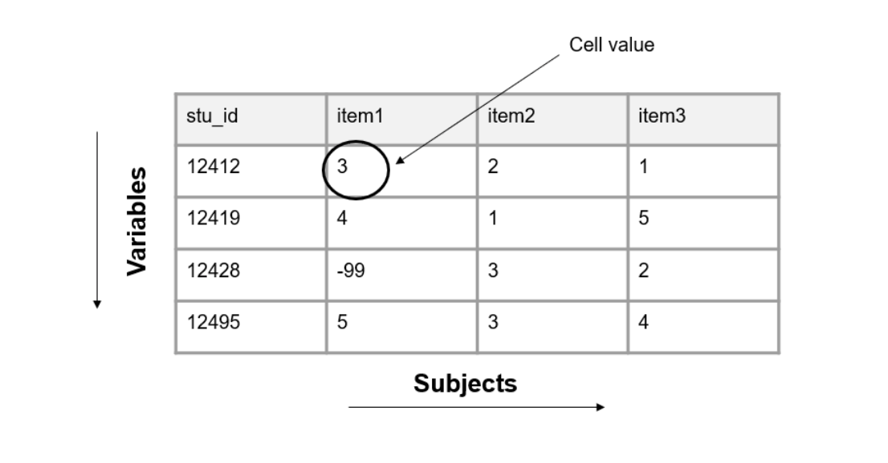

:::{.notes}
- Data are collected in a variety of ways by a variety of different actors for a variety of different reasons. 
- Those data come in many forms, and they are represented as text or numbers
- A dataset is organized in a rectangular format which allows the information to be machine-readable. Rectangular, also called tabular, datasets are made up of columns and rows.
- The columns in your dataset will consist of the following types of variables:
  - Variables you collect
    - These are variables collected from an instrument or external source.
  - Variables you create
    - These may be indicators you create (e.g., cohort, treatment, time).
    - Or they me be variables derived for summary purposes (e.g., means, sum scores).
  - Identifier variables
    - You must also include values that uniquely identify subjects in your data (e.g., a student unique identifier).
- The columns, or variables, in your dataset also have the following attributes:
  1. Variable names
    - A variable name is the short representation of the information contained in a column.
    - Variable names must be unique. No variable name in a dataset can repeat. We will talk more about variable naming when we discuss style guides in Chapter 9.
  2. Variable types
    - A variable's type determines allowable values for a variable, the operations that can be performed on the variable, and how the values are stored.
    - Example types include numeric, character (also called text or string), or date. Types can also be more narrowly defined as needed (e.g., continuous, categorical).
  3. Variable values
    - Variable values refer to the information contained in each column. Every variable has pre-determined allowable values.
    - Examples of setting allowable values for different types of variables include:
      - Categorical character variable: “yes” | “no”
      - Numeric variable: 1–25
      - Date variable: 2023-08-01 to 2023-12-15
      - Free text character variable: any value is allowed
    - Anything outside of your expected values or ranges is considered an error.
  4. Variable labels
    - A variable label is the human readable description of what a variable represents.
    - This may be a label that you, as the variable creator, assigns (e.g., “Treatment condition”) or it may be the actual wording of an item (e.g., “Do you enjoy pizza?”).
    - This may be a label that you, as the variable creator, assigns (e.g., “Treatment condition”) or it may be the actual wording of an item (e.g., “Do you enjoy pizza?”).
- Rows
  - The rows in your dataset are aligned with subjects (also called records or cases) in your data. 
  - Subjects in your dataset may be students, teachers, schools, locations, and so forth. The unique subject identifier variable denotes which row belongs to which subject.
- Cells
  - The cells are the observations associated with each case in your data. Cells are made up of key/value pairs, created at the intersection of a column and a row (see Figure 3.2). Consider an example where we collect a survey (also called a questionnaire) from students. In this dataset, each row is made up of a unique student in our study, each column is an item from the survey, and each cell contains a value that corresponds to that row/column pair (i.e., that participant and that question).
:::

---

## Dataset organization rules

### Rectangular

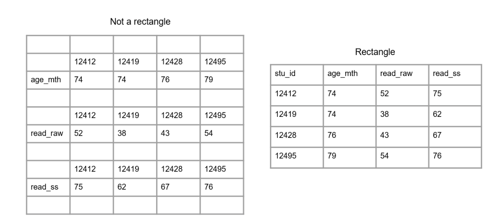

:::{.notes}
- In order for your dataset to be machine-readable and analyzable, it should adhere to a set of organizational rules (Broman and Woo 2018; Wickham 2014).
- The first rule is that data should make a rectangle (Figure 3.3). The first row of your data should be your variable names (only use one row for this). The remaining data should be made up of values in cells.
:::

---

## Dataset organization rules

### Column values should be consistent

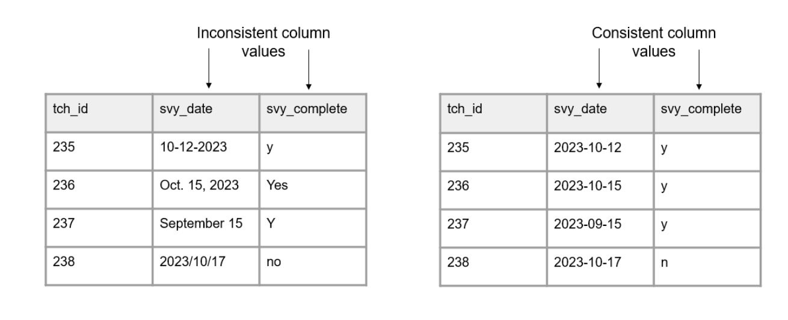

:::{.notes}
- Column values should be consistent (Figure 3.4). Both humans and machines have difficulty categorizing information that is not measured, coded, or formatted consistently.
  - For text categorical values, use controlled vocabularies and keep consistent spelling, case, and spacing.
  - For date values, keep the format consistent.
  - For numeric values, measure in consistent units and keep consistent decimal places.
:::

---

## Dataset organization rules

### Columns should adhere to your expected variable type

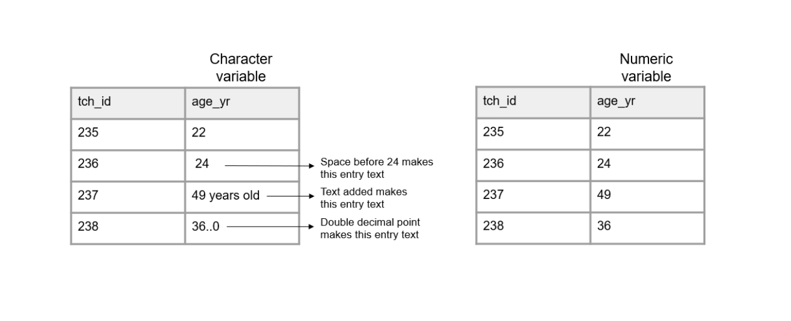

:::{.notes}
- Columns should adhere to your expected variable type.
- For example, if you have a numeric variable, such as age, but you add a cell value that is text, your variable no longer adheres to your variable type. Machines will now read this variable type as character.
:::

---

## Dataset organization rules

### A variable should only collect one piece of information

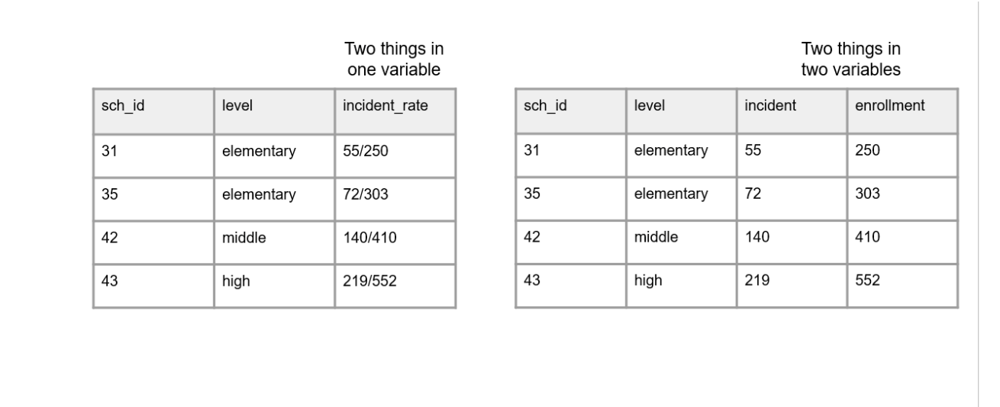

:::{.notes}
- A variable should only collect one piece of information. This allows you to more easily work with your variables.
For example, rather than combining the number of incidents and the number of enrolled students in the same variable, separate this information into two variables. This allows you to aggregate information as needed (e.g., calculate an incident rate).
:::

---

## Dataset organization rules

### All cell values should be explicit

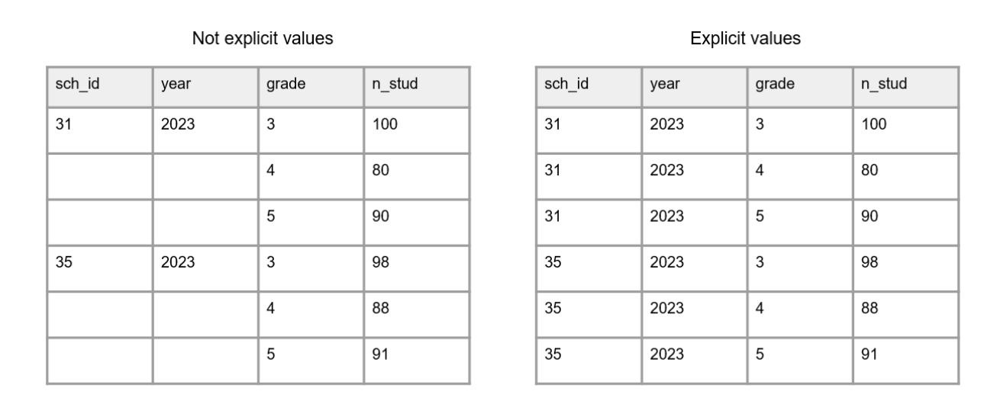

:::{.notes}
- All cell values should be explicit (Figure 3.7). This means all cells that are not missing values should be filled with a value.
Consider why a cell value is empty
  - If a value is actually missing, you can either leave those cells blank or fill them with your pre-determined missing values (e.g., -99). See Section 9.5.1 for ideas on coding missing values.
  - If a cell is left empty because it is implied to be the same value as above, the cells should be filled with the actual data.
  - If an empty cell is implied to be 0, fill the cells with an actual 0.
:::

---

## Dataset organization rules

### All variables should be explicit 

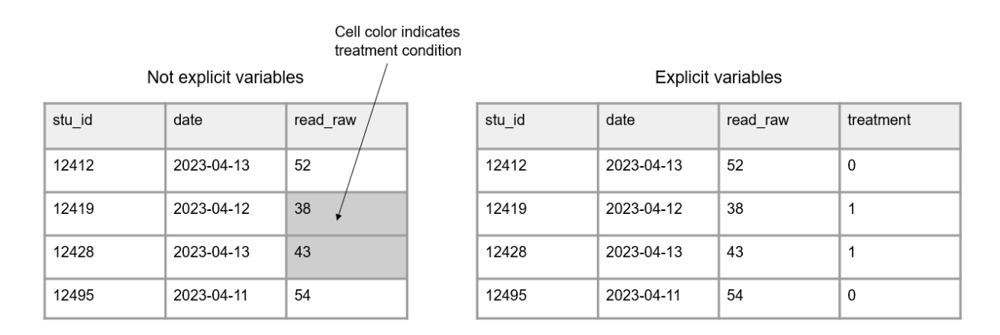

:::{.notes}
- All variables should be explicit (Figure 3.8). No variables should be implied using color coding.
  - If you want to indicate information, add an indicator variable to do this rather than cell coloring.
:::

---

## Linking data

### Database design

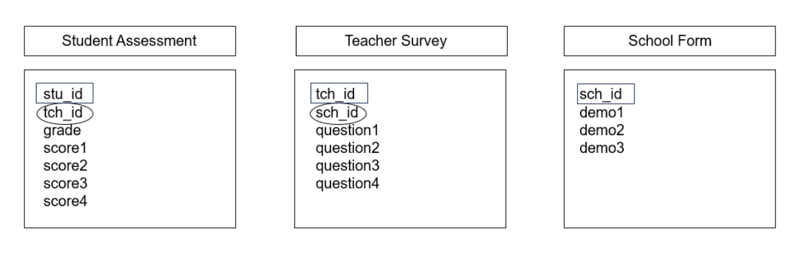

:::{.notes}
- Up until now we have been talking about one, standalone dataset. However, it is more likely that your research project will be made up of multiple datasets, collected from different participants, using a variety of instruments, and possibly across different time points. At some point you will most likely need to link those datasets together.
- In order to think about how to link data, we need to discuss two things, database design and data structure.
- Database design
  - A database is “an organized collection of data stored as multiple datasets” (USGS 2023). Sometimes this database is actually housed in a database software system (such as SQLite or FileMaker), and other times we are loosely using the term database to simply define how we are linking datasets together that are stored individually (i.e., flat files). No matter the storage system, the general concepts here will be applicable.
  - In database terminology, each dataset we have is considered a “table”. Each table includes one or more variables that uniquely define rows in your data (i.e., a primary key). Tables may also contain variables associated with unique values in another table (i.e., foreign keys) (Wickham, Çetinkaya-Rundel, and Grolemund 2023). See Figure 3.9 for an example of three tables that contain primary keys (denoted by rectangles) and foreign keys (denoted by ovals). Furthermore, tables can be joined either horizontally or vertically.
:::

---

## Linking data

### Horizontal joins

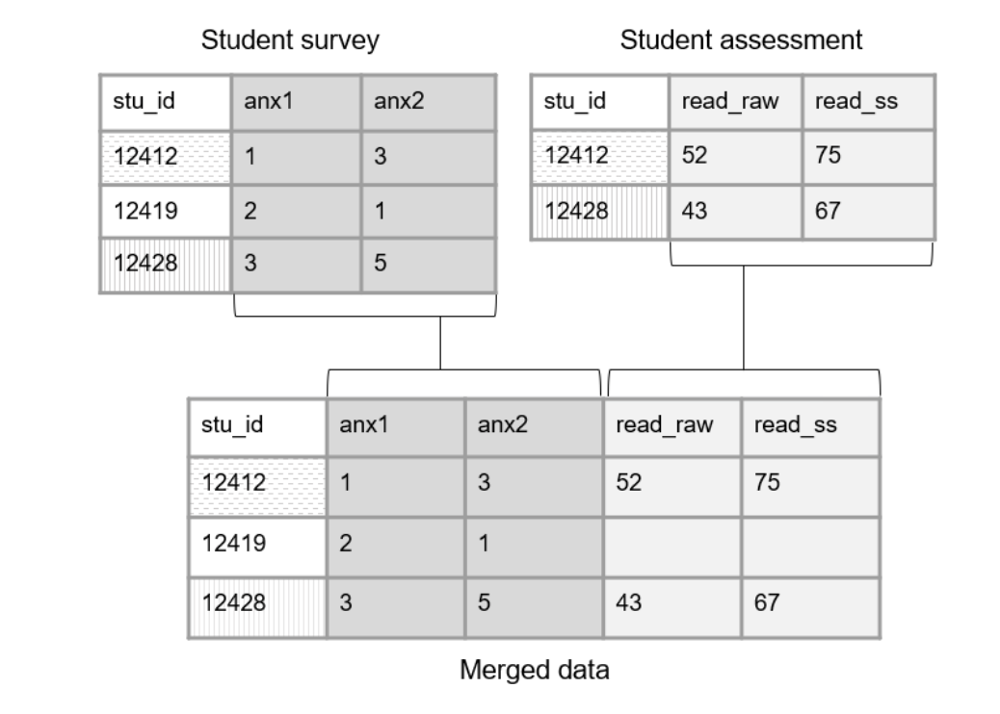

:::{.notes}
- Joining tables horizontally, also called merging, involves matching rows by one (e.g., stu_id) or more (e.g., first_name and last_name) keys, resulting in a table of combined information. With the exception of primary and foreign keys which are often identically named across tables, it is important that all variables are uniquely named across tables when joining horizontally.
- There are several different types of horizontal joins (e.g., left, right, inner, full). While diving into the different types of joins is outside of the scope of this book, resources for further learning will be provided at the end of this section. For now, just assume that the joins we discuss are all left joins (i.e., all records from our first table will be matched to any available records in our second table).
- To better understand horizontal joins, let's take the simple example in Figure 3.10, where we only have a primary key (stu_id) in each table, no foreign keys. Here we collected data from students using two different instruments (a survey and an assessment). When we join these tables on our primary key, it will be a one-to-one merge because each student only appears once in each table.
:::

---

## Linking data

### Foreign keys

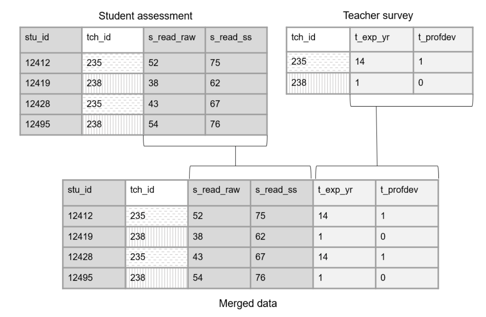

:::{.notes}
- However, we are often not only collecting data using a variety of instruments, we are also collecting nested data across different entities (e.g., students, nested in classrooms, nested in schools). Let's look at another example where we collected data from both students (an assessment) and teachers (a survey). Figure 3.11 shows how we can now link the foreign key in the student assessment (tch_id) with the primary key in the teacher survey (tch_id). In this scenario, we are doing a many-to-one join (i.e., multiple students are associated with the same teacher), meaning upon merging, teacher data will be repeated for all students in their classroom.
:::

---

## Linking data

### Vertical joins

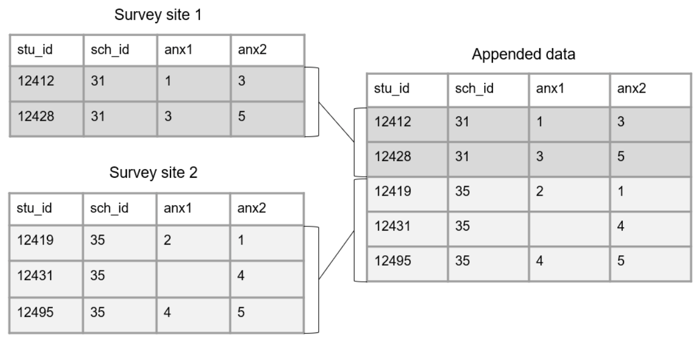

:::{.notes}
- Joining tables vertically, also called appending, involves stacking tables on top of each other. Here, rather than joining by primary and foreign keys, we are matching columns by variable names. In this case, variable names and variable types should be identical across tables for the matching to work.
- Let's take a simple example where we collected a survey from two different sites. Those surveys were entered into two separate tables and we want to combine that data. Figure 3.13 shows how we could vertically join those tables.
:::

---

## Data structure

### Wide format

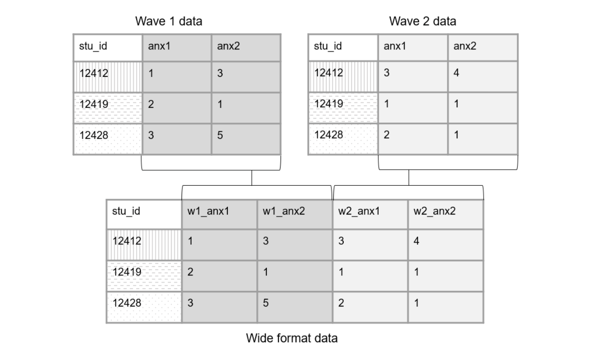

:::{.notes}
- When working with longitudinal data, it's important to consider data structure before linking data. Collecting longitudinal, or repeated measures data, typically results in multiple, identically formatted tables, each representing a different wave of data collection. It is common for researchers to join these waves of data for storage or analysis purposes. However, there are two different ways to structure combined longitudinal data—in wide format or long format—and it is important to choose this structure before joining your data.
- When we structure our data in a wide format, all data collected on a unique subject will be in one row. Subjects should not be duplicated in your data in this format.
- To structure data in wide format, we join our tables horizontally. Before joining though, each wave of data collection will be appended to a variable name to create unique names. Figure 3.14 shows of an example of how we could structure two waves of data collection in wide format.
:::

---

## Data structure

### Long format

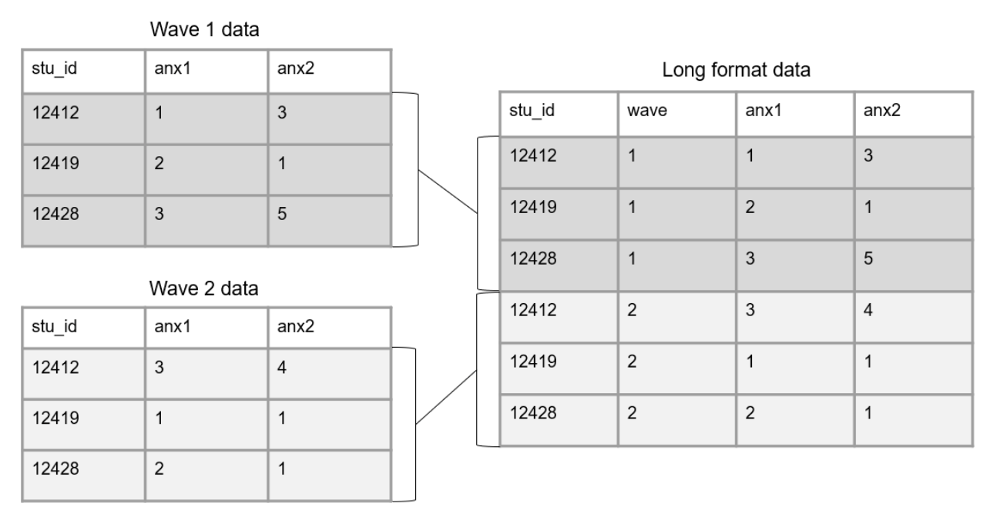

:::{.notes}
- Another way to structure longitudinal data is in long format. Here a participant can, and often will, repeat in your dataset, and unique rows will now be identified through a combination of variables (e.g., stu_id and wave together will be your primary key).
- To structure data in long format, we join our tables vertically. In this scenario, we no longer add the data collection wave to variable names. However, a time period variable should be added to denote the wave associated with each row of data. Figure 3.15 shows an example of how we could structure two waves of data collection in long format.
- There are different reasons for structuring your longitudinal data one way or another. Storing data in long format is usually considered to be more efficient than storing in wide format, potentially requiring less memory. However, when it comes time for analysis, specific data structures may be required. For example, repeated measure procedures typically require data to be in wide format, where the unit of analysis is the subject. While mixed model procedures typically require data to be in long format, where the unit of analysis is each measurement for the subject (Grace-Martin 2013). It may be that you structure data in one format for one reason (e.g., storing or sharing), and then restructure data into another format a different reason (e.g., analysis). Luckily, this type of restructuring can be done fairly quickly in many statistical programs4. We will further review decision making around data structure in Chapters 14 and 16.
:::

# Human Subjects Data

---

## Identifiability of a dataset

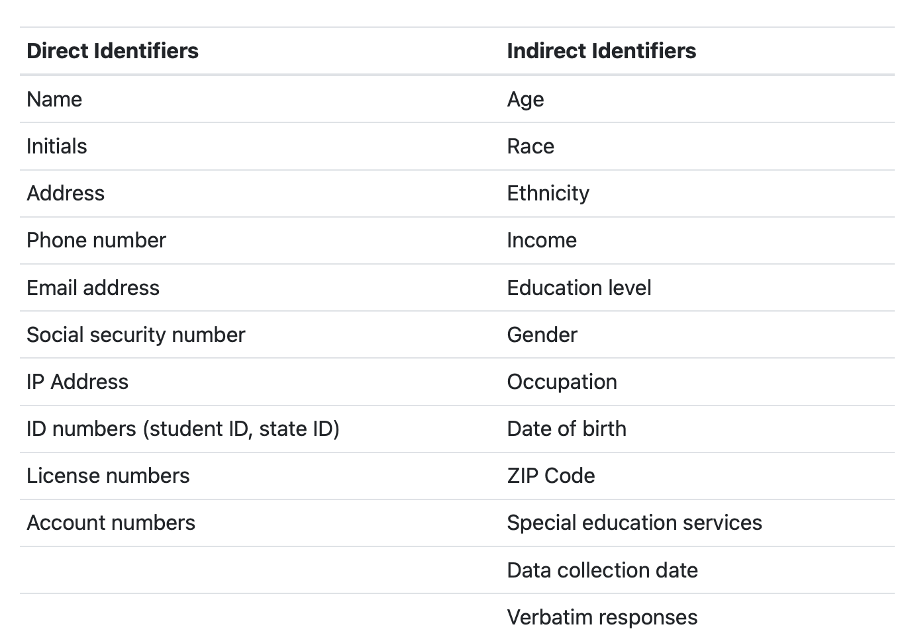

:::{.notes}
- In addition to understanding how to organize data, we also need a foundational understanding of the types of data we may collect. In the field of education research, we are often working with data that is collected from human subjects. Along with collecting data from people comes the responsibility to secure that data. Data from humans may contain identifiable information increasing the risk that participants can be revealed in a dataset. Human subjects data sometimes also contains information on sensitive topics such as mental health, drug use, or criminal behavior, further increasing risks if participants are identified. Before beginning your project, it is important to assess the type of data you will be collecting and understand the protections that will need to be in place to secure your data. This chapter will briefly review the types of human subjects data you may work with as well as any regulations, organizations, policies, or agreements that may impact how you need to secure your data.
- When working with human subjects there are two types of identifiers you may collect in your study, direct and indirect (see Table 4.1). Direct identifiers are unique to an individual and can be used to identify a participant. Indirect identifiers are not necessarily unique to a particular individual, but if combined with other information they could be used to identify a participant (Kopper, Sautmann, and Turitto 2023a).
- A term often used when discussing identifiable information is personally identifiable information (PII). This term broadly refers to information that can be used to identify a participant. There is no agreed-upon list for what fields should be included in a list of PII but generally it includes both the direct and indirect types of information shown in Table 4.1.
- When collecting data and creating datasets, you will be working with one or more of these four types of data files (UNC Office of Human Research Ethics 2020).
    1. Identifiable: Data includes personally identifiable information. It is common for your raw research study data to be identifiable.
    2. Coded: In this type of data file, PII has been removed or distorted and names are replaced with a code (i.e., a unique participant identifier). The only way to link the data back to an individual is through that code. The identifying code file (linking key) is stored separate from the research data (see Chapter 10). Coded data is typically the type of file you create after cleaning your raw study data.
    3. De-identified: In this type of file, identifying information has been removed or distorted and the data can no longer be reassociated with the underlying individual (the linking key no longer exists). This is typically what you create when publicly sharing your research study data.
    4. Anonymous: In an anonymous dataset, no identifying information is ever collected and so there should be little to no risk of identifying a specific participant.
:::

---

## Human subjects data oversight

- Regulations and laws
- Institutions and departments
- Agreements

:::{.notes}
- When working with human subjects data, there are laws, policies, departments, and agreements that may impact how you collect and manage that data. Below we will review some of the most commonly encountered oversight in education research.

- Regulations and laws
  - HIPAA: The Health Insurance Portability and Accountability Act (HIPAA) provides federal protection for the privacy of protected health information (PHI) collected by covered entities serving patients. The HIPAA Privacy Rule provides a list of 18 identifiers that should be protected.
- Institutions and departments
  1. IRB: An Institutional Review Board (IRB) is a formal organization designated to review and monitor human subjects research and ensure that the welfare, rights, and privacy of participants are maintained throughout the project (Oregon State University 2012). In particular the IRB is concerned with three ethical principles established in the Belmont Report (The National Commission for the Protection of Human Subjects of Biomedical and Behavioral Research 1979); respect for persons (i.e., protecting the autonomy of participants), beneficence (i.e., minimizing harm and maximizing good), and justice (i.e., fair distribution of burdens and benefits)(Duru and Sautmann 2023; Gaddy and Scott 2020). When conducting human subjects research, it is important to review your local IRB's policies and procedures to determine if your study requires IRB approval.
  2. IT department: Institutional information technology (IT) departments often vet data collection, transfer, and storage tools and are the authority on what tools are approved for research use. They may also be your source for determining classification levels for data security.
- Agreements
  - Informed consent/assent: Often required by an IRB, consent involves informing a participant of what data will be collected for your research study and how it will be handled and used, as well as obtaining a participant's voluntary agreement to participate in your study. If your study involves participants under the age of 18, you may also be required to obtain a participant assent form, in addition to a parent/guardian consent form.
  - DUA: A data use agreement (DUA), also sometimes referred to as a data sharing agreement (DSA), is a contractual agreement that provides the terms and conditions for sharing data. DUAs are commonly written for data sharing when partnering with school districts or state agencies. As an example, a DUA may include the terms for sharing, working with, and storing education records data. However, DUAs can be used to provide guidance for outgoing data as well (i.e., a researcher is sharing their original data with an agency). DUAs can be standalone documents or may be incorporated into other documents such as a memorandum of understanding (MOU).
  - NDA: Non-disclosure agreements (NDAs), sometimes synonymous with confidentiality agreements, restrict the use of proprietary or confidential information (University of Washington 2023) and are legally enforceable agreements. These may be required when partnering with districts or other agencies.
:::

---

## Protecting human subjects data

- Get consent to collect identifiers
- Collect as few identifiers as possible
- Follow the applicable laws, policies, and agreements
- Replace names with codes
- De-identify data before sharing it
- Use data sharing agreements and controlled access

:::{.notes}
- In most situations it will be important to get consent to collect identifiers. Consult with your local IRB to determine what is required. See Section 11.2.5 for more information.
- Collect as few identifiers as possible. Only collect what is necessary. See Section 11.2.1 for more information.
- Follow rules laid out in applicable laws, policies, and agreements when collecting, storing, and sharing data. This includes, but is not limited to, using approved tools for data collection, capture, and storage, assigning appropriate data access levels, and transmitting data using approved methods. See Chapters 11, 12, 13, and 15 for more information.
- Remove names in data and replace them with codes (i.e., unique study identifiers). See Sections 10.4 and 14.3.1 for more information.
- Fully de-identify data before publicly sharing it. See Section 16.2.3.4 for more information.
- Use data sharing agreements and controlled access as needed when publicly sharing data. See Section 16.2.1 for more information.
:::

# Data Management Plan

---

## What is it?

1. Description of data to be shared
2. Format of data to be shared
3. Documentation to be shared
4. Standards
5. Data preservation
6. Access, distribution, or reuse considerations
7. Protection of privacy and confidentiality
8. Data security
9. Roles and responsibilities
10. Preregistration

:::{.notes}
- Typically, a data management plan is a supplemental two-to-five-page document, submitted with your grant application, that contains high-level decisions about how you plan to collect, store, manage, and share your research data products. 
- For most funders these DMPs are not part of the scoring process, but they are reviewed by a panel or program officer. Some funders may provide feedback or ask for revisions if they believe your plan and/or your budget and associated costs are not adequate. Although this document is usually submitted to your funder, it should be considered a living document to be updated as plans change throughout a study.

1. Description of data to be shared (see Chapters 11, 12, 14, and 16)
  - What is the source of data? (e.g., surveys, assessments, observations, extant data)
  - How will data be cleaned and curated prior to data sharing?
  - What will the level of aggregation be? (e.g., item-level, summary data, metadata only)
  - Datasets from a project may need to be shared in different ways due to legal, ethical, or technical reasons.
  - Will both raw and clean data be shared?
  - What is the expected number of files? Expected number of rows/cases in each file?
2. Format of data to be shared (see Chapters 14 and 16)
  - Will data be in an electronic format?
  - Will it be provided in a non-proprietary format? (e.g., CSV)
  - Will more than one format be provided? (e.g., SPSS and CSV)
  - Are there any tools needed to manipulate or reproduce shared data? (e.g., software, code)
  - Provide details for those tools. (e.g., how they can be accessed, version number, required operating system)
3. Documentation to be shared (see Chapters 8 and 16)
  - What documentation will you share?
  - Consider project-level, dataset-level, and variable-level documentation.
  - What format will your documentation be in? (e.g., XML, CSV, PDF)
4. Standards (see Chapters 8, 11, and 16)
  - Do you plan to use any standards for things such as metadata, data collection, or data formatting?
5. Data preservation (see Chapter 16)
  - Where will data be archived for public sharing?
  - Many agencies are now requiring applicants to name a specific data repository in this section.
  - What are the desirable characteristics of the repository?10 (e.g., unique persistent identifiers assigned to data, metadata collected, records provenance, licensing options)
  - When will you deposit your study data in the repository and for how long will data remain accessible?
  - How will you enable discoverability and reuse of data?
6. Access, distribution, or reuse considerations (see Chapters 4 and 16)
  - Are there any legal, technical, or ethical factors affecting reuse, access, or distribution of your data?
  - Will any data be restricted?
  - Are access controls required (e.g., a data use agreement, data enclave)?
7. Protection of privacy and confidentiality (see Chapters 4, 14, and 16)
  - Do participants sign informed consent agreements? Does the consent communicate how participant data are expected to be used and shared?
  - How will you prevent disclosure of personally identifiable information when you share data?
8. Data security (see Chapter 13)
  - How will security and integrity of data be maintained during a project? (e.g., consider data storage, access, backup, and transfer)
9. Roles and responsibilities (see Chapter 7)
  - What are the staff roles in management and preservation of data?
  - Who ensures accessibility, reliability, and quality of data?
  - Is there a plan if a core team member leaves the project or institution?
10. Preregistration
  - Where and when will you pre-register your study?
:::

# Documentation

---

## Dataset-level

1. README
2. Changelog
3. Data cleaning plan

:::{.notes}
- Dataset-level documentation applies to your datasets and includes information about what they contain and how they are related. It also captures things such as planned transformations, potential issues to be aware of, and any alterations made to the data. In addition to being helpful descriptive information, a huge reason for creating dataset documentation is authenticity. Datasets go through many iterations of processing which can result in multiple versions of a dataset (CESSDA Training Team 2017; UK Data Service 2023). Preserving data lineage by tracking transformations and errors found is key to ensuring that you know where your data come from, what processing has already been completed, and that you are using the correct version of the data.

8.3.1 Readme
When to create: At any time they are useful

A README is a plain text document that contains information about your files. These stem from the field of computer science but are now prevalent in the research world. These documents are a way to convey pertinent information to collaborators in a simple, no-frills manner. READMEs can be used in many different ways, but I will cover three ways they are often used in data management.

1. For conveying information to your colleagues
2. For conveying steps in a process (sometimes also called a setup file)
3. For providing information about a set of files in a directory

After a dataset has been collected, cleaned, and finalized, it is not uncommon to revise that file again at a later point due to errors found, or the addition of new data. However, rather than saving over previous files, it is important to use version control. Version control is a method of recording changes to a file in a way that allows you to track revision history and revert back to previous versions of a file as needed (Briney 2015; The Turing Way Community 2022). While there are automatic ways to track updates to your files through version control programs such as Git, this may not always fit into an education research workflow. Institution-approved storage locations, such as Box or SharePoint, also often have versioning capabilities. These programs save copies of your files at different points in time, allowing you to go back to previous versions. However, unless users are able to add contextual messages about changes made when saving versions (e.g., a commit message with Git), users will want to manually version their files.

Manual version control involves a two-step process. First, add a version indicator to file names (see Section 9.3 for ideas on how to version a file name). When a file is revised, a copy is saved and the indicator is updated. Second, a description of the change is recorded in a changelog—a historical record of all major file changes (UK Data Service 2023; Wilson et al. 2017) (see Figure 8.14).

Manually versioning file names and keeping an up to date changelog serves many purposes. First, it supports reproducibility. If a file is used for analysis but then that file is saved over with a new version, the original findings from that analysis can no longer be reproduced (The Turing Way Community 2022). Version control also reduces data rot (Henry 2021) by providing data lineage, allowing a user to understand where the data originated as well as all transformations made to the data. Last, it supports data confidence, allowing a user to understand what version of the data they are currently using, and to decide if they should be using a more recently created version of the file.

In its simplest form a changelog should contain the following (Schmitt and Burchinal 2011):

1. The file name
2. The date the file was created
3. A description of the dataset (including what changes were made compared to the previous version)
4. It can also be helpful to record additional information such as who made the change and a link to any code used to transform the data (CESSDA Training Team 2017).

A data cleaning plan is a written proposal outlining how you plan to transform your raw data into clean, usable data. This document contains no code and is not technical skills dependent. A data cleaning plan is created for each dataset listed in your data sources catalog (see Section 8.2.2). Since this document lays out your intended transformations for each raw dataset, it allows any team member to provide feedback on the data cleaning process.

This document can be started in the documentation phase, but will most likely continue to be updated throughout the study. Typically, the person responsible for cleaning the data will write the data cleaning plans, but the documents can then be brought to a planning meeting allowing your DMWG to provide input on the plan. This ensures that everyone agrees on the transformations to be performed. Once finalized, this data cleaning plan serves as a guide in the cleaning process. In addition to the changelog, this data cleaning plan (as well as any syntax used) provides all documentation necessary to assess data provenance, a historical record of a data file's journey.

A data cleaning plan should be based on agreed-upon norms for what constitutes a clean dataset to help ensure that all datasets are cleaned and formatted consistently (see Section 14.2). These norms can be operationalized into a checklist of transformations that can inform your data cleaning plan, along with your data dictionary and other relevant documentation. We will review what types of transformations you should consider adding to your data cleaning plan in Section 14.3.
:::

---

## Variable-level

1. Data dictionary
2. Codebook

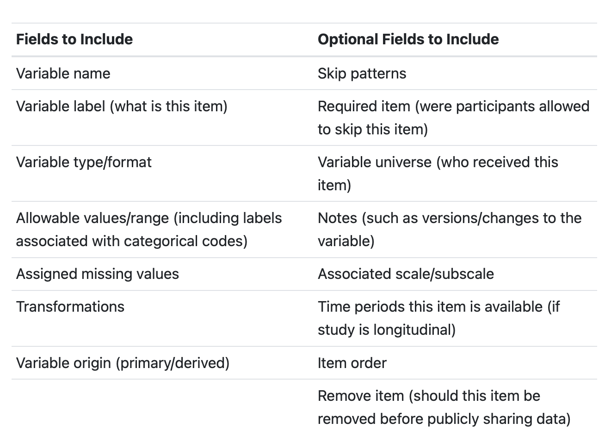

:::{.notes}
When we think about data management, I think this is most likely the first type of documentation that pops into people's minds. Variable-level documentation tells us all pertinent information about the variables in our datasets: Variable names, descriptions, types, and allowable values. While this documentation is often used to interpret existing datasets, it can also serve many other vital purposes including guiding the construction of data collection instruments, assisting in data cleaning, or validating the accuracy of data. We will discuss this more throughout the chapters in this book.

8.4.1 Data dictionary
When to create: Documentation phase, sometimes the data capture phase for external datasets

A data dictionary is a rectangular formatted collection of names, definitions, and attributes about variables in a dataset (Gonzales, Carson, and Holmes 2022; UC Merced Library 2023). This document is most useful if created during the documentation phase and used throughout a study for both planning and interpretation purposes (see Figure 8.15) (Lewis 2022a; Van Bochove, Alper, and Gu 2023).

A data dictionary is typically structured so that each row corresponds to a variable in your dataset, and each column represents a field of information about that variable (Broman and Woo 2018; Grynoch 2024). There are several necessary fields to include in a data dictionary, as well as several optional fields (see Table 8.1).

You should build one data dictionary for each instrument you plan to collect, including both original data collection instruments and external data sources (e.g., student education records). If there are five data sources in your data sources catalog, you should end up with five data dictionaries.

Codebooks provide descriptive, variable-level information as well as univariate summary statistics which allows users to understand the contents of a dataset without ever opening it. Unlike a data dictionary, a codebook is created after your data is collected and cleaned, and its value lies in data interpretation and data validation.

The codebook contains some information that overlaps with a data dictionary, but is more of a summary document of what actually exists in your dataset (ICPSR 2011) (see Table 8.2).
:::

# Style Guide

---

## Style Guide

- A style guide provides general rules for the formatting of information.

:::{.notes}
- A style guide provides general rules for the formatting of information. As mentioned in Chapter 8, style guides can be created to standardize procedures such as variable naming, variable value coding, file naming, file structure, and even coding practices.
- Style guides create standardization within and across projects. The benefits of using them consistently include:
  - Creating interoperability: This allows data to easily be combined or compared across forms or time.
  - Improving interpretation: Consistent and clear structure, naming, and coding allows your files and variables to be findable and understandable to both humans and computers. This in turn prevents errors such as accidentally using the wrong file or incorrectly interpreting a variable.
  - Increasing reproducibility: If the organization of your file paths, file naming, or variable naming constantly change, it undermines the reproducibility of any data management or analysis code you have written.
Style guides can be created for individual projects, but they can also be created at the team level, to be applied across all projects. Most importantly, they should be created before a project kicks off so you can implement them as soon as your project begins. If you do not have a team-wide style guide already created, you most likely will want to create a project-level style guide during your planning phase so that you can begin setting up your directory structures and file naming standards before you start creating and saving project-related files.

Style guides can be housed in one large document, with a table of contents used to reference each section, or they can be created as separate documents. Either way, style guides should be stored in a central location that is easily accessible to all team members (such as a team or project wiki), and all team members should be trained, and periodically retrained, on the style guide to ensure adherence to the rules. If all team members are not consistently implementing the style guide, then the benefits of the guide are lost.
:::

---

## General good practices

1. Avoid spaces.
2. With the exception of (_) and (-), avoid special characters.
3. Pick a naming convention.
4. Character length matters.

:::{.notes}
Before we dive into particular types of style guides, there are a few things to know about how computers read names in order to understand the “why” behind some of these practices.

Avoid spaces.
Command line operations and some operating systems do not support them, so it is best to avoid them all together. Furthermore, they can often break a URL when shared.
The underscore (_) and hyphen (-) are generally good delimiters to use in place of spaces. An exception to this rule is denoted in Section 9.4.
With the exception of (_) and (-), avoid special characters.
Examples include but are not limited to ?, ., *, \, /, +, ', &, ".
Computers assign specific meaning to many of these special characters.
There are several existing naming conventions that you can choose to add to your style guide. Different naming conventions may work better for different purposes. Using these conventions help you to be consistent with both delimiters and capitalization, which not only makes your names more human-readable but also allows your computer to read and search names easier.
Pascal case (ScaleSum)
Snake case (scale_sum)
Camel case (scaleSum)
Kebab case (scale-sum)
Train case (Scale-Sum)
Character length matters. Computers are unable to read names that surpass a certain character length. This applies to file paths, file names, and variable names. Considerations for each type of limit are reviewed below.
:::

---

## Directory structure

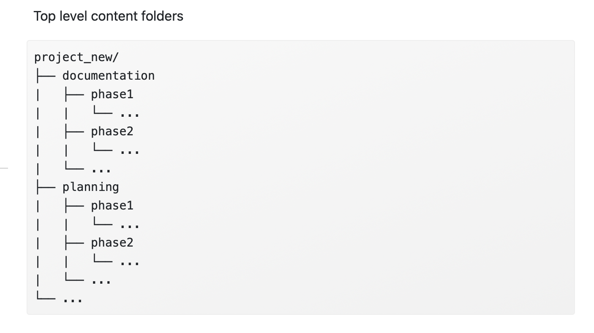

:::{.notes}
First, consider organizing your directory into a hierarchical folder structure to clearly delineate segments of your projects and improve searchability.
The alternative to using a folder structure is using metadata and tagging to organize and search for files (Cakici 2017; Fuchs and Kuusniemi 2018; Krishna 2018).
When creating your folder structure, strike a balance between a deep and shallow structure.
Too shallow leads to too many files in one folder which is difficult to sort through.
Too deep leads to too many clicks to get to one file, plus file paths can max out with too many. characters. A file path includes the full length of both folders and file name.
An example file path with 73 characters W:\team\project_new\data\wave1\student\survey\pn_w1_stu_svy_clean_v02.csv
Examples of file path limits:
SharePoint/OneDrive path limit is 400 characters (Microsoft 2023)
Windows path limit is 260 characters (Ashcraft 2022)
Create folders that are specific enough that you can limit access.
For example, you will want to limit user access to folders that hold personally identifiable information (PII).
To protect any files that you don't want others to accidentally edit (for example your clean datasets), also consider making some files “read only”.
Decide if you want an “archive” folder to move old files into or if you want to leave previous versions in the same folder.
Ultimately, create a structure that is consistently applied.
For example, if your project includes three phases of an intervention, consider creating “phase” folders at the top of your directory with content folders under each or creating content folders at the top of your directory and with phase folders in each. Do not mix and match methods. This leads to confusion when searching for files.
:::

---

## Naming folders

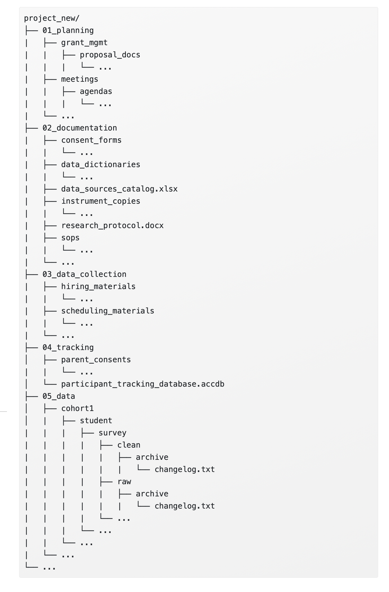

:::{.notes}
Consider setting a character limit on folder names (again to reduce problems with hitting path character limits).
Make your folder names meaningful and easy to interpret.
Don't use spaces in your folder names.
Use (_) or (-) to separate words.
With the exception of (-) and (_), don't use special characters in your folder names.
Be consistent with delimiters and capitalization. Follow an existing naming convention (as mentioned in Section 9.1).
If you prefer your folders to appear in a specific order, add the order number to the beginning of the folder name, with leading zeros to ensure proper sorting (01_, 02_). 
:::

---

## File naming

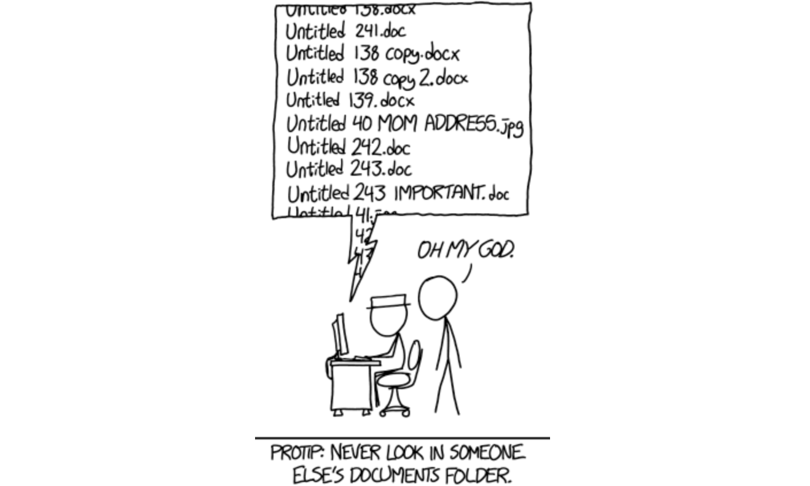

:::{.notes}
As seen in Figure 9.2, naming files in a consistent and usable way is hard. We are often in a rush to save our files and maybe don't consider how unclear our file names will be for future users (including ourselves).

Our file names alone should be able to answer questions such as:

What are these documents?
When were these documents created?
Which document is the most recent version?
A file naming style guide helps us to name files in a way that allows us to answer these questions. You can have one overarching file naming guide, or you may have file naming guides for different purposes that need different organizational strategies (e.g., one naming guide for project meeting notes, another naming guide for project data files). Let's walk through several conventions to consider when naming your files.

Make names descriptive (a user should be able to understand the contents of the file without opening it).
No PII should be used in a file name (e.g., participant name).
Never use spaces between words.
Use (-) or (_) to separate words.
It is worth noting that underscores may be difficult to read when file paths are shared in links that are underlined to denote that the path is clickable (for example when sharing a SharePoint link to a document).
With the exception of (_) and (-), never use special characters.
Be consistent with delimiters and capitalization. Follow an existing naming convention (see Section 9.1).
Consider limiting the number of allowable characters to prevent hitting your path limit.
For instance, Harvard Longwood Research Data Management (2023) recommends keeping file names to 40-50 characters.
Format dates consistently and do not use forward slashes (/) to separate parts of a date. It is beneficial to format dates using the ISO 8601 standard in one of these two ways (International Organization for Standardization 2017):
YYYY-MM-DD or YYYYMMDD
Using the ISO 8601 standard ensures that dates are consistently formatted and correctly interpreted (e.g., “06-01-2023” is interpreted as DD-MM-YYYY in Europe, while it is often interpreted as MM-DD-YYYY in the U.S.).
While using delimiters between parts of the date adds characters to your variable names, it also may be clearer for users to interpret. Either of these date formats will be sortable.
When manually versioning file names (see Section 8.3.2), pick a consistent indicator to use.
One method is to add a number to the file name. Using this method, consider left padding single numbers with a 0 to keep the file name the same length as it grows (v01, v02).
Another method is to add a date to the file name, using the ISO 8601 standard.
If your files need to be run in a sequential order, add the order number to the beginning of the file name, with leading zeros to ensure proper sorting (01_, 02_).
Choose abbreviations to use for common phrases (student = stu).
This helps reduce file name character lengths and also creates standardized, searchable metadata, which can allow you to more easily, programmatically retrieve files (for example, retrieve all files containing the phrase “stu_obs_raw”).
Keep redundant metadata (information) in the file name.
This reduces confusion if you ever move a file to a different folder or send a file to a collaborator. It also makes your files searchable.
For example, always put the data collection wave in a file name, even if the file is currently housed in a specific wave folder, always put the project acronym in the file name, even if the file is currently housed in a project folder, or always put the word “raw” or “clean” in a data file name, even if the file is housed in a “raw” or “clean” folder.
Choose an order for file name metadata (e.g., project -> time -> participant -> instrument).
:::

---

## Variable naming

- Don't use spaces or special characters, except (_).

:::{.notes}
- Don't name a variable any keywords or functions used in any programming language (such as if, for, repeat) (R Core Team 2023; Stangroom 2019).
Set a character limit.
- Most statistical programs have a limit on variable name characters.
SPSS is 64
Stata is 32
SAS is 32
Mplus is 8
R is 10,000
- With this said, do not limit yourself to 8 characters based on the fact that one future user may use a program like Mplus. Consider the balance between character limit and interpretation. It is very difficult to make good human-readable variable names under 8 characters. It is much easier to make them under 32. Also, most of your users will be using a program with a limit of 32 or more. If you have one potential Mplus user, they can always rename your variables for their specific analysis.
- Don't use spaces or special characters, except (_). They are not allowed in most programs.
- Even the (-) is not allowed in programs such as R and SPSS as it can be mistaken for a minus sign.
While (.) is allowed in R and SPSS it is not allowed in Stata so it's best to avoid using it.
Do not start a variable name with a number. This is not allowed in many statistical programs.
Do not embed indicator information into variable names.
Cohort, treatment, site, or other grouping information should be added as its own variable in a dataset, not embedded into variable names. This allows your data to be combined across groups as needed.
All variable names should be unique.
This absolutely applies to variables within the same dataset, but it should also apply to all variables across datasets within a project (e.g., across a teacher survey and a student survey). The reason is, at some point you may merge data across forms and end up with identical variable names (which programs will not allow).
The exception to this rule is if you are collecting the same variables across time. In this case, identical variables should be named consistently across waves of data collection to allow easier comparison of information.
If an item is named `anx1` in the fall, name that same item anx1 again in the spring (see Section 9.4.1 for a discussion on accounting for time).
If you substantively change an item (substantive wording OR response options change) after at least one round of data has been collected, version your variable names to reduce errors in interpretation.
For example, revised `anx1` becomes `anx1_v2`.
:::

## References

