## Evals rule everything around me

---

## Overview {.smaller}

- AI use brings risk of catastrophic failures:
  - Lawyers using AI, submit documents containing hallucinations.
  - Air Canada found liable for misleading information provided by its chatbot.
  - Chatbot encouraging self-harm.
- Evaluation is the biggest hurdle to adoption.
  - Evaluation must be considered at the system level.
  - To mitigate risks, first identify the places where the system is likely to fail and design evaluations around them.

---

## Challenges {.smaller}

- As AI systems become more capable, it is more difficult to evaluate them.
- Open-ended nature of Foundation Models (FM) undermines the Machine Learning (ML) approach of comparing against a ground truth.
- Black-box models: model providers do not expose model details or app developers are not experts in FM.
- Benchmarks saturate quickly: a benchmark becomes "saturated" for a model when it achieves the perfect score.
- And, of course, scope quickly expands because we want to evaluate not just performance on known tasks, but also discovery and performance of new tasks.
- We need systematic evaluation pipelines.

---

## Part I: What a benchmark is

---

## Progress depends on the instruments we use to measure it {.smaller}

- Traditionally, machine learning (ML) models were trained for and tested on task-specific functions.
- For example, models were deliberately trained to perform visual recognition and object classification in the ImageNet challenge [@russakovsky2015] and movie recommendation in the Netflix Prize contest [@bell2010].
- @brown2020 found that sufficiently large transformer models that were trained only on next-token prediction could perform competitively with fine-tuned state-of-the-art (SOTA) models on tasks that were not in their training data.
- Today, LLMs are used as search engines, office assistants, and personal tutors.

---

## What is a benchmark? {.smaller}

- In machine learning (ML), standard benchmarks are measurement instruments consisting of queries with corresponding ground truth answers and an evaluation metric for model performance across different tasks [@Raji2021].
- Traditionally, LLM benchmarks are designed to test specific capabilities, such as summarizing documents (`SummEval` [@fabbri2021]; `UserSumBench` [@wang2024]) and coding (`SWE-bench` [@jimenez2024]; `Terminal-Bench` [@merrill2026]).
- LLM benchmarks also intend to compare models through objective metrics [@Raji2021], allowing for the quantitative tracking of LLM progress, the ranking of models by performance, and the identification of the most promising technologies to guide research efforts and general usage [@zhu2025].

---

## What is a benchmark? {.smaller}

- Following @Raji2021, we define a benchmark 'as a particular combination of a dataset or sets of datasets [...], and a metric, conceptualized as representing one or more specific tasks or sets of abilities, picked up by a community of researchers as a shared framework for the comparison of methods'.
- Using benchmarks to facilitate comparison, measure performance, track progress, and identify weaknesses has become a standard practice.
- However, the fidelity of this approach depends entirely on the benchmarks' quality, where we define a high-quality benchmark as one that is interpretable, clear about its intended purpose and scope, and that is usable.

::: {.aside}
[@Reuel2024, pp. 1-2.]
:::

---

## The benchmark lifecycle

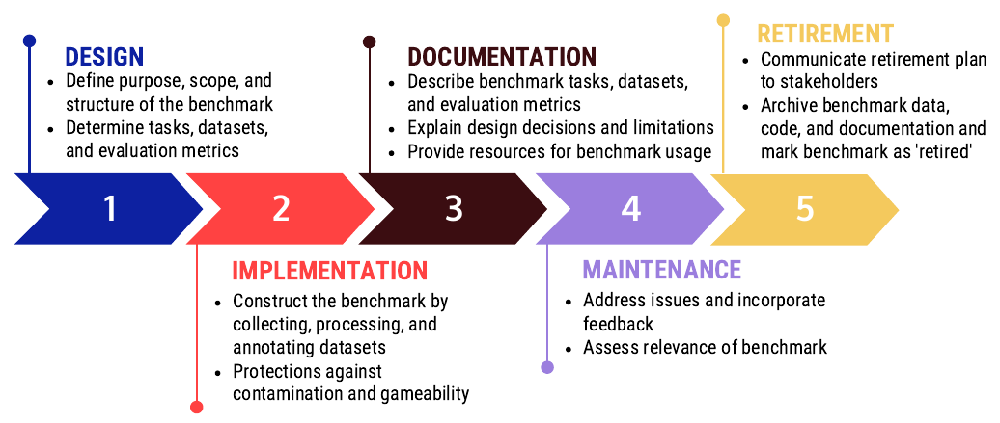{fig-align="center" height="380"}

::: {.aside}
[@Reuel2024, Figure 1, p. 2.]
:::

---

## From model evaluation to agent evaluation {.smaller}

- For much of the history of artificial intelligence (AI) and machine learning (ML) models, evaluation followed a simple template: query a model, collect its response, and compare that response against a given reference answer.
- However, with the advent of AI agents, evaluation has grown into a significantly more complex enterprise.
- Questions of interest for evaluation of AI agents today no longer implicate models alone, but rather expand to the larger systems around them, consisting of scaffolds (also referred to as 'agent harnesses'), tools, testing environments, and user interfaces.
- We use evaluation to describe works that 'measure, characterize, or analyze properties of AI models or systems.'

::: {.aside}
[@Chen2026, pp. 3 and 6.]
:::

---

## From model evaluation to agent evaluation

{fig-align="center" height="225"}

::: {.aside}
[@Chen2026, Figure 2, p. 7.]
:::

## Model cards {.smaller}

- Model cards—reports of newly released models published by model providers [@Mitchell2019]—are one way of understanding LLM performance at a point in time.
- While model cards summarize model performance across various capabilities, they do not account for model drift—the performance degradation of LLMs as data and language patterns, as well as domain-specific knowledge, change over time [@khairnar2025].
- As a result, model cards become outdated as new model versions are released and existing models are changed post-deployment.
- Beyond infrequent testing, model cards are published by model developers, reinforcing doubts about transparency and impartiality.

::: {.aside}
@GardenBench2026
:::

---


## Validity {.smaller}

> - Consider the example of a 'replay agent' for computer use—one that merely copies a single successful agent trajectory on a task and reproduces those exact actions.
> - It scores highly on certain benchmarks, even achieving higher success rates than agents powered by frontier models.
> - Does this higher success rate imply that the replay agent is better at computer-use reasoning than those of frontier models?
> - This example highlights the importance of *construct validity*, which asks to what extent a metric—in this case, success on various computer-use tasks—accurately represents the abstract concept (the 'construct') it claims to measure: computer-use capability.

::: {.aside}
[@Chen2026, pp. 8-9.]
:::

---

## Kinds of validity

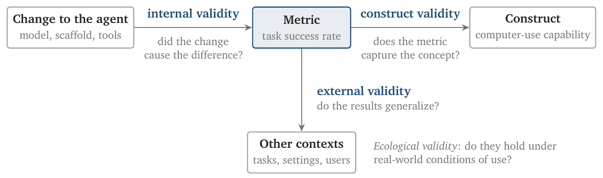{fig-align="center" height="300"}

::: {.aside}
[@Chen2026, Figure 4, p. 10.]
:::

---

## Poor construct validity {.smaller}

> - Construct validity refers to the degree to which a test or measurement tool accurately measures the construct it intends to measure.
> - Due to the difficulties with construct validity, most benchmarks cannot provide an absolute signal and instead give a relative one by comparison of models on the same benchmark.
> - Model developers report whichever benchmarks they see fit without being obligated to provide a rationale, resulting in inconsistent reporting, especially apparent in the case of benchmarks relating to responsible AI concepts.

::: {.aside}
[@Reuel2024, p. 10.]
:::

---

## Not all benchmarks are of the same quality {.smaller}

> - Model developers frequently report performance on benchmarks that vary significantly in quality.
> - For instance, the widely-used MMLU benchmark scored the lowest in our assessment (weighted average: 5.5), while GPQA scored significantly higher (weighted average: 11.0).
> - However, recent communications introducing models like GPT-4, Claude-3, and Gemini report results on both benchmarks without explicitly acknowledging their limitations or quality differences.
- The lack of clear guidance on AI benchmark quality and limitations may lead to incorrect conclusions about a model's performance, even if developers do not intend to mislead users.

::: {.aside}
[@Reuel2024, pp. 8-9.]
:::

---

## Not all benchmarks are of the same quality

{fig-align="center" height="260"}

::: {.aside}
[@Reuel2024, Figure 7, p. 8.]
:::

---

## Most benchmarks fail to distinguish signal and noise {.smaller}

> - Benchmark developers should not only report a single result for a model but also re-run their evaluation with, e.g., different random seeds or sampling temperatures, and report the mean and variance for these intra-model evaluations.
> - As benchmarks are primarily used to compare models, users must know the intra-model variance of a benchmark to determine whether observed inter-model variances are genuine performance differences or arise from noisy results.
> - Yet, 14 out of 24 benchmarks did not perform multiple evaluations of the same model or report statistical significance or uncertainty of results.

::: {.aside}
[@Reuel2024, p. 9.]
:::

---

## Saturation

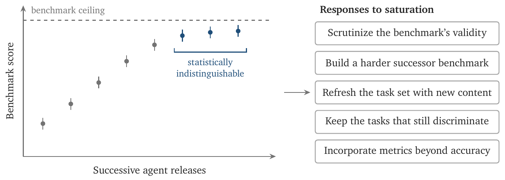{fig-align="center" height="330"}

::: {.aside}
[@Chen2026, Figure 5, p. 11.]
:::

:::{.notes}
- "*Saturation* refers to when a benchmark can no longer reliably distinguish between the performance of different agents."
- "Saturation can be evidence of genuine progress in underlying capabilities, while also offering an opportunity for introspection and iteration on a benchmark and to identify validity issues."
- "Benchmarks have touted how 'impossible' their tasks are, while simultaneously overclaiming on the construct a benchmark intends to represent."
- "Benchmarks are also not immune to the pressure to publish first—among similar benchmarks, the first one to be released has a strong advantage in adoption by the community."
:::

---

## Part III: Building evals

---

## Evaluation pipelines

- Why pipelines matter
  - Evaluation should not be one-off project but a continuous process.
  - Pipelines ensure reliable tracking of progress over time by combining automatic evaluation with human or AI-judge oversight.
  - Pipelines help identify risks, failures, and opportunities for improvement.

::: {.aside}
[@Huyen2025; @DSI2026]
:::

---

## Designing an evaluation pipeline

1. Evaluate all components: per task, per turn, per step.
2. Create clear guidelines and rubrics tied to business metrics.
3. Define evaluation methods and datasets: exact, subjective, human-in-the-loop.
4. Validate the pipeline: reliability, bootstrap resampling, significance tests.

::: {.aside}
[@Huyen2025; @DSI2026]
:::

---

## Evaluation doesn't have to be fancy

```
Look at this bookshelf photo. Give me a bulleted list of these books, in order, \
from top to bottom, left to right within each shelf. Return a markdown list with \
a dash, then the author's surname, comma, then first name, comma, then the title of the book
in double quotes. \
If you don't know what the book is, then put unknown. Do not include any other text,
explanations, or commentary.

Format each line as:
- Surname, First Name, "Title"
```

---

## 46 best practices {.smaller}

> - In this paper, we develop an assessment framework considering 46 best practices across an AI benchmark's lifecycle and evaluate 24 AI benchmarks against it.
>- We find that there exist large quality differences and that commonly used benchmarks suffer from significant issues.
- "We further find that most benchmarks do not report statistical significance of their results nor allow for their results to be easily replicated."
- "To support benchmark developers in aligning with best practices, we provide a checklist for minimum quality assurance based on our assessment."

::: {.aside}
@Reuel2024, p. 1.
:::

---

## Benchmark design {.smaller}

<!-- BB, Figure 2 and Section 4.1, p. 5 -->

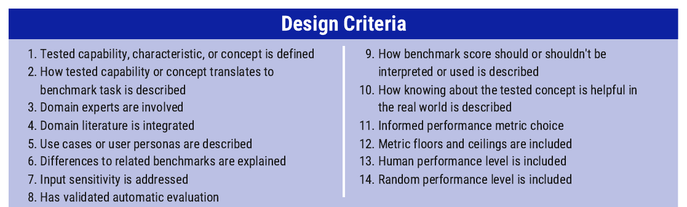{fig-align="center" width="1000"}

- "Benchmarks should clearly describe their goals and scope."

::: {.aside}
@Reuel2024, Figure 2, p. 5.
:::

:::{.notes}
- "A benchmark's measurements must be interpretable, which requires an informed choice of performance metric(s) and a description of how the benchmark score should or shouldn't be interpreted."
- "This includes defining the tested capability or characteristic, describing how the tested capability translates to the benchmark task, and stating how knowing about the tested concept is helpful in real-world applications."
- "Including floors, ceilings, human performance levels, and random performance levels for the chosen metric(s) further assists users in understanding a model's score."
:::

---

## Benchmark implementation {.smaller}

<!-- BB, Figure 3 and Section 4.2, pp. 5-6 -->

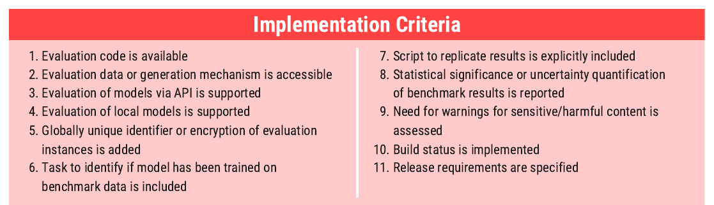{fig-align="center" width="1000"}

- "A script should be available to replicate initial published results."

::: {.aside}
@Reuel2024, Figure 3, pp. 5-6.
:::

:::{.notes}
- "To ensure reproducibility and scrutiny, a benchmark should provide working evaluation code, and make its evaluation data, prompts, or dynamic test environment accessible."
- "Criteria in the implementation stage focus on the availability of necessary code and infrastructure and the inclusion of key engineering features."
- "Including a training_on_test_set task allows determining whether a model's training data included benchmark examples."
:::

---

## Benchmark documentation {.smaller}

<!-- BB, Figure 4 and Section 4.3, p. 6 -->

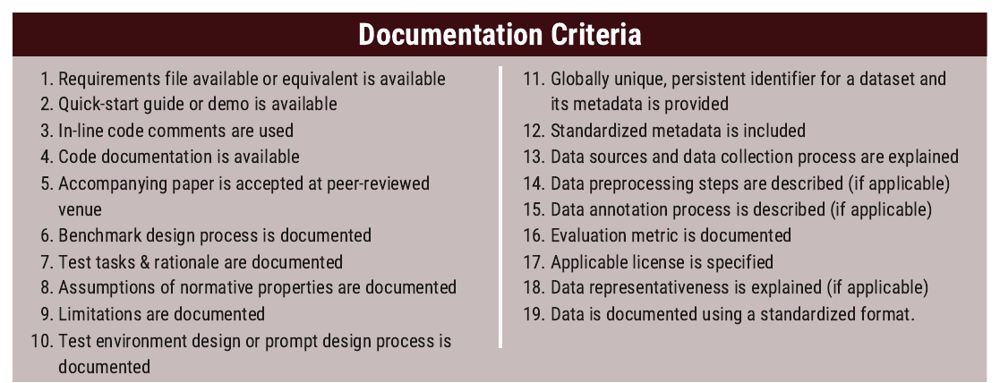{fig-align="center" width="1000"}

::: {.aside}
@Reuel2024, Figure 4, p. 6.
:::

:::{.notes}
- "Providing comprehensive and accessible documentation is crucial for the practicability and interpretation of benchmarks."
- "To provide context and prevent misinterpretation, developers should document normative assumptions about benchmark properties and discuss the limitations of their benchmark."
- "Clearly documenting evaluation metric(s) and reporting the statistical significance of results is necessary so that users can understand a benchmark's actual signal."
- "Lastly, developers should specify the applicable license to provide legal clarity and enable, e.g., commercial use."
:::

---

## Benchmark maintenance {.smaller}

<!-- BB, Figure 5 and Section 4.4, p. 6 -->

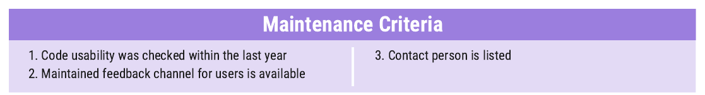{fig-align="center" width="1000"}

- "An optimally designed, implemented, and documented benchmark will cease to be useful if it is not maintained."
- "Developers should regularly check code usability and maintain a feedback channel for users to report issues or suggest improvements."
- "Alternatively, if a benchmark is not maintained anymore, authors should include a corresponding statement indicating that the benchmark was retired in any official benchmark artefacts."

::: {.aside}
@Reuel2024, Figure 5, p. 6.
:::

---

## A checklist for benchmark developers {.smaller}

<!-- BB, Appendix I and Appendix H, p. 26. The README lists benchmark cards. BetterBench does not use that term: it has this checklist, and mentions data cards for datasets (p. 3). The assignment defines the benchmark card as one page that follows this checklist. -->

- "In this section, we provide the assessment criteria as a checklist for benchmark developers to use during their benchmark construction process, pre-deployment of the benchmark."
- "On the website, we will further provide an easy-to-fill-out checklist in LaTeX and .doc format that can be easily included as part of any benchmark documentation."
- "Benchmark developers acknowledge that our checklist is a minimum quality assurance and not sufficient for high-quality benchmark construction."

::: {.aside}
@Reuel2024, p. 26.
:::

---

## Scoring a benchmark against the criteria {.smaller}

<!-- BB, Section 3, Step 4 and Step 5, p. 4 -->

- "We scored benchmarks on a discrete 0/5/10/15-point scale for each criterion: 15 for fully meeting, 10 for partially meeting, 5 for mentioning without fulfilling, and 0 for neither referencing nor satisfying the criterion."
- "At least two authors independently reviewed each benchmark."
- "We consider a mean score of 10 or higher to indicate a reasonably good benchmark for each aggregated scoring category, as it signifies that, on average, the benchmark at least partially fulfills all assessment criteria within the respective category."

::: {.aside}
@Reuel2024, p. 4.
:::

---

## Scores by lifecycle stage {.smaller}

<!-- BB, Figure 6, Table 1, and Section 6, pp. 7-8; second note from Section 7, p. 9 -->

:::: {.columns}

::: {.column width="42%"}
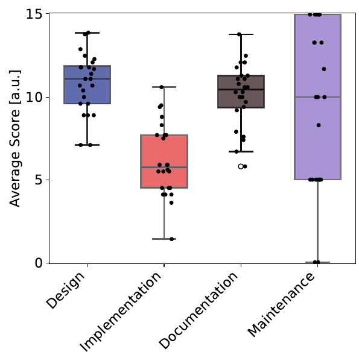{height="330"}
:::

::: {.column width="58%"}
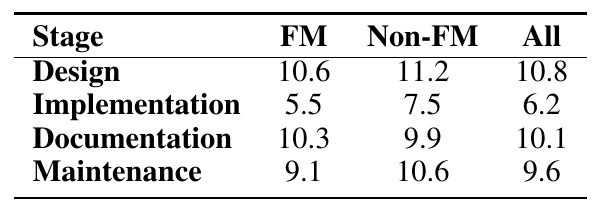{width="430"}

- "Tab. 1 showcases the average scores per benchmark lifecycle stage, showing that for both FM and non-FM benchmarks, the implementation stage tends to be the weakest area, followed by maintenance."
:::

::::

::: {.aside}
@Reuel2024, Figure 6 and Table 1, pp. 7-8.
:::

:::{.notes}
- "Notably, both benchmark types are particularly weak for criteria supporting the reproducibility and interpretation of results: benchmarks get an average score of 3.75 on *Including a script to replicate results* and an average score of 5.62 on *Reporting statistical significance*."
- "Notably, 17 out of 24 benchmarks do not provide easy-to-run scripts to replicate the results reported in the initial paper, and 4 out of 24 only provide scripts to replicate part of the results."
:::

---

## Other design considerations {.smaller}

<!-- BB, Section 5, p. 7 -->

- "**Detecting small improvements.** Benchmarks should be designed so that a 1% improvement can be reliably detected."
- "**Versioning.** Minor updates (e.g., removing faulty prompts) should be clearly indicated via task versioning."
- "**Dynamic vs. static benchmarks.** Dynamic benchmarks may better address quick saturation and contamination issues but reduce result comparability and are easier to implement for some tasks (e.g., adding numbers) than others."
- "**Gameability.** An ideal benchmark is resilient to attempts to boost task performance without improving the fundamental capability being tested."

::: {.aside}
@Reuel2024, p. 7.
:::

:::{.notes}
- "**General vs. specific benchmarks.** Benchmark developers must decide whether to prioritize general or abstract knowledge and skills or specific contexts and domains."
- "Practically, this is likely dependent on evaluation data size and task diversity."
:::

---

## Items: developing testing suites {.smaller}

<!-- GB, Data and methods, "Developing testing suites", paragraphs 2 and 3 -->

- Our benchmark consists of 107 individual tests organized into 11 distinct testing suites.
- Tests in the same suite either evaluate LLMs on variations of the same task or multiple closely related but distinct tasks.
- For instance, the *Birds* suite consists of 10 instances of the same task: "Identify the species of the bird shown in this image."
- Conversely, the *Books* suite contains single instances of 9 different tasks, all of which ask the LLM to extract different information from a photograph of a bookshelf, such as the title and author of one of the books).

::: {.aside}
@GardenBench2026
:::

:::{.notes}
- We distinguish between image- and text-based suites because some of the models we evaluated, such as DeepSeek, were not natively capable of image processing.
- Similarly, sound-based tasks were initially considered (for example, recognizing songs from audio recordings), but ultimately discarded as few models in 2026 natively support audio file processing.
- As we evaluate model capabilities without tool use, audio-based tasks were not feasible.
:::

---

## Items: the suites {.smaller}

<!-- GB, tbl-suites -->

::: {style="font-size: 50%;"}

| Suite Name | Number of Tests | Input Type | Task Description |
|:---|---:|:---|:---|
| Birds | 10 | Image | Identify the species of bird from its image |
| Books | 9 | Image | Identify information from an image of a bookshelf. |
| Clothes | 10 | Image | Identify information from an image of a wardrobe. |
| Colours | 12 | Image | Identify paint types and colour mixtures from an image of a paint palette. |
| Countries | 11 | Image | Identify the country from an image of its silhouette. |
| Graphs | 10 | Image | Identify the equation of the derivative from a graph of a simple function. |
| Transit | 10 | Image | Identify information from a map of a transit system. |
| Ciphers | 10 | Text | Decode a word transformed with a cipher. |
| Haystack | 8 | Text | Identify a target string within a large corpus of text. |
| Puzzles | 12 | Text | Solve logical puzzles. |
| Self-Check | 5 | Text | Answer questions about self. |

: Set of suites considered in our study with their reference names, number of tests they contain, and a one-sentence task description.

:::

::: {.aside}
@GardenBench2026
:::

---

## Items: what the suites test {.smaller}

<!-- GB, Data and methods, "Developing testing suites", paragraph 4 -->

- Our suites represent diverse ordinary tasks that test a broad range of LLM capabilities while being effectively cost-efficient to run.
- The *Ciphers*, *Puzzles*, *Clothes*, *Transit*, and *Colours* suites test the model's ability to reason across different domains and based on different media input types.
- The *Countries* and *Birds* suites test base LLM knowledge, when access to tools such as web searching was restricted.
- The *Haystack* and  *Books* suites test information retrieval.
- We also included a *Self-Check* suite, where the LLM was prompted to return its own model slug, a string used to identify a specific model.

::: {.aside}
@GardenBench2026
:::

---

## Items: an example

<!-- GB, fig-example-prompt -->

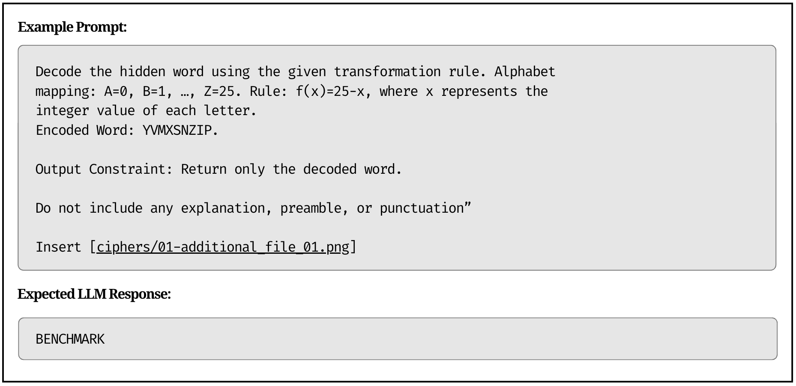{fig-align="center" height="350"}

::: {.aside}
@GardenBench2026
:::

---

## Items: an example

<!-- GB, Appendix A, Books -->

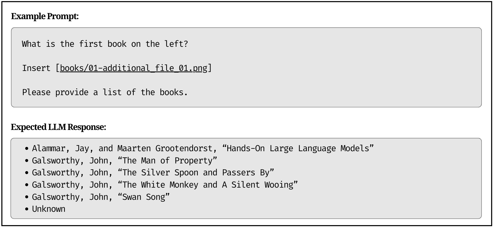{fig-align="center" height="350"}

::: {.aside}
@GardenBench2026
:::

:::{.notes}
- The Books test suite evaluates an LLM's capability to parse complex visual data and extract structured information from images.
- The dataset consists of photographs of unique bookshelves of varying sizes and book quantities, captured directly by one of the authors with ground-truth labels established manually.
- Designed to imitate tasks performed in professional library settings, the suite features varying levels of difficulty.
- It has also been provided a strict formatting structure, in order to enable the comparison of its result to a ground truth.
:::

---

## Ground truth {.smaller}

<!-- GB, Data and methods, "Developing testing suites", paragraphs 2 and 5 -->

- In our final collection of tasks, all correct answers could be found within the image or text in the prompt, meaning web searching was not required.
- We only considered tasks which could be evaluated on a binary pass or fail.
- Model responses were evaluated by comparing the model output to the test's ground truth, after trimming surrounding whitespace and ignoring letter case; any other deviation was marked incorrect.
- Moreover, prompts each demanded a specific response structure from the LLM with no pleasantries, throat clearing, or other excess communication.

::: {.aside}
@GardenBench2026
:::

:::{.notes}
- Our objective in this approach was to evaluate raw LLM capabilities without the support of external resources.
- This makes the results of `GardenBench` easily interpretable.
- In addition, models were only given a single chance to respond and example responses were not provided in the prompts.
- This zero-shot prompting style is intended to emulate how a human with a quick question would interact with an LLM.
- Therefore, our approach simplifies evaluation, making results easily conceivable to broad LLM users without sacrificing depth of analysis.
:::

---

## Ground truth: how it is made {.smaller}

<!-- GB, Appendix A: Puzzles, Self Check, Colours -->

- The puzzles and corresponding solutions were programmatically generated and verified by adapting the open-source TruthQuest framework [@mondorf2024liar].
- Ground truths are set per model from the benchmark configuration.
- The model's generated color list is compared directly against a ground-truth list of the exact color names, alphabetized for consistency.
- The dataset consists of photographs of unique bookshelves of varying sizes and book quantities, captured directly by one of the authors with ground-truth labels established manually.

::: {.aside}
@GardenBench2026
:::

---

## Exact evaluation

<!-- Rotman p. 55 -->

- Exact evaluation: produces a judgement or assessment without ambiguity. Two approaches are:
  - Functional correctness:
    - Similar to unit testing in software engineering, functional correctness tests aim to assess if the system works as intended.
    - Evaluate the system based on whether it performs the intended functionality.
  - Similarity to references

---

## Evaluating test cases {.smaller}

<!-- Rotman p. 56 -->

- For each problem, k code samples are generated.
  - A model solves a problem if any of the k code samples it generated pass all of that problem's test cases.
  - The score pass@k is the ratio of solved problems to total number of problems.
- For example, a model that solves 5 out of 10 tests problems with 3 generated code samples each has a pass@3 score of 50%.
- [Discussion] What is an example of a task in your own work that you would want a pass@1 of 100%, what about pass@10 with 50%?

---

## pass@1, pass@k, and pass∧k

<!-- Chen, Figure 7 and Section 1d, p. 13 -->

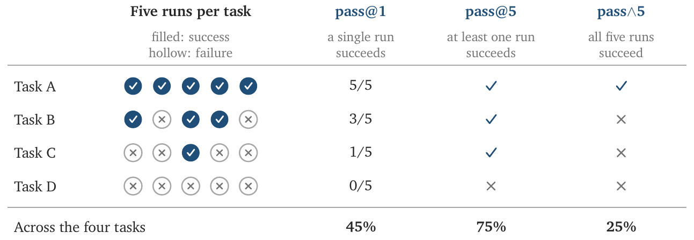{fig-align="center" height="300"}

::: {.aside}
@Chen2026, Figure 7, p. 13.
:::

:::{.notes}
- "Pass@k represents the probability of 'success' at least once within k attempts."
- "In contrast, pass∧k quantifies consistency in task success by representing the probability of success over all k runs."
:::

---

## Exact Evaluation: Similarity Measurements Against Test Data {.smaller}

<!-- Rotman p. 57 -->

- The approach is to evaluate AI's outputs against reference data.
- Reference data is called ground truth or canonical responses.
- Metrics that require references are called referenced-based; metrics that do not require references are called reference-free.
- Four approaches:
  - i. Ask an evaluator.
  - ii. Exact match: generated response matches exactly the canonical response.
  - iii. Lexical similarity: how similar the generated response look like the reference responses.
  - iv. Semantic similarity: how similar are the meaning of generated and reference responses.

---

## Exact match

<!-- Rotman p. 58 -->

- The generated response matches exactly the reference response.
  - Works for tasks with short, exact responses, such as simple math, common knowledge, trivia-style questions.
  - Can take into account formatting differences. For example, a variation of exact match could evaluate if the reference response is contained in the generated response.
- Exact match is rarely useful beyond simple tasks.

---

## Lexical similarity

<!-- Rotman p. 59 -->

- Lexical similarity measure how much two texts overlap.
- A simple implementation: count number of tokens in common.
  - Reference: My cats scare the mice.
  - Response A: My cats eat the mice.
  - Response B: Cats and mice fight all the time.
- Assuming one word per token, response A has 80% score (4/5) and response B has 60% (3/5).

---

## What exact match marks wrong {.smaller}

<!-- GB, Discussion, "Prompting and suite construction", paragraphs 1 and 3 -->

- Anthropic models returned reasoning frequently, despite being clearly instructed not to include additional text in their responses.
- On occasions where models returned additional text, even if the answer to the task was correct, answers were coded as incorrect.
- This is because our benchmark is not only checking that the models can perform the task correctly by providing the right answer, but also evaluating whether the models are able to follow specific instructions by returning outputs that followed a structured schema specified in the prompt.
- The most common error in the *Birds* suite was that most models correctly identified the Genus of the bird, but got the Species wrong.
- This resulted in a completely incorrect answer, since we did not consider partial correctness.

::: {.aside}
@GardenBench2026
:::

:::{.notes}
- Asking for one-word responses, comma-separated lists, or binary answers also allowed us to simplify our evaluation method while preserving reliability and depth of analysis.
- On many occasions, models were able to correctly identify the book title but failed to identify the author.
- When models did not return an author name, it was given a failed grade.
:::

---

## Rubrics: the task {.smaller}

<!-- SH, Data and methods, "Task", paragraph 1 -->

- The task that we evaluate is based on a broad assignment given to third-year undergraduate statistics students.
- Students are expected to develop a research question that is of interest to them and then obtain or create a relevant dataset and put together a paper that answers it.
- They use `R` or `Python` to download, clean, and analyze the dataset, and then use Quarto to write a 5-20 page paper including graphs, tables, and references, that communicates their work and findings.
- Students are provided with a template repository, past examples, and the rubric by which they will be graded.
- The rubric has 28 items and a total of 112 points.

::: {.aside}
@Alexander2026Iterated
:::

:::{.notes}
- The expectation is that all of the analysis is reproducible and students submit a link to a GitHub repository with all their files.
- We present essentially the same set-up and broad task to the models although two items, hand-drawn sketches and a commit history, are removed from the rubric that the models are evaluated against, leaving 26 items and a total of 108 points.
- The data science task that we examine involves writing code to obtain, clean, test, and analyze data, and writing a paper to communicate the results.
- Many earlier benchmarks of data science agents gave the model a dataset and a task with a specific outcome, such as a numerical answer, a set of analysis decisions, or a Kaggle leaderboard score [@chen2025scienceagentbench; @chan2025mlebench; @jing2025dsbench], but real-world data science tends to be less clear-cut.
:::

---

## Rubrics: rubric summary {.smaller}

<!-- SH, Appendix, "Rubric summary" -->

- The rubric has 26 items, which could be collected into three groups, and the maximum number of points for each rubric item is in brackets.
- **Paper content (66 points)**
  - Abstract (4). About four sentences that say what was done, what was found, and why it matters.
- **Presentation (21 points)**
  - Captions (2). Every figure and table has a detailed and meaningful caption. 0 if the paper does not render.
- **Code and project quality (21 points)**
  - Tests (4). Extensive test suites for the simulated and the actual data, in separate scripts.

::: {.aside}
@Alexander2026Iterated
:::

---

## Rubrics: scoring

<!-- SH, Appendix, "Rubric summary", last two paragraphs; Data and methods, "Writer-grader interaction", paragraph 4 -->

- Four aspects result in a 0 overall: generating data in the paper, using a dataset from Kaggle, UCI, or Statistica, reading data directly from a provider's server in the paper, and any signs that the work is a class paper.
- A submission's score is its total of 108 as a percentage, rounded to a whole number.
- The rubric is strict and some breaches, such as using simulated rather than real data, even result in getting zero overall.

::: {.aside}
@Alexander2026Iterated
:::

---

## Rubrics: the grader {.smaller}

<!-- SH, Data and methods, "Writer-grader interaction", paragraph 4 -->

- The grader then receives the rubric, all the files that the writer created, and the execution report and returns a score and a comment for each rubric item.
- If a grade cannot be read, or there is a rubric item that does not have a mark, then the grader is given opportunities to address this, and if there is still not a mark for every rubric item, then the round's grade is considered unavailable.
- The score of a submission is worked out as a percentage, rounded to the nearest whole number.

::: {.aside}
@Alexander2026Iterated
:::

---

## Running the models: how they were prompted {.smaller}

<!-- GB, Data and methods, "Models" and "Developing testing suites" -->

- We evaluated the performance on our benchmark of 17 different models developed by 7 distinct providers.
- Models were prompted in Python using the @openai2026 package, through each provider's OpenAI-compatible chat completions endpoint.
- No temperature, seed, or token limit was set, so each provider's defaults applied.
- To support reliability and scalability, the exact same bytes were sent to each API.
- We put a 5-minute time-out on each test, meaning if the model took more than five minutes to complete a task, we deemed it a failure.

::: {.aside}
@GardenBench2026
:::

:::{.notes}
- The exact API string of each model is available in Appendix B.
- This set of models includes open- and closed-weight models developed in the U.S., Canada, and China.
- This decision is consistent with our motivations for `GardenBench`, since models that take over five minutes to respond to a simple task may not be effectively useful.
- Kimi K3 timed out most frequently, being unable to complete a task within 5 minutes around 16 percent of the time, followed by Kimi K2 at around 9 percent.
:::

---

## Running the models: the schedule {.smaller}

<!-- GB, Data and methods, "Evaluation schedule" -->

- This paper analyzes results obtained from running the benchmark from August 17, 2026 to August 31, 2026, with runs scheduled at 2:00AM Eastern Daylight Time (EDT) each day.
- All models were evaluated every day during this period, with two exceptions: Command A+ was evaluated on 11 of the 15 days, and Qwen 3.8 was added to the benchmark on August 28 and so was evaluated on only the final four days.
- A cumulative dataset of historic runs was automatically updated using the GitHub Actions workflow detailed in @deangelis2026.
- Our primary product is a publicly available live dashboard, where visualisations of daily `GardenBench` evaluations are updated and displayed every day.

::: {.aside}
@GardenBench2026
:::

---

## Running the models: research workflow

<!-- GB, fig-workflow -->

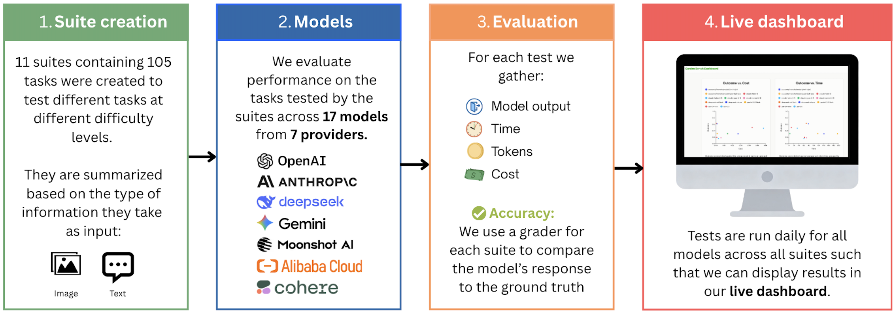{fig-align="center" height="370"}

::: {.aside}
@GardenBench2026
:::

---

## Running the models: the harness {.smaller}

<!-- SH, Introduction, footnote 1 -->

- For instance, given a goal and a set of tools, an agentic model may write a tool call.
- A harness, also called a scaffold [@wijk2024rebench], refers to all the software and set-up surrounding the model, for instance, to enable the tool call.
- So in agentic AI, the harness runs the call and appends the result to the context, and the model may then write another call from that longer context, and so on, until it eventually writes the call that ends the task [@yao2023react; @GrootendorstAlammar2026].

::: {.aside}
@Alexander2026Iterated
:::

---

## Running the models: writer, executor, grader

<!-- SH, fig-loop -->

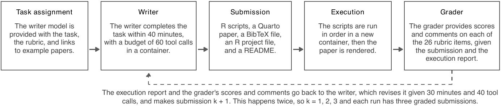{fig-align="center" height="300"}

::: {.aside}
@Alexander2026Iterated
:::

---

## Running the models: the writer {.smaller}

<!-- SH, Data and methods, "Writer-grader interaction", paragraph 2 -->

- The first step is that the writer creates a project of eleven files in a working directory.
- The writer has access to five tools. These are to run a shell command, write a file, read a file, list the files, and to end the session.
- A session ends when the writer ends it, when it has used its tool calls or its time, or when it replies without calling a tool, and the submission is the files in the directory at that point, but does not include the data that are used or the rendered output because everything is expected to be able to run and render in a new environment.

::: {.aside}
@Alexander2026Iterated
:::

:::{.notes}
- This includes `R` scripts for simulating, downloading, cleaning, testing, exploring, and analyzing the data, a Quarto file containing the paper, a BibTeX file for citations, an `R` project file, and a README.
- We provide them with a budget of 60 tool calls and a maximum of 40 minutes for the first round, and an additional 40 tool calls and 30 minutes for each of the subsequent two rounds.
:::

---

## Running the models: the executor {.smaller}

<!-- SH, Data and methods, "Writer-grader interaction", paragraph 3 -->

- The submission is then evaluated in a new container.
- The `R` scripts are run in filename order, and the paper is rendered with Quarto.
- A neutral executor evaluates whether the download and cleaning scripts exited without error and wrote at least one data file, whether the test and model scripts exited without error, and whether the Quarto file produced a PDF.
- A submission is considered to execute if the scripts run without errors and the paper renders.
- The executor produces a report that lists the five outcomes, each script's exit status and running time, and the error lines for any failed scripts or render.

::: {.aside}
@Alexander2026Iterated
:::

:::{.notes}
- These run inside a container that has R, Python, Quarto, and a wide range of packages.
- The container has network access, which is typically needed to download data.
- The execution report that the grader and the writer get is created by the harness and does not require a model call.
- The executor runs the submission in a new container, so nothing from the writer's session, apart from what is done in the code, persists.
:::

---

## Running the models: which model answered {.smaller}

<!-- SH, Data and methods, "Models", paragraph 2; Appendix, "Consistency of OpenRouter and developer APIs" -->

- We queried each model, apart from DeepSeek V4.1 Flash, using OpenRouter.
- We pinned our requests to the developer's own host and disabled fallback to other hosts.
- There is some concern that accessing the model via OpenRouter may give different results to using the model providers' APIs directly and so we re-graded some projects directly with the API from the relevant model provider.

::: {.aside}
@Alexander2026Iterated
:::

---

## Running the models: model, scaffold, and everything else {.smaller}

<!-- Chen, Section 1e, pp. 14-15 -->

- "Agent performance is jointly influenced by the model, scaffold, tool use, budget constraints, the environment, and how it is evaluated."
- "When several of these components change at once, a statistically significant impact on performance does not allow us to disaggregate which precise factors drove that change."
- "Identify and document clearly different components of an experimental setup—the models used, scaffolds paired, environments tested, prompts used, and the budget constraints."
- "When comparing agents, hold all but one component fixed such that any change in performance can be properly attributed."

::: {.aside}
@Chen2026, pp. 14-15.
:::

---

## Running the models: model, scaffold, and everything else

<!-- Chen, Figure 8, p. 14 -->

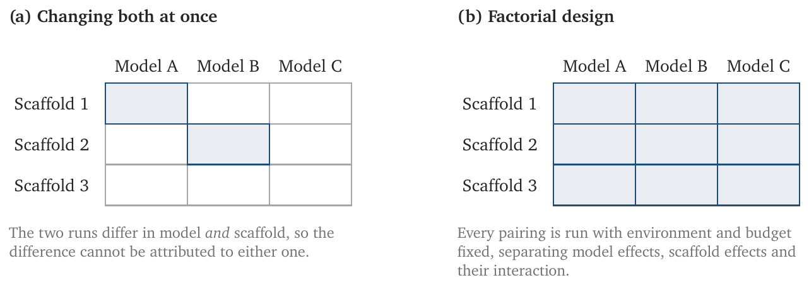{fig-align="center" height="295"}

::: {.aside}
@Chen2026, Figure 8, p. 14.
:::

---

## Evaluation metrics {.smaller}

<!-- GB, Data and methods, "Evaluation metrics" -->

- We begin by measuring aggregate performance comparatively across models and average accuracy by suite.
- First, we analyze the relationship between average dollar cost per test and accuracy to allow for direct and transparent comparison across models.
- Next, we evaluate model accuracy as a function of wall-clock time elapsed to solve tests.
- Lastly, we measure model accuracy against output token use to measure token efficiency as a separate function from cost.
- Cost and time were chosen as metrics with the broad community of LLM users in mind.

::: {.aside}
@GardenBench2026
:::

:::{.notes}
- This metric differs from price-per-token analysis, which is often used by model providers.
- One limitation of this approach is that it assumes all models output roughly the same number of tokens to solve a given problem in order to enable comparison.
- However, due to chain-of-thought reasoning, we find that some models output significantly more tokens than others to solve the same problem.
- For many people deciding which model to use for non-frontier applications, cost is an important constraint and is not often accounted for in existing benchmarks.
:::

---

## Metrics beyond accuracy {.smaller}

<!-- Chen, Section 1c, pp. 11-12 -->

- "Even if task success serves as a valid metric, it may only capture one dimension of agent performance."
- "*Cost*: how many credits or compute an agent consumes."
- "*Latency*: how long it takes for models (or agents) to return a response."
- "*Reliability*: a composite metric capturing how consistent, robust, and predictable an agent is."

::: {.aside}
@Chen2026, pp. 11-12.
:::

---

## Metrics beyond accuracy

<!-- Chen, Figure 6 and Section 1c, p. 12 -->

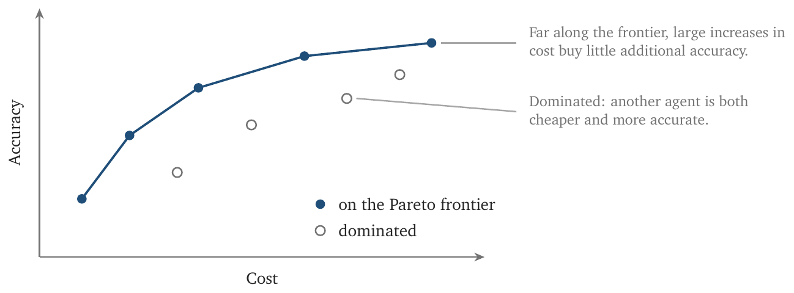{fig-align="center" height="330"}

::: {.aside}
@Chen2026, Figure 6, p. 12.
:::

:::{.notes}
- "They help evaluators visualize the tradeoffs involved, since maximizing on certain metrics such as accuracy alone can lead to unbounded cost."
- "This is especially relevant for agents, since cost variance can be much higher for agents than models alone."
:::

---

## Aggregate performance

<!-- GB, fig-overall-accuracy-by-model -->

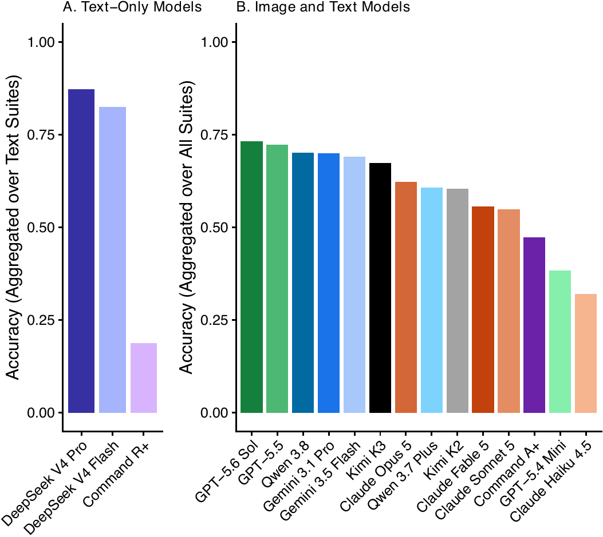{fig-align="center" height="370"}

::: {.aside}
@GardenBench2026
:::

:::{.notes}
- The highest performing model evaluated on the full benchmark was GPT-5.6 Sol, followed closely by GPT-5.5, which respectively achieved average per-suite accuracies of 73 percent and 72 percent during our evaluation period.
- As DeepSeek V4 Pro, DeepSeek V4 Flash, and Command R+ were not image-capable, they were only evaluated on text-based suites (4 of the 11 total suites) and are represented separately from the others.
:::

---

## Overall accuracy per suite

<!-- GB, fig-overall-accuracy-by-suite -->

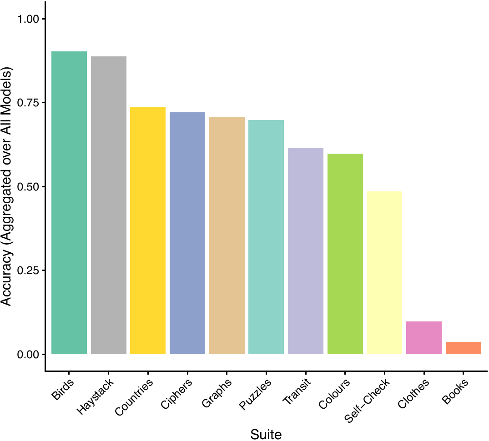{fig-align="center" height="320"}

::: {.aside}
@GardenBench2026
:::

:::{.notes}
- We observe variation in model performance on certain suites or groups of suites, suggesting that aggregated accuracy metrics are not necessarily representative of a model's specific capacities.
- Finally, the *Clothes* and *Books* suites were noticeably more challenging than the others, as models achieved an average accuracy of less than 15 percent.
:::

---

## Limitations and future directions {.smaller}

<!-- GB, Discussion, "Limitations and future directions" -->

- One limitation of our benchmark is that it involves text- and image-based prompting, even though 3 of our tested models (DeepSeek V4 Flash, DeepSeek V4 Pro, and Command-R+) were independently incapable of image processing.
- It is possible that the accuracy of these models may be overstated as they were evaluated on a reduced set of testing suites (4 suites instead of 11).
- Moreover, some testing suites varied in the number of tests included, which also could have influenced average accuracy representations.
- In addition, our tests restricted models from web searching in order to evaluate the raw capabilities of LLMs. However, Internet information retrieval is an important feature of LLMs that is necessary for common general-use prompts.

::: {.aside}
@GardenBench2026
:::

---

## Our approach has a number of weaknesses {.smaller}

<!-- SH, Discussion, last paragraph -->

- Firstly, the score measures how well a submission meets 26 explicit rubric items, and the writers are given the rubric and told that their submission is graded using it, so an increase may be the writer targeting the rubric, rather than an improvement in the underlying work.
- We also do not actually look at whether an analysis is right, but just focus on aspects such as whether the scripts run and the paper renders.
- We use LLM-as-a-judge and do not have humans review them.

::: {.aside}
@Alexander2026Iterated
:::

:::{.notes}
- Although this is fine for our particular setting where the rubric is important it does limit how this could generalize to situations without.
- It would be worth considering some aspect of analysis with a known outcome.
- It may be that a human would identify systematic weaknesses in the reviewer models and relatedly, we do not attempt to deliberately improve the graders with feedback from humans.
:::

---

## Limitations of the checklist {.smaller}

<!-- BB, Section 9, p. 10 -->

- "Our assessment assigns equal weight to all criteria, despite their varying levels of effort required for fulfillment and differing contributions to overall benchmark quality."
- "Given the equal weighting and scoring, benchmark developers could potentially 'game' the assessment by focusing on easily fulfilled criteria."
- "Furthermore, assessing the construct validity of a benchmark and determining whether its approach to assessing a concept is truly effective would presumably require in-depth analysis by domain experts in the respective fields, which is beyond the scope of this assessment."
- "Instead, we aim to provide benchmark developers with a blueprint for minimum quality assurances."

::: {.aside}
@Reuel2024, p. 10.
:::

---

## Continuous evaluation

<!-- Rotman p. 50 -->

- Evaluation should be performed during all stages of development.
  - Early tests can be simple (eyeballing, small benchmarks) but most tests must scale later.
- Over time, evaluation should become systematic and automated.
  - This enables faster iteration while maintaining reliability.
  - If you care about something, test it automatically.

::: {.aside}
@Huyen2025; @DSI2026
:::

---

## Group exercise [5 minutes writing; 1 minute presentations]

<!-- Rotman p. 48 -->

Who know's how the financial market is going? Who checks the S&P 500 most days? We need the equivalent for AI.

- Generate some ideas for some personal benchmarks
- Generate some private business benchmarks
- Could your business publish public benchmarks?

---

## References
