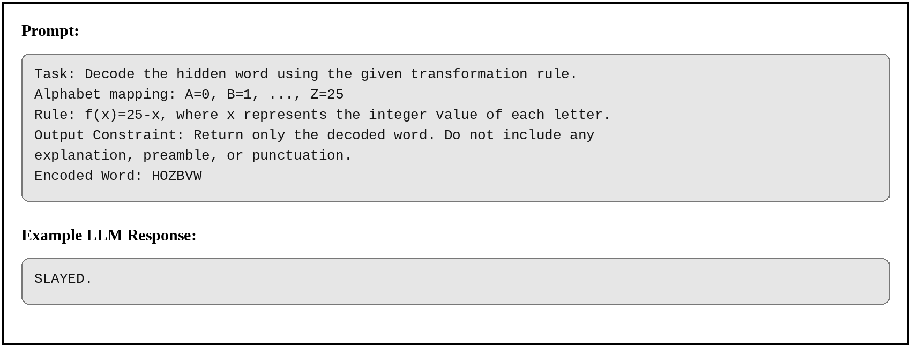
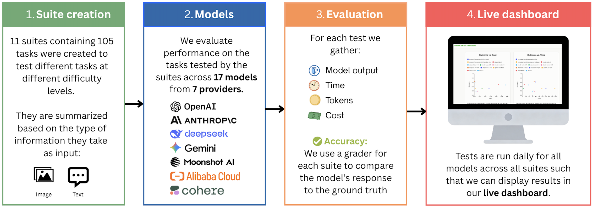
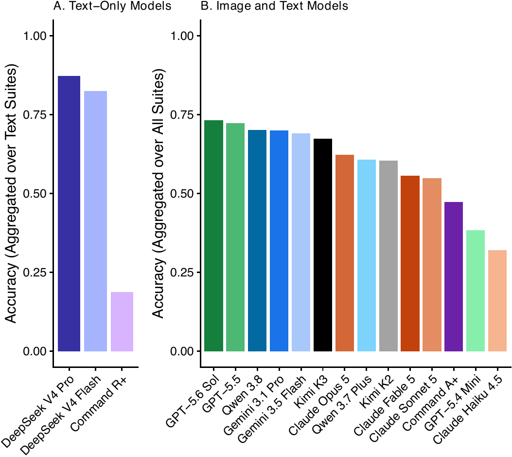
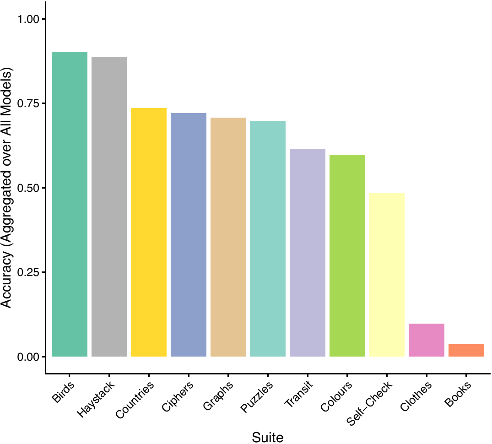
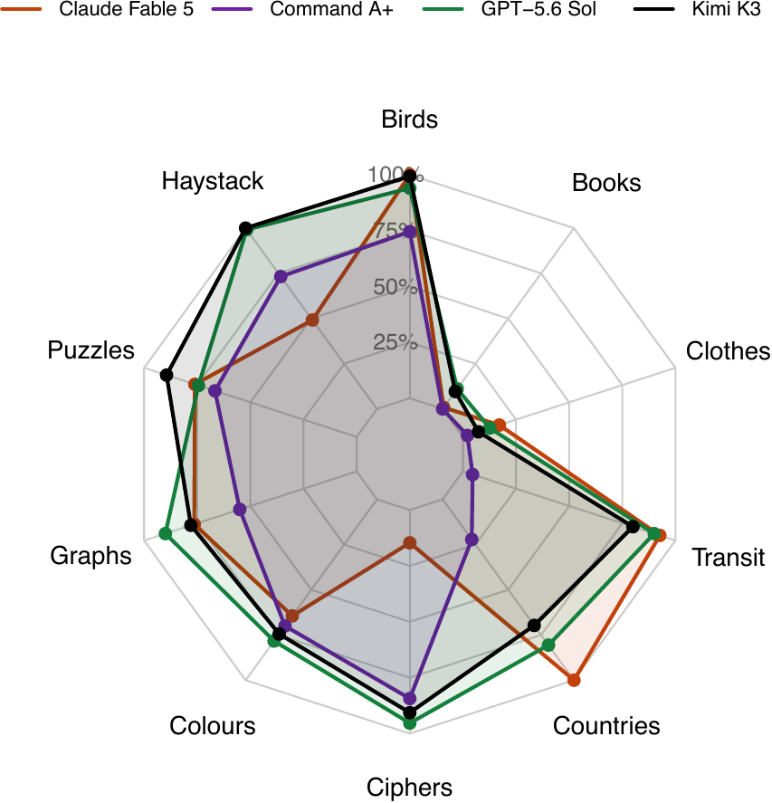
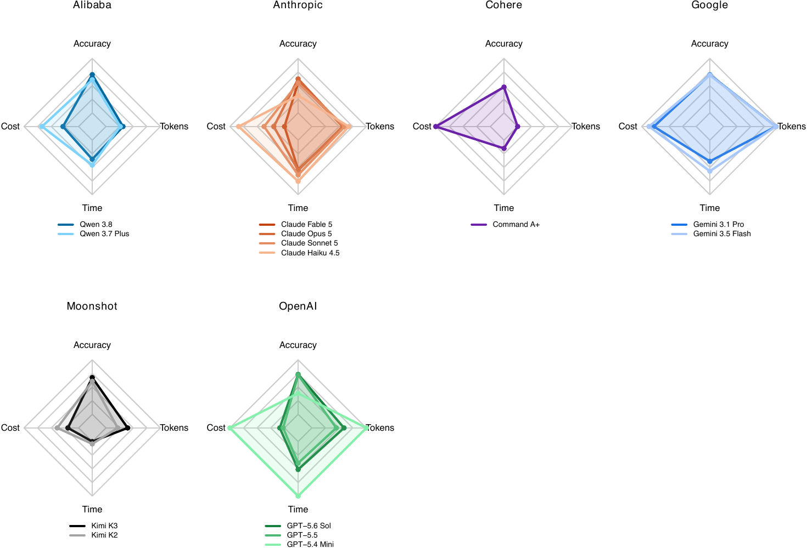

## {.center}

*One must cultivate one's own garden.*

—Voltaire

## Abstract

- `GardenBench` is a benchmark with 11 test suites that evaluate the capabilities of Large Language Models (LLMs) across a range of tasks.
- By systematically prompting LLMs with various lightweight queries, we document day-to-day changes in model performance, including run costs and times, that other benchmarks miss.

# Introduction

## Progress depends on the instruments we use to measure it

- Traditionally, machine learning (ML) models were trained for and tested on task-specific functions.
- However, in 2020, the release of GPT-3 [@brown2020], one of the first publicly accessible and general-use large transformer models, changed the trajectory of LLM training and testing.
- Today, LLMs are used as search engines, office assistants, and personal tutors.

## Two shortcomings

- Though LLM use has broadened, the evaluation and documentation of LLM performance remains scientifically oriented and domain-specific.
- Model cards are published by model developers, allowing them to selectively showcase model abilities and exclude failures.
- One-time evaluation of models does not capture changes in performance and reliability over time.
- We emphasize the need for cost-effective, lightweight benchmarks that can run every day.

## `GardenBench`

- `GardenBench` is a lightweight, fast, and inexpensive LLM benchmark designed to run daily on all frontier models.
- `GardenBench` consists of 107 tests organized into 11 suites with varying tasks and difficulty levels.
- Like a garden, the benchmark represents diversity and variety—in terms of the nature of its tasks and its tested capabilities—within one environment.

# Background

## Background

- In machine learning (ML), standard benchmarks are measurement instruments consisting of queries with corresponding ground truth answers and an evaluation metric for model performance across different tasks [@Raji2021].
- `GardenBench` follows existing publicly accessible [@chiang2024; @epochai2026] and general use [@hendrycks2021; @rein2023] benchmarks that address two key concerns in LLM benchmarking: They are highly specialized, and they are costly.

## Selective reporting

- LLM evaluation occurs largely as a closed-door practice, where model providers often selectively publish their own evaluations [@cheng2025; @baack2026], benchmark results target niche professional communities [@koch2021], and evaluation metrics are often not useful and difficult to interpret for the broad scope of LLM users [@Raji2021; @eriksson2025].
- This enables providers to publish benchmarks on which their models perform well, while less successful performances remain undisclosed [@cheng2025; @baack2026].

## Specialization and professional communities

- AI companies test their new models in a set of widely used and domain-specific benchmarks.
- While these insights are important for model development and medical applications, these metrics may not be useful to LLM users beyond these professional communities, who use LLMs for ordinary daily tasks.
- Many benchmarks may fall short in capturing real-world use cases [@eriksson2025].

## Data contamination

- Lastly, data contamination, which happens when test data leaks into models' training data and leads models to perform exceptionally well [@dong2024], may also undermine the trustworthiness of LLM benchmarks.
- @cheng2025 highlights that data contamination can lead to biased model evaluations.
- This makes it difficult to distinguish between exaggerated claims about model performance and genuine progress.

## Expensive model testing

- The expensive cost of many LLM benchmarks is another vulnerability.
- @gundlach2026 found that the cost of benchmarking frontier models is increasing by 3 to 18 times yearly, as models continue to grow in size and require more internal thinking before outputting responses.
- One example is @kapoor2025's "Holistic Agentic Leaderboard" which cost \$40,000 USD to run once across nine models and nine benchmarks.
- GPT-6 Astra tests on ARC-AGI-3 cost \$26,000 USD at its most efficient reasoning [@kamradt2026].

## Static benchmarking

- The increasing cost of running benchmarks and the need for frequent evaluation are at odds with one another.
- Many traditional LLM benchmarks are static, or evaluated once, meaning that they may not capture possible model changes over time and risk data leakage [@dai2025].
- Performance degradation over time has been observed [@roberts2023; @zhu2024; @guan2026].
- The result is a call for movement toward more dynamic benchmarks that continuously evaluate LLMs and thus avoid becoming outdated [@chen2025].

## Static benchmarking

- Model cards—reports of newly released models published by model providers [@Mitchell2019]—are one way of understanding LLM performance at a point in time.
- While model cards summarize model performance across various capabilities, they do not account for model drift—the performance degradation of LLMs as data and language patterns, as well as domain-specific knowledge, change over time [@khairnar2025].
- As a result, model cards become outdated as new model versions are released and existing models are changed post-deployment.

## Reliability

- In addition to running benchmarks once to calculate model performance, it is also of interest to observe performance across repeated runs of the same benchmark to understand model reliability.
- Multiple studies examining the consistency and reproducibility of LLM outputs have found that model accuracy varies over time and from prompt to prompt.
- @mehta2025 found that agent performance can drop from 60 percent on a single run to 25 percent on 8 consistent runs.

## Reliability

- With `GardenBench`, we introduce a new notion of reliability by testing whether the same prompt asked to the same model at the same time, on different days, produces the same response.
- We argue that the consistency of responses across days of the week is equally an important component of reliability.
- However, the expensive cost of running LLM benchmarks does not allow for this kind of analysis, which requires frequent recurring testing.

# Data and methods

## Developing testing suites

- Our benchmark consists of 107 individual tests organized into 11 distinct testing suites.
- We distinguish between image- and text-based suites because some of the models we evaluated, such as DeepSeek, were not natively capable of image processing.
- In our final collection of tasks, all correct answers could be found within the image or text in the prompt, meaning web searching was not required.
- Our objective in this approach was to evaluate raw LLM capabilities without the support of external resources.

## Developing testing suites

::: {style="font-size: 52%;"}

| Suite Name | Number of Tests | Input Type | Task Description |
|:---|:---|:---|:---|
| Birds | 10 | Image | Identify the species of bird from its image |
| Books | 9 | Image | Identify information from an image of a bookshelf. |
| Clothes | 10 | Image | Identify information from an image of a wardrobe. |
| Colours | 12 | Image | Identify paint types and colour mixtures from an image of a paint palette. |
| Countries | 11 | Image | Identify the country from an image of its silhouette. |
| Graphs | 10 | Image | Identify the equation of the derivative from a graph of a simple function. |
| Transit | 10 | Image | Identify information from a map of a transit system. |
| Ciphers | 10 | Text | Decode a word transformed with a cipher. |
| Haystack | 8 | Text | Identify a target string within a large corpus of text. |
| Puzzles | 12 | Text | Solve logical puzzles. |
| Self-Check | 5 | Text | Answer questions about self. |

: Table 1: Set of suites considered in our study with their reference names, number of tests they contain, and a one-sentence task description.

:::

## Developing testing suites

- Tests in the same suite either evaluate LLMs on variations of the same task or multiple closely related but distinct tasks.
- For instance, the *Birds* suite consists of 10 instances of the same task: "Identify the species of the bird shown in this image."
- Conversely, the *Books* suite contains single instances of 9 different tasks, all of which ask the LLM to extract different information from a photograph of a bookshelf, such as the title and author of one of the books.

## Developing testing suites

- We only considered tasks which could be evaluated on a binary pass or fail.
- In addition, models were only given a single chance to respond and example responses were not provided in the prompts.
- Model responses were evaluated by comparing the model output to the test's ground truth, after trimming surrounding whitespace and ignoring letter case; any other deviation was marked incorrect.

## Developing testing suites

{fig-align="center" height="381"}

## Models

- We evaluated the performance on our benchmark of 17 different models developed by 7 distinct providers, shown in Table 2.
- Models were prompted in Python using the @openai2026 package, through each provider's OpenAI-compatible chat completions endpoint.
- No temperature, seed, or token limit was set, so each provider's defaults applied.
- This set of models includes open- and closed-weight models developed in the U.S., Canada, and China.

## Models

::: {style="font-size: 50%;"}

| Provider | Model Name | Image Support | Evaluation Frequency |
|:---|:---|:---|:---|
| Alibaba Cloud (via Fireworks) | Qwen 3.7 Plus | Yes | Daily |
| Alibaba Cloud (via Fireworks) | Qwen 3.8 | Yes | Daily (from August 28) |
| Anthropic | Fable 5 | Yes | Daily |
| Anthropic | Opus 5 | Yes | Daily |
| Anthropic | Sonnet 5 | Yes | Daily |
| Anthropic | Haiku 4.5 | Yes | Daily |
| Cohere | Command-R+ | No | Daily |
| Cohere | Command-A+ | Yes | Daily |
| Deepseek | V4 Pro | No | Daily |
| Deepseek | V4 Flash | No | Daily |
| Google | Gemini 3.1 pro | Yes | Daily |
| Google | Gemini 3.5 flash | Yes | Daily |
| Moonshot AI | Kimi K3 | Yes | Daily |
| Moonshot AI (via Fireworks) | Kimi K2 | Yes | Daily |
| OpenAI | GPT 5.6 Sol | Yes | Daily |
| OpenAI | GPT 5.5 | Yes | Daily |
| OpenAI | GPT 5.4 mini | Yes | Daily |

: Table 2: Set of models evaluated in our study, organized by their providers, with their names, native image support capability, and frequency of evaluation.

:::

## Evaluation metrics

- We begin by measuring aggregate performance comparatively across models and average accuracy by suite.
- We then analyze model accuracy as a function of several relevant variables.
- First, we analyze the relationship between average dollar cost per test and accuracy to allow for direct and transparent comparison across models.
- Next, we evaluate model accuracy as a function of wall-clock time elapsed to solve tests.

## Evaluation metrics

- Cost and time were chosen as metrics with the broad community of LLM users in mind.
- For many people deciding which model to use for non-frontier applications, cost is an important constraint and is not often accounted for in existing benchmarks.
- Time is another metric that can inform decisions of which model to use for real-world applications, as LLMs that take seconds rather than minutes to respond may be more effective search engines or office assistants.

## Evaluation schedule

- This paper analyzes results obtained from running the benchmark from August 17, 2026 to August 31, 2026, with runs scheduled at 2:00AM Eastern Daylight Time (EDT) each day.
- All models were evaluated every day during this period, with two exceptions: Command A+ was evaluated on 11 of the 15 days, and Qwen 3.8 was added to the benchmark on August 28 and so was evaluated on only the final four days.
- We use two weeks of data to demonstrate observable fluctuations in daily performance, specifically as models frequently progress or degrade.

## Evaluation schedule

{fig-align="center" height="351"}

:::{.notes}
- Figure 2 presents a high-level overview of our research workflow.
:::

## Evaluation schedule

- Our primary product is a publicly available live dashboard, where visualisations of daily `GardenBench` evaluations are updated and displayed every day.
- To preserve the integrity of our experiment while running `GardenBench` daily, we do not publish our underlying dataset.
- This decision was informed by concerns about dataset contamination, where model training data and evaluation data may intersect, enabling LLMs to memorize responses, thus artificially enhancing performance [@xu2024; @fu2025; @li2024].

# Results

## Aggregate performance

{fig-align="center" height="468"}

:::{.notes}
- The highest performing model evaluated on the full benchmark was GPT-5.6 Sol, followed closely by GPT-5.5, which respectively achieved average per-suite accuracies of 73 percent and 72 percent during our evaluation period.
- Performance decreased steadily across the remaining models, with Qwen 3.8, Gemini 3.1 Pro, Gemini 3.5 Flash, Kimi K3, Claude Opus 5, Qwen 3.7 Plus, Kimi K2, Claude Fable 5, and Claude Sonnet 5 performing between 55 percent and 70 percent accuracy.
- Command A+, GPT-5.4 Mini, and Claude Haiku 4.5 followed with accuracies below 50 percent.
- DeepSeek V4 Pro and DeepSeek V4 Flash performed similarly on the text-based suites, achieving average accuracies substantially higher than Command R+---87 and 82 percent, respectively, compared to 19 percent.
:::

## Overall accuracy per suite

{fig-align="center" height="443"}

:::{.notes}
- Performance was highest in the *Birds* and *Haystack* suites, where LLMs were asked to identify the species of bird from an Internet-sourced image, and retrieve a target string from a block of text respectively.
- Models performed similarly across the *Countries*, *Ciphers*, *Graphs*, and *Puzzles* suites, where average accuracy ranged from around 70 to 75 percent, and somewhat worse on the *Transit* and *Colours* suites, at around 60 percent.
- Accuracy on the *Self-Check* suite, where models were asked about their own identity, was around 50 percent.
- Finally, the *Clothes* and *Books* suites were noticeably more challenging than the others, as models achieved an average accuracy of less than 15 percent.
:::

## Overall accuracy per suite

{height="380"}

:::{.notes}
- Figure 5 displays the performance of a few select frontier models on individual suites.
- We observe variation in model performance on certain suites or groups of suites, suggesting that aggregated accuracy metrics are not necessarily representative of a model's specific capacities.
- For example, Claude Fable 5 underperformed significantly on text-based suites relative to other frontier models, but performed similarly on image-based suites.
:::

## Model performance by cost, time, and token use

{fig-align="center" height="366"}

:::{.notes}
- We notice that for most providers, there typically appears to be a tradeoff between accuracy and cost, time, and/or token use.
- For example, the largest models from each provider (e.g., Qwen 3.8, Claude Fable 5, Command A+, Gemini 3.1 Pro, Kimi K3, and GPT-5.6 Sol) generally achieved the highest accuracy but also had the highest costs, longest response times, and largest output token counts.
- We note some exceptions to this trend, such as Kimi K3, which outperforms Kimi K2 in accuracy while also using fewer tokens, and Gemini 3.5 Flash, which comes within one percentage point of Gemini 3.1 Pro in accuracy while being faster and cheaper.
:::

## Day-to-day variance in model performance

{fig-align="center" height="341"}

:::{.notes}
- For all models, performance appears to fluctuate slightly from day to day.
- Some models like GPT-5.5, Claude Haiku 4.5, and Claude Sonnet 5 have relatively stable performances over time, with only mild deviations from their series average.
- DeepSeek V4 Flash and DeepSeek V4 Pro appear to have the most pronounced fluctuations over time, with a wide range of variability in scores.
- Others like Command A+ and Kimi K2, also have variable performance over time, but relatively less pronounced.
- These fluctuations were substantial enough to affect the daily ranking of these models, as certain models performed better than others on some days, and worse subsequently.
- For instance, on August 17, GPT-5.6 Sol performed better than GPT-5.5. However, on August 18, 22, 24, 26, and 27, GPT-5.5 outperformed GPT-5.6 Sol.
- We observe a similar case with Claude Sonnet 5 and Claude Fable 5, as these two Anthropic models alternated in rank from August 24 onward.
- We did not observe a consistent increasing or decreasing trend for any model. Instead, daily fluctuations suggest that models may both progress and degrade post-deployment.
:::

# Discussion

## Discussion

- In conceptualizing `GardenBench`, we addressed two main shortcomings in previous methods of LLM benchmarking.
- First, `GardenBench` is publicly accessible, with interpretable results posted daily to a live dashboard.
- We believe that LLM evaluation mechanisms should be as broadly accessible as LLMs themselves, keeping pace with the widespread use of LLMs for general, everyday tasks by the vast public.

## Discussion

- Second, LLM benchmarks are often expensive and time-consuming, resulting in infrequent testing [@polo2024].
- In total, the complete benchmark costs approximately \$30 USD and takes up to one hour per day to run.
- Systematically running our tests at the same time each day of the week allows us to achieve a high level of reliability and scalability in our results.

## Takeaways from model performance

- Specifically, string matching, image recognition (from image-capable models), and general knowledge appeared to be more developed qualities of LLMs.
- The tested models were somewhat less successful in the *Ciphers*, *Graphs*, and *Puzzles* suites, indicating that logical and arithmetic reasoning are less developed areas, and less successful again in the *Transit* and *Colours* suites, which require spatial reasoning and fine visual perception.
- Lastly, very low accuracy in the *Clothes* and *Books* suites suggests that LLMs generally struggle with counting and information extraction from dense, author-collected images.

## Takeaways from model performance

- Secondly, our results for model performance account for API run times and costs, exhibiting trade-offs associated with achieving high accuracy.
- Many high performing models took less than 25 seconds to output responses, namely GPT-5.6 Sol and GPT-5.5, which were evaluated on all 11 test suites.
- In the four text-based suites, DeepSeek V4 Flash and DeepSeek V4 Pro were among the highest performing models, while also being among the most cost-efficient (see Figure D1).

## Prompting and suite construction

- Our benchmark construction process also revealed how prompt engineering may impact model performance.
- In developing testing suites, we observed that model performance improved significantly when models were asked to follow a specific prompt structure, for instance, in terms of capitalization and punctuation.
- Anthropic models returned reasoning frequently, despite being clearly instructed not to include additional text in their responses.

## Prompting and suite construction

- Generally, models performed with low accuracy on the *Clothes* and *Books* suites, which were both based on author-collected images.
- The *Clothes* suite, where the task was to count the number of clothing items folded in a closet, may have been difficult for models since some items were very thin, dark, or looked very similar to one another.
- On many occasions, models were able to correctly identify the book title but failed to identify the author.

## Daily evaluation

- We observed that some models presented more variation in performance than others, which may impact benchmark rankings over time.
- Our framework shows that it may be beneficial to continuously evaluate models post-deployment on smaller and more affordable benchmarks to monitor performance and make changes accordingly.
- LLMs have been adopted widely nowadays as tools in both industry and academic environments. Therefore, it is important to supervise them as they become available to and used by the public.

## Limitations and future directions

- One limitation of our benchmark is that it involves text- and image-based prompting, even though 3 of our tested models (DeepSeek V4 Flash, DeepSeek V4 Pro, and Command-R+) were independently incapable of image processing.
- It is possible that the accuracy of these models may be overstated as they were evaluated on a reduced set of testing suites (4 suites instead of 11).

## Conclusion

- This paper introduced `GardenBench`, offering an innovative approach to measuring LLM capabilities across various general use cases on a daily basis.
- While it is important to monitor performance of models on domain-specific tasks, it is equally important to develop benchmarks for general aptitude.
- The field has moved from many specialized models to a few models that do everything.
- Researchers, businesses, and individuals now expect models that display general competence on new tasks given only a prompt or a few examples.

## References
