## Part I: Variance in evals

---

## Reliability

- In addition to running benchmarks once to calculate model performance, it is also of interest to observe performance across repeated runs of the same benchmark to understand model reliability.
- Multiple studies examining the consistency and reproducibility of LLM outputs have found that model accuracy varies over time and from prompt to prompt.
- For example, @cui2026 examined the ability of LLMs to produce the same response to the same prompt ten-out-of-ten times and found that model output differs even between executions with the same prompting strategy and temperature settings.

---

## Lack of reporting on uncertainty and variance {.smaller}

- LLMs are stochastic animals and their outputs depend on a large number of both arbitrary decisions and random events that occur during their training and evaluation.
- This is rarely acknowledged during model evaluation, likely because it makes evaluating models much more challenging.
- But it is becoming more important over time as the subject of the evals becomes more advanced which may be associated with small eval datasets, which will lead to larger uncertainty around the results.

::: {.aside}
[@Biderman2024, pp. 8-9]
:::

---

## A single run and ten runs

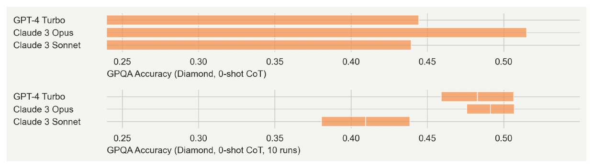{fig-align="center" height="290"}

::: {.aside}
[@Biderman2024, Figure 2, p. 9.]
:::

---

## Sampling: language models are completion machines

- A language model is a completion machine: given a text (prompt), it tries to complete the text.
- Completions are predictions, based on probabilities, and not guaranteed to be correct.
- Many tasks can be thought as completion: translation, summarization, coding, and solving math problems.
- But real-world ROI requires more.

::: {.aside}
[@Huyen2025; @DSI2026]
:::

---


## Sampling: repeated runs {.smaller}

- Repeated runs are increasingly adopted for agent evaluations, but single-run evaluations remain common due to the constraints from cost and compute.
- Pass@k represents the probability of 'success' at least once within k attempts.
- In contrast, pass∧k quantifies consistency in task success by representing the probability of success over all k runs.
- Conduct repeated runs to measure consistency for each task, and report how many runs were conducted. Avoid claims relying on low run-to-run variance if only a single run is affordable.

::: {.aside}
[@Chen2026, pp. 13-14.]
:::

---

## Items: benchmark accuracy and generalized accuracy {.smaller}

- One important distinction for rigor in evaluation is between *benchmark accuracy*—which concerns expected performance of an agent on a specific benchmark—and *generalized accuracy*—which concerns the tasks that get selected into a benchmark relative to the entire population of tasks.
- That is, benchmark accuracy asks, 'how well would an agent perform on these exact tasks again?'
- In contrast, generalized accuracy asks, 'how well would an agent perform on new tasks similar to these tasks?'
- The latter has wider uncertainty because sampling the tasks themselves adds variance.

::: {.aside}
[@Chen2026, p. 13.]
:::

---

## Prompts {.smaller}

- In constructing our testing scheme, we follow extensive literature on prompt engineering [@marvin2024; @sahoo2025] and the instruction-following capabilities of LLMs [@zhou2023; @wu2024].
- These studies find that developing specific and intentional query structures combined with length and formatting constraints—for instance, punctuation and spacing—is critical in maximizing the effectiveness of LLMs.
- Our benchmark construction process also revealed how prompt engineering may impact model performance.
- In developing testing suites, we observed that model performance improved significantly when models were asked to follow a specific prompt structure, for instance, in terms of capitalization and punctuation.

::: {.aside}
[@GardenBench2026]
:::

---

## Prompts: "minor" implementation details matter {.smaller}

<!-- Biderman, Section 3.1, p. 5 -->

- "LMs are not robust, often in seemingly unintuitive ways: for example, the precise string used for a given prompt, even down to whitespace usage, can significantly impact performance."
- "Even the choice of few-shot examples can also significantly change performance."
- "Thus, the selection of prompt affects the model rankings and research conclusions produced in addition to numeric scores themselves."

::: {.aside}
[@Biderman2024, p. 5.]
:::

---

## Prompts: two prompt styles

<!-- Biderman, Table 1 and Section 3.1, p. 5 -->

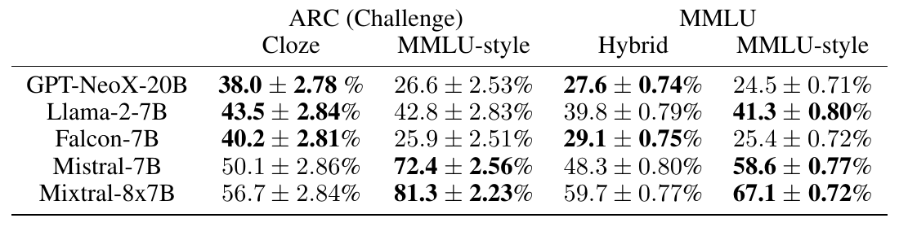{fig-align="center" height="250"}

::: {.aside}
[@Biderman2024, Table 1, p. 5.]
:::

---

## Prompts: best practices {.smaller}

- Provide Evaluation Code: Whenever possible, new publications should be accompanied by release of the exact evaluation code used."
- Provide Prompts and Detail Methodology Thoroughly: Failing the release of code or to supplement the release of code, prompts should be clearly reported within a publication.
- Create Reporting Standards: These issues are exacerbated by the fact that there does not exist commonly held practices or checklists within the community to incentivize or ensure adequately thorough documentation of evaluation methodologies.

::: {.aside}
[@Biderman2024, p. 7.]
:::

---

## Judges: the Key Problem {.smaller}

<!-- Biderman, Section 2.1, p. 2 -->

- When evaluating language models, there can be many semantically equivalent but syntactically different ways of expressing the same idea.
- In an ideal world, to assess correctness we would have a way to automatically detect when two sentences express the same content but in different words.
- However, our best automated tools for determining whether two sentences are semantically equivalent are the very models we are seeking to evaluate.
- Responses to the Key Problem generally fall into three broad categories: converting the open-domain problem into a closed-domain one where correctness can be determined mechanically, using model-based grading, or relying on human labor.

::: {.aside}
[@Biderman2024, p. 2.]
:::

---

## Judges: AI as a judge

- Human evaluation is an option for open-ended responses. Can AI be used as a judge?
  - Benefits: fast, scalable, no reference data needed.
  - Studies show strong correlation with humans (GPT-4 ~85%).
  - Applications: quality, relevance, safety, and hallucination checks.

---

## AI as a judge, implementation 1/3

- Evaluate the quality of a response by itself, given the original question.

```
Given the following question and answer, evaluate how good the
answer is for the question. Use the score from 1 to 5.

- 1 means very bad.

- 5 means very good.

Question: [QUESTION]

Answer: [ANSWER]

Score:
```

---

## AI as a judge, implementation 2/3

- Compare a generated response to a reference response; assess whether it is the same.

```
Given the following question, reference answer, and generated
answer, evaluate whether this generated answer is the same as
the reference answer.

Output True or False.

Question: [QUESTION]

Reference answer: [REFERENCE ANSWER]

Generated answer: [GENERATED ANSWER]
```

---

## AI as a judge, implementation 3/3

- Compare two generated responses and determine which one is better or predict which one users will likely prefer.

```
Given the following question and two answers, evaluate which
answer is better. Output A or B.

Question: [QUESTION]

A: [FIRST ANSWER]

B: [SECOND ANSWER]

The better answer is:
```

---

## AI-as-a-judge, limitations {.smaller}

:::: {.columns style="font-size: 90%;"}

::: {.column width="50%"}
- Inconsistency: for an evaluation method to be trustworthy, it needs to be consistent.
  - AI judges are AI and, therefore, probabilistic in nature.
  - Evaluation examples in the prompt can increase consistency.
  - Criteria ambiguity: AI as a judge metrics are not standardised.
  - Increases risk of misinterpretation or misuse.
  - An application evolves over time, but the way it's evaluated should be fixed.
:::

::: {.column width="50%"}
- Cost and latency: using powerful models to evaluate responses can be expensive and can add latency.
  - Use a weaker model for evaluation.
  - Apply spot-checks.
- Biases:
  - Self-bias: model favours own responses.
  - Position bias: model favours first answer in a pairwise comparison or the first in a list of options.
  - Verbosity bias: model favours lengthier answers, regardless of quality.
- AI judges should be combined with exact or human evaluation.
:::

::::

---

## Judges: writer and grader

<!-- SH, fig-loop -->

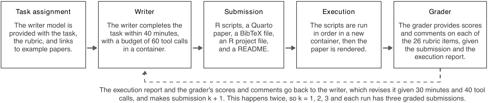{fig-align="center" height="340"}

::: {.aside}
[@Alexander2026Iterated]
:::

---

## Graders are not neutral measuring instruments {.smaller}

- Even when all seven graders grade the same first-round submissions, 4 per cent of the variation in the scores is due to the grader and 84 per cent is due to the submission, and the difference between the graders that give a writer's submissions the highest and the lowest score is 28 percentage points on average.
- Gemini 3.8 Flash and Haiku 4.5 give 100 per cent to 51 and 41 per cent of the submissions that they grade, and then the writer has nothing to work with, and indeed no sense that the submission was lacking.
- But there is considerable noise from grade to grade, even when the submission and the grader are held constant, and this is compounded by differences even between models on the Pareto frontier.

::: {.aside}
[@Alexander2026Iterated]
:::

---

## Consistency of grading

<!-- SH, fig-consistency-1 -->

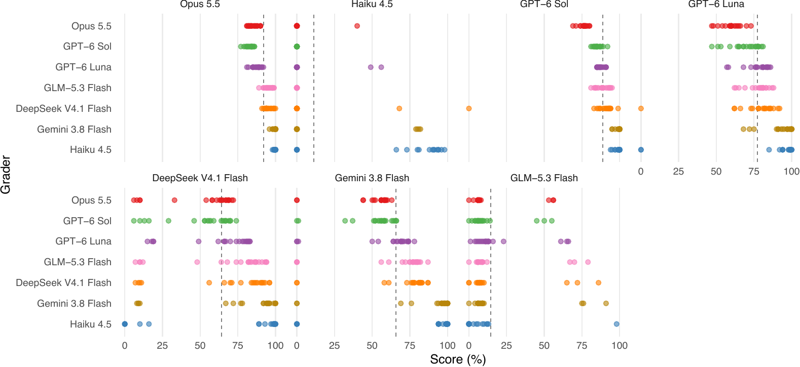{fig-align="center" height="360"}

::: {.aside}
[@Alexander2026Iterated]
:::

---

## Consistency of grading {.smaller}

- To enable direct comparison, we had each of the seven graders grade every first-round submission.
- We find that even in this controlled setting the graders can differ considerably.
- For instance, the first-round submissions from Haiku 4.5 receive an average of 0 per cent from GPT-6 Sol, 2 per cent from Opus 5.5, and 54 per cent from Haiku 4.5 itself.
- The difference between the graders that give a writer's submissions the highest and the lowest average score ranges from 10 percentage points for the submissions from GLM-5.3 Flash to 54 percentage points for the submissions from Haiku 4.5, and is 28 percentage points on average.
- In contrast, the difference between the highest and the lowest of the three scores that the same grader gives the same first-round submission is 6 percentage points on average.

::: {.aside}
[@Alexander2026Iterated]
:::

---

## Consistency of grading {.smaller}

- It is worth noting that in general, although the graders differ in terms of what the score should be, they often agree on the order.
- On the 147 first submissions and the 141 final submissions that all seven models graded, each round taken on its own, the marks of the six graders, other than Haiku 4.5, have a correlation of 0.78 to 0.99.
- Haiku 4.5 tends to be erratic in its grading, giving 0 per cent to seven of the 21 first-round submissions that it grades and 100 per cent to eight of them.

::: {.aside}
[@Alexander2026Iterated]
:::

---

## Consistency of grading

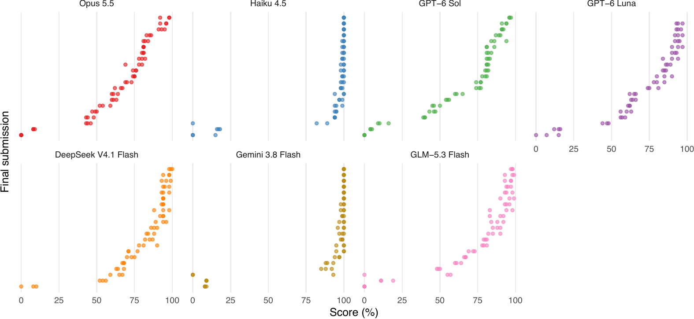{fig-align="center" height="360"}

::: {.aside}
@[Alexander2026Iterated]
:::

---

## Consistency of grading {.smaller}

<!-- SH, Results, "Consistency of grading", paragraphs 3 and 4 -->

- In addition to consistency between different models we are interested in consistency within models.
- To examine this, every final submission was scored three times by the grader of its run with the same files and the same execution report.
- Across all graders the three scores of a submission differ by almost 4 percentage points, on average, and are the same for 12 per cent of submissions.
- The difference ranges from almost 2 percentage points for GPT-6 Sol to 5 percentage points for GLM-5.3 Flash.
- Gemini 3.8 Flash tends to agree with itself because its scores are at the maximum.
- Looking across all of the models, we see that 51 per cent of third-round changes in score are in that situation of being within the grader's own noise, and 45 per cent of second-round changes are.

::: {.aside}
@[Alexander2026Iterated]
:::

---

## Consistency of grading {.smaller}

:::: {.columns}

::: {.column width="50%"}
- A submission scores about 9 percentage points higher when graded by its own writer than when by the other graders.
- The score that a model gives its own final submissions is higher than the average of the other six graders for Haiku 4.5 by 37 percentage points, Gemini 3.8 Flash by 23 percentage points, DeepSeek V4.1 Flash by 8 percentage points, and GLM-5.3 Flash by 4 percentage points.
- It is lower for Opus 5.5, by 7 percentage points, GPT-6 Sol by 3 percentage points, and GPT-6 Luna by 1 percentage point.
:::

::: {.column width="50%"}
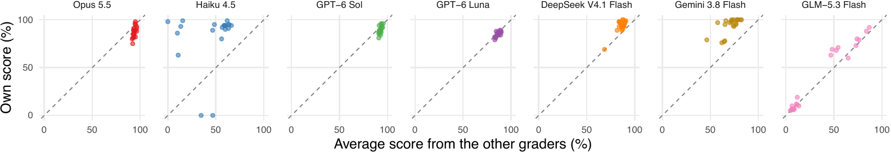
:::

::::

::: {.aside}
@[Alexander2026Iterated]
:::

---

## Consistency of grading {.smaller}

- A grader can fail to return a usable grade.
- If the grade could not be read, or left a rubric item unmarked, then the grader was asked again, up to three requests in each of up to three attempts, and a request that failed with a provider error was repeated.
- Opus 5.5, GPT-6 Luna and Gemini 3.8 Flash never returned a grade that could not be used.
- GPT-6 Sol did in one of its gradings, GLM-5.3 Flash in seven, DeepSeek V4.1 Flash in 13, and Haiku 4.5 in 49, and each of these gradings ended with a usable grade.
- Separately, 51 gradings ended without a grade because the submission was too large for the grader to read.

::: {.aside}
[@Alexander2026Iterated]
:::

---

## Planted errors {.smaller}

Finally, we inserted specific errors into a submission to see if the graders would identify them. The errors were:

1. Have the download script generate random numbers but claim they were from the USGS.
2. Remove a latitude adjustment from the model, but have the paper still claim that it is there.
3. Have a wrong main finding in the headline compared with the actual finding.
4. Have the test script read the data, but not assert anything.
5. Name the International Seismological Centre as the source of the data, but have the script download data from the USGS.
6. Claim the estimand is a causal effect but have the model estimate an association.
7. Have a cross-reference to a table that does not resolve.

::: {.aside}
@[Alexander2026Iterated]
:::

---

## Planted errors

- Each grader graded each copy three times along with the execution report.
- The unchanged copy got 95 per cent.
- The only error that had a substantial effect on the mark was generating data.
- Finally, a high score also does not mean that a submission is right.

::: {.aside}
[@Alexander2026Iterated]
:::

---

## Graders compared with teaching assistants {.smaller}

- To provide a sense of how the grader compared with a human teaching assistant we can examine how the graders mark real student submissions.
- In general we find that they tend to give marks that are lower than the human teaching assistants did.
- The graders marked these without an execution report and with a slightly modified rubric.
- The comparison is based on 22 rubric items that total 100 points.
- The mean absolute error ranges from 13.9 for Gemini 3.8 Flash to 48.1 for GPT-6 Sol, and bias from -48.1 for GPT-6 Sol to -6.3 for Haiku 4.5.

::: {.aside}
[@Alexander2026Iterated]
:::

---

## Graders compared with teaching assistants

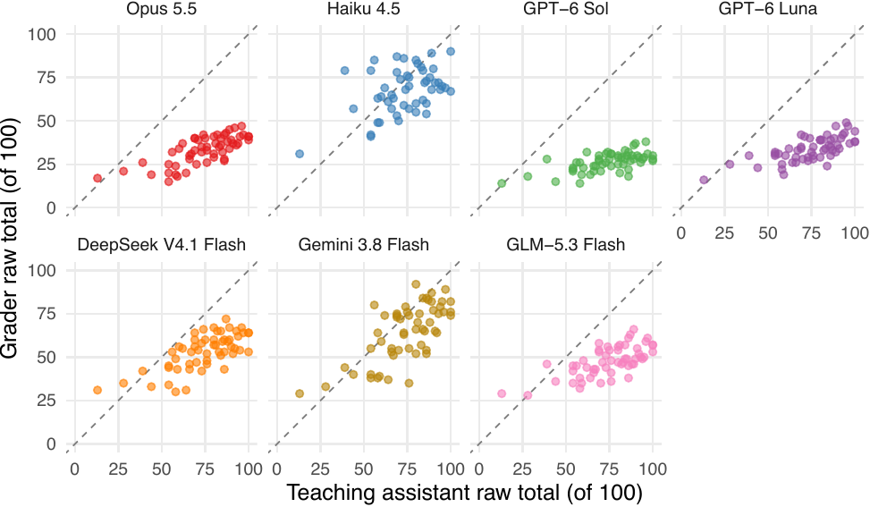{fig-align="center" height="370"}

::: {.aside}
[@Alexander2026Iterated]
:::

---

## Judging the judge {.smaller}

<!-- SH, Discussion, paragraphs 3 and 6 -->

- The implication is that when a feedback loop is thought to have improved quality, as judged by a particular model, a considerable part of that result is a result for that judge.
- Reporting judge consistency over multiple independent judgments of the same submission is important, and one also needs to be especially concerned with judging the judge.
- But it is difficult to see how one could give a student a mark from a model without considering a few different models, or at least considerable benchmarking on closely related assignments.
- The self-bias that we find suggests that any automated review system needs to be composed of at least two frontier models, and the stochasticity that we find between independent runs suggests that it needs to be run at least twice for each submission.

::: {.aside}
[@Alexander2026Iterated]
:::

---

## Who judges the judges? {.smaller}

- Who judges the judges?
- LLM-as-judges require validation against appropriate holdouts, such as expert labels.
- This judge error should moreover be reflected in how uncertainty is reported, in particular to inform how error bars are presented when LLM-as-judges are in play.
- Validate autograders and scanners against human-coded holdouts representative of the intended use case with subject matter expert participation.
- Incorporate targeted manual analysis into automated analysis.

::: {.aside}
[@Chen2026, pp. 17-18.]
:::

---

## Part II: Contamination

---

## Data contamination

- Data contamination, which happens when test data leaks into models' training data and leads models to perform exceptionally well [@dong2024].
- This makes it difficult to distinguish between exaggerated claims about model performance and genuine progress.

---

## Data contamination: publishing the data {.smaller}

- They argue that most LLM benchmarks either publish all the code and data used, which risks data contamination and may make results misleading or difficult to interpret, or selectively report findings and discuss them in an overly broad manner.
- There is less literature on how to navigate the risk of data contamination for emerging dynamic benchmarks [@chen2025].

---

## Data contamination: static benchmarking {.smaller}

- Many traditional LLM benchmarks are static, or evaluated once, meaning that they may not capture possible model changes over time and risk data leakage [@dai2025].
- The result is a call for movement toward more dynamic benchmarks that continuously evaluate LLMs and thus avoid becoming outdated [@chen2025].
- Some examples of this approach include `Dynabench` [@kiela2021], an open-source platform for dynamic benchmarking using human-and-model in the loop dataset creation through a web browser and human annotators.

---

## Targeting the rubric {.smaller}

- Firstly, the score measures how well a submission meets 26 explicit rubric items, and the writers are given the rubric and told that their submission is graded using it, so an increase may be the writer targeting the rubric, rather than an improvement in the underlying work.
- Although this is fine for our particular setting where the rubric is important it does limit how this could generalize to situations without.
- This is difficult to parse out, but some type of pairwise comparison in addition to a rubric-based approach could help.

::: {.aside}
[@Alexander2026Iterated]
:::

---

## Contamination: agents {.smaller}

- For model-only evaluations, contamination arises from exposure to evaluation tasks verbatim or with high similarity, through pre-training data, benchmark content, or public test sets.
- Agent evaluations introduce additional surfaces for contamination.
- With access to tool use, agents may be susceptible to search-time contamination, whereby agents are able to retrieve answers at inference time.
- Contamination should also not be conceptualized as merely a binary question of whether certain data is included or not.

::: {.aside}
[@Chen2026, p. 15.]
:::

---

## Contamination: agents

<!-- Chen, Figure 9, p. 15; note from the best practices, p. 16 -->

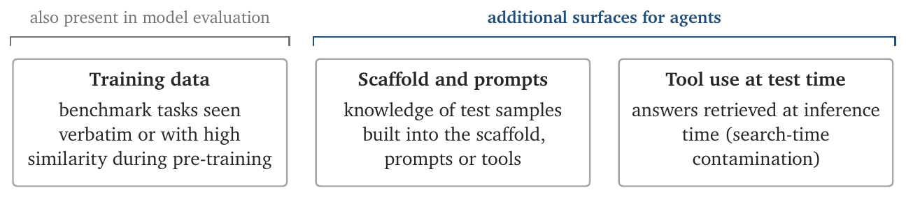{fig-align="center" height="210"}

::: {.aside}
[@Chen2026, Figure 9, p. 15.]
:::

---

## Contamination: dynamic benchmarks {.smaller}

- Refreshing or updating benchmarks with new tasks can aim to mitigate possible contamination—for example, LiveBench adds new test questions on a monthly basis to resist contamination.
- A central tradeoff with modifying and refreshing tasks over time raises the issue of longitudinal comparability; if the evaluation itself is not consistent across different tests over time, how can we compare the results in a relative sense?

::: {.aside}
[@Chen2026, p. 16.]
:::

---

## Contamination: dynamic benchmarks

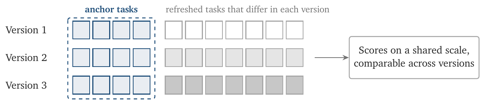{fig-align="center" height="230"}

::: {.aside}
[@Chen2026, Figure 10, p. 17.]
:::

---

## Overfitting to a leaderboard

{fig-align="center" height="270"}

::: {.aside}
[@Singh2025, Figure 10, p. 17.]
:::

---

## Part III: What a difference on a leaderboard means
---

## Five recommendations {.smaller}

1. Computing standard errors of the mean using the Central Limit Theorem
2. When questions are drawn in related groups, computing clustered standard errors
3. Reducing variance by resampling answers and by analyzing next-token probabilities
4. When two models are being compared, conducting statistical inference on the question-level paired differences, rather than the population-level summary statistics
5. Using power analysis to determine whether an eval (or a random subsample) is capable of testing a hypothesis of interest"

::: {.aside}
[@Miller2024, p. 2.]
:::

---


## Standard errors: reporting them {.smaller}

<!-- Miller, Section 2.1 and Table 2, p. 3 -->

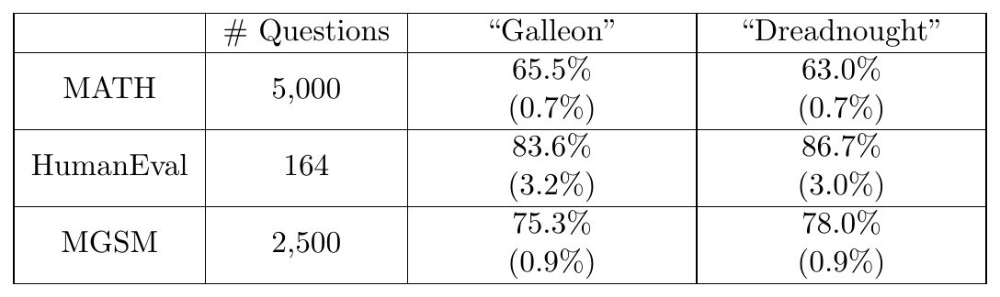{fig-align="center" height="220"}

- We suggest reporting the standard error of the mean alongside (beneath) the mean when reporting eval scores.
- A common practice in other sciences is to report the standard error in parentheses; we suggest emulating this practice.

::: {.aside}
[@Miller2024, Table 2, p. 3.]
:::

---


## Clustered questions {.smaller}

<!-- Miller, Table 4 and Section 2.2, pp. 4-5 -->

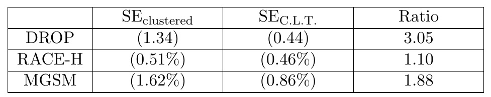{fig-align="center" height="150"}

- "Failure to adjust standard errors for clustered sampling may lead an unsuspecting analyst to suppose that the measurement of the overall eval score is much more precise than it actually is."

::: {.aside}
@Miller2024, Table 4, pp. 4-5.
:::

:::{.notes}
- "The clustered standard error acts as a kind of 'sliding scale' between cases where scores within a cluster are perfectly correlated (in which case each cluster acts as a single independent observation) and perfectly uncorrelated (in which case the clustered standard error is equivalent to the unclustered case)."
:::

---


## On temperature {.smaller}

- It may be tempting to reduce the 'sampling temperature' of the model in order to reduce (or eliminate) the conditional variance.
- However, we advise against this practice, unless the purpose is to study the model at the new temperature.
- In neither case should the sampling temperature be adjusted for the sake of reducing variance in the scores.

::: {.aside}
@Miller2024, p. 6.
:::

---

## The Leaderboard Illusion {.smaller}

- Any observed statistical regularity will tend to collapse once pressure is placed upon it for control purposes. — Charles A. E. Goodhart
- A meaningful benchmark demonstrates the relative merits of new research ideas over existing ones, and thereby heavily influences research directions, funding decisions, and, ultimately, the shape of progress in our field.
- Created in 2023, Chatbot Arena rates LLMs by allowing anyone to submit a prompt and subsequently rank two anonymous responses from different models.
- As Goodhart's Law states, when a measure becomes a target, it ceases to be a good measure.

::: {.aside}
[@Singh2025, pp. 2-3.]
:::

---

## The Arena Score {.smaller}

- In Arena, users engage in pairwise comparisons, voting on which of two models performs better (or declaring a tie) in a given interaction.
- Instead, Chatbot Arena ranks models based on their Arena Score, which is a normalized version of the Bradley-Terry (BT) model, a probabilistic framework for estimating skill levels based on pairwise comparisons.
- The BT model assumes that pairwise comparisons are drawn from an unbiased sampling process, so that each model's skill parameter is estimated independently and based on representative outcomes.

::: {.aside}
[@Singh2025, pp. 8-9.]
:::

---

## Private testing and selective disclosure {.smaller}

- Chatbot Arena has an unstated policy of allowing select providers to test many submissions privately in parallel.
- In a single month, we observe as many as 27 models from Meta being tested privately on Chatbot Arena in the lead up to llama 4 release.
- Private testing coupled with the option to retract enables a best-of-N strategy, where an organization submits multiple model variants to Chatbot Arena, privately evaluates them, and retains only the top-performing variant to be publicly published on the leaderboard.

::: {.aside}
[@Singh2025, pp. 4 and 12.]
:::

---

## Private testing and selective disclosure

<!-- Singh, Figure 6, p. 11 -->

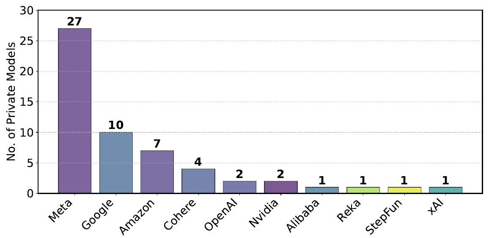{fig-align="center" height="300"}

::: {.aside}
[@Singh2025, Figure 6, p. 11.]
:::


---

## Two identical checkpoints {.smaller}

<!-- Singh, Section 3.3, p. 15 -->

- "For this purpose, we submitted two identical variants of Aya-Vision-8B to the Arena in March 2025."
- "This scenario is a very conservative lower bound of gains, as any difference in Arena score can be attributed to the benefits of multiple submissions rather than differences in model quality."
- "In Figure 9, we observe notable differences in final Arena scores between identical checkpoints: 1052 (±21/22) and 1069 (±19/23)."
- "As a result, 4 models are positioned between our two identical checkpoints."

::: {.aside}
@Singh2025, p. 15.
:::


---

## Recommendations for a leaderboard {.smaller}


1. Prohibit score retraction after submission."
2. Establish transparent limits on the number of private models per provider."
3. Ensure model removals are applied equally to proprietary, open-weights, and open-source models."
4. Implement fair sampling.
5. Provide transparency into what models are being removed from the leaderboard.

::: {.aside}
[@Singh2025, p. 7.]
:::

---

## Evaluations are not just numbers {.smaller}

- When one runs an evaluation benchmark, what comes out is a numerical score."
- The appropriate conclusions to draw about a model's behavior are informed by, not constituted by, these numerical scores.
- It is almost never the case that one cares about the actual score of a language model on a particular benchmark.
- Instead, benchmarks are typically proxies for some broader notion of capability or ability that is difficult to make precise and measure.

::: {.aside}
[@Biderman2024, p. 8.]
:::

---

## Social dynamics of evaluation {.smaller}

- Model developers face strong pressure to present their models as the best.
- Evaluations are not just scorecards: they are advertisements.
- The field has, in effect, adopted a norm where model developers grade their own homework.
- Even when independent evaluation is possible, there is pressure to cherry-pick favorable tasks, choose flattering prompting strategies, or report single-run point estimates that obscure uncertainty.

::: {.aside}
[@Biderman2024, pp. 3-4.]
:::


---

## References
